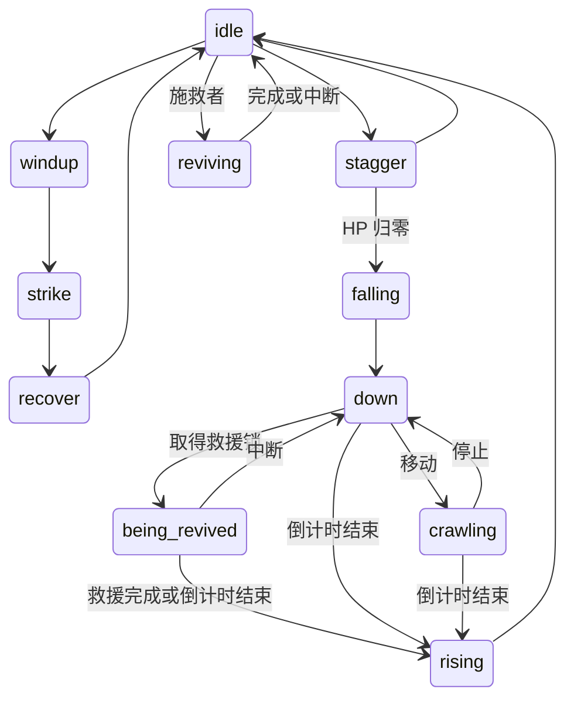

# 徒步拳击与救援

空手站稳后，单击场景出拳。鼠标从按下到松开须少于 200 毫秒，移动小于 6 像素。左右手交替，连续第三拳为摆拳。按住 E 救援附近倒地玩家。设置中的「出拳」「长按救援」支持改键。触屏可点「出拳」、按住「救援」。离线时可空挥。上下车和进店沿用已有 F 交互，骑行时 E 继续加档。

倒地后，方向键和摇杆用于爬行。施救者移动超过 0.3 米、松键、离线或被打会中断救援。救援进度按配置回退，倒地倒计时继续。倒地会收起鱼竿、香烟和相机，正在进行的一次抛竿退回已扣鱼饵。

## 调整数值

浏览器和实时服务共用 `rt/combat-config.json`。修改后重新构建客户端并重启本地 rt 测试进程。

| 字段 | 含义及默认值 |
| --- | --- |
| hpMax | 满血 100 |
| damage、zone | 直拳 8、摆拳 15，头部 ×1.5、身体 ×1，伤害四舍五入 |
| comboWindowMs、punchCooldownMs | 850 ms 内承接上一拳，直拳冷却 350 ms、摆拳 650 ms。服务端另有 200 ms 最小间隔 |
| cooldownSlackMs | 120 ms。服务端按包到达时间计冷却，允许比客户端冷却早到这么多，吸收网络抖动与掉帧；不低于 200 ms 下限 |
| reachM、networkMarginM | 客户端近身距离 0.9 m，rt 以双方最新三维位置另容许 0.4 m 同步误差 |
| downSeconds、selfRiseHpRatio | 15 秒自行起身，恢复 30% |
| crawlSpeed | 爬行速度上限 0.6 m/s，实际另受步速 30% 限制 |
| reviveRangeM、reviveMoveM | 1.6 m 内可救援，对齐后允许挪动 0.3 m |
| reviveHoldSeconds、reviveDecayPerSec | 满进度需 3 秒，中断每秒扣除 0.5 满进度 |
| reviveHpRatio | 救援后恢复 40% |
| regenDelaySeconds、regenPerSec | 出拳或受击后 8 秒开始回血，每秒 3 HP |
| overheadBarHideSeconds | 临时头顶血条保留 5 秒，最多显示 4 人 |

## 接入

`windup` 同步出手预备动作。`punch` 只在命中帧上报一次，携带拳型、序号、命中部位和目标 ID，空拳省略目标。客户端用手部挂点与玩家胶囊检测接触，NPC 和载具不在候选集内。服务端用活动状态、距离、节奏和连击次序校验，再更新 HP。施救端发送 `rescue-start`、`rescue-stop`。服务端通过 `combat` 向本人和可见玩家推送结算、剩余倒地时间、施救者和进度。首次加入与续连从 welcome 恢复快照。

前端状态与姿势分别在 `web/src/combat/state.ts` 和 `poses.ts`。HUD 使用 `cb-` 前缀，倒计时与救援条通过 CSS 变量 `--p` 读取 0 到 1 的进度。打击颜色、尺寸和时长在 `look.ts`。可以监听 window 的 `combat:hp`（hp、max）、`combat:state`（state）与 `combat:hit`（dmg、heavy、dir，弧度）更新表现。

扩充武器或技能时，在配置表新增数值，在服务端增加动作资格、距离与冷却校验，再接入命中检测和姿势层。限定组队救援时，在取得锁前检查双方的服务端队伍关系。每次改动可运行 `node --test rt/combat-test.mjs`。构建开发世界后，运行 `node scripts/verify-mp.mjs --combat` 做双端验收，附加 `--frames` 测量八个可见角色的同场帧间隔。
