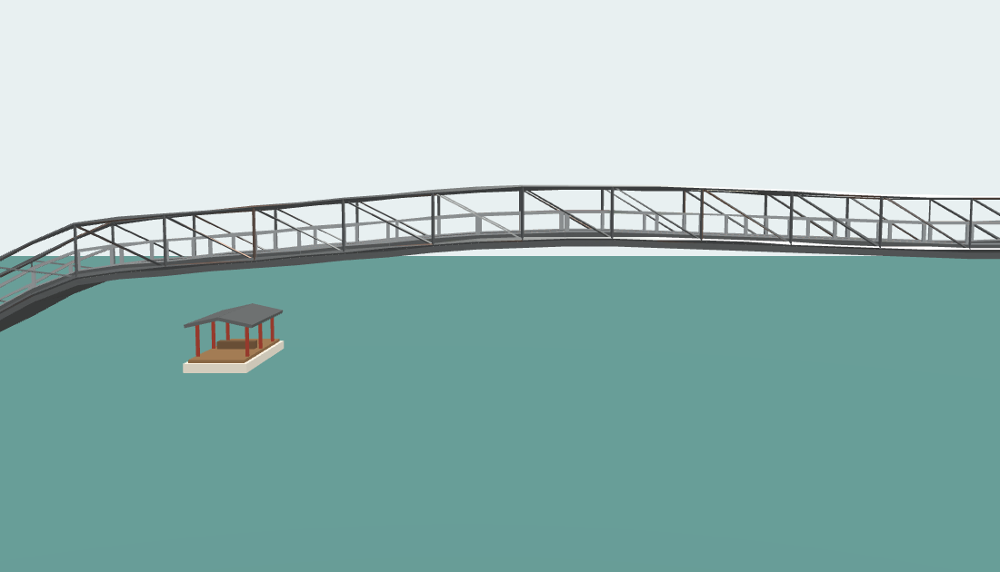
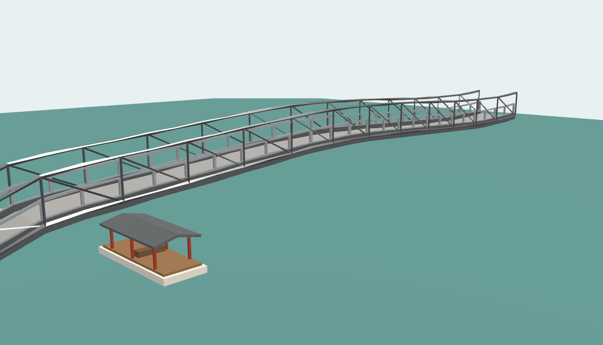

## 坝区水岸验收

世界生成器从水域扣除 OSM 面状 `waterway=dam`。普通跨河桥不切分水位；闸、堰、坝仍可分隔水体。近景水网使用与地形相同的三角剖分，水深过零处即为岸线。没有在两岸之间强行拉平水位。

生产构建会复用锁定的 GL04 发布包，因此 `npm run build` 的 `postbuild` 还会在 `dist/world` 对实心坝范围恢复干地和碰撞高程。此步骤不写入发布包或 `public/world`，重复执行不会继续抬高坝顶。坝顶取邻水最高值加 0.3 m，是未测量时的近似，不是实测高程。替换 OSM 快照时，运行 `uv run python pipeline/dam_cells.py` 更新 4 m 网格掩膜。

验证发布包可在其独立副本上执行：

通航口使用 `pipeline/dam-passages.json` 的 `[col,row]` 世界网格坐标（乘 4 得米）。原始快照没有渡线，所列节点来自 OpenStreetMap `way/485320269`（木龙湖）和 `way/674893651`（春天湖）的 `/full.json`。只选中心在坝内、且格子与渡线穿坝段相交的格子，不加缓冲。木龙湖闸门 `node/6318049385` 在坝外，不是第二条穿坝通道。可用 `PYTHONPATH=pipeline uv run python -m unittest pipeline/test_dam_passages.py` 从 raw 坝面复算清单。

```sh
node scripts/bake-dams.mjs /path/to/world-copy
node scripts/check-dams.mjs /path/to/world-copy
```

用 `CHROMIUM=/usr/bin/chromium node scripts/dam-views.mjs captures/dams` 对 `public/world` 拍摄木龙湖出口及虹桥坝的固定视角。拍摄修复后画面时须使用已经处理的世界副本。

榕湖钢桥 `way/155148522` 的南北两端维持原落地点；在渡线穿过处，桥板、底面和步行碰撞使用相同的纵向断面。按通行需求设计，不是实测桥高。用 `node scripts/capture-ronghu-ferry.mjs` 可从打包后的模型复拍侧面和斜 45°，船使用游戏的游船模型。



