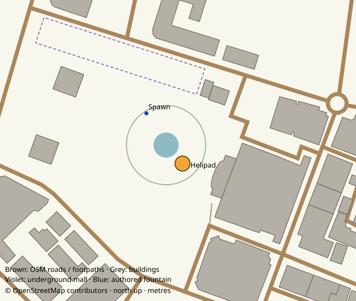

中心广场地标内，半径 7.5 m 的停机坪位于音乐喷泉东南侧的硬铺装环带，不改广场地标本体。开发世界的地标基面为 153.8 m。出生点与坪心直线距离 61.6 m。紫虚线是地下商业城范围，不是地上屋顶。

复核方法：下载 OpenStreetMap API 0.6 `map` 原始要素，bbox 为 `110.2898,25.2758,110.2971,25.282`。该框匹配到“小香港商业城”（way 1521982963），未匹配“小香港美食城”。用 `python3 scripts/heli-site.py PATH_TO_MAP.osm` 更新叠图。淡绿圆及喷泉来自 `pipeline/landmarks/central_square.py`；棕线是 OSM 道路和步道，不是实测 NPC 轨迹。

航线核查：安装 `npm run world:dev` 对应的校验和固定世界，再运行 `node --import tsx scripts/helicopter-clearance.mjs`。脚本读取 GL04 地形、屋顶与 CMAB 高度、地标 GLB 包围盒和 PK02 山体三角形，计算含 7 m 水平缓冲的保守高度上界，按 20 Hz 扫描实际飞行曲线，输出高度、滚转角和最小净空。起降在停机坪上方单独处理，不计入巡航净空。
