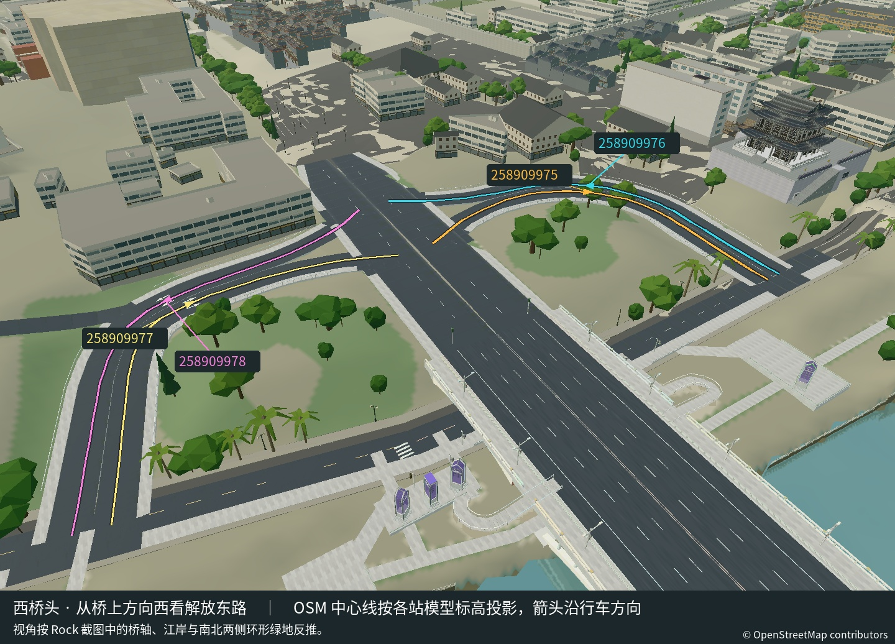
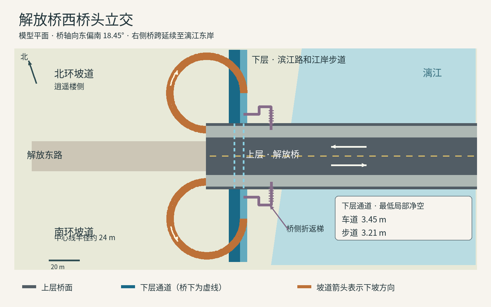

# 地标精模清单（M2.6，2026-11-18 起）

Rock 2026-11-18 要求：市中心关键地标按**近几年实拍照片**精细建模，**模型和贴图**都要做好；街道尽量还原现实布局。

- 参考照片清单：`pipeline/landmark-refs.json`（Wikimedia Commons，含年份、许可、原页面链接）。下载到本地：`uv run python pipeline/fetch_refs.py <id>` → `raw/refs/<id>/`（不入库）。
- 照片只作参考：**不入库、不发布、不当贴图**。贴图全部自己画（程序生成或手绘），按照片的材质、颜色、比例做。
- 清单里照片少的地标（标“缺图”）由建模那一轮继续找：携程/马蜂窝/大众点评/新闻图片可以看，但只记链接，不下载进仓库。
- 模型由 sg claude 写生成脚本 `pipeline/landmarks/<id>.py`，输出 `public/landmarks/<id>.glb`；放置、剔除、压平、碰撞由引擎框架负责（M2.6 引擎子 issue）。

## 分组和顺序

| 组 | 地标 | 参考照片 | 说明 |
|---|---|---|---|
| A | 靖江王城（正阳门、承运门、承运殿、城墙）、独秀峰细节、东西巷、正阳路步行街 | 40 / 16 / 31 / 10 张 | 老城核心，最先做 |
| B | 十字街路口、微笑堂、中山中路街景、中心广场 | 0（缺图）/ 1 / 12 / 0（缺图） | 现代商业街区 |
| C | 榕湖（系舟亭、湖心岛、钢桥、榕湖饭店、图书馆）、古南门、桂林中学解西校区（校门、奎光楼） | 8 / 3 / 4 | 湖区 + 老城南界 |
| D | 杉湖与日月双塔、象鼻山景区（象鼻、水月洞、普贤塔） | 18 / 40 | 最有名的两处 |
| E | 解放桥、逍遥楼 | 12 / 0（缺图） | 漓江西岸门面 |
| F | 伏波山、叠彩山、木龙湖、花桥 | 6 / 1 / 0 / 0（缺图） | 外围景点 |

## 每个地标从照片里看到的要点

### 靖江王城（A）
- 城墙：灰白石灰岩**方整块石**砌筑，顶上垛口，墙面有绿植从缝里长出（2018–2019 照片）。正门一带是三个拱形门洞并列。
- 承运门：**明黄色墙**，中间一个大拱门，两层灰瓦歇山顶，檐下朱红木构；门前大片草坪和黄色遮阳伞。
- 王城内建筑（师大王城校区旧楼）：黄墙、朱红圆柱、白色栏杆外廊、灰瓦屋顶、石阶。
- 独秀峰脚有拱门洞窟（读书岩）和摩崖石刻。

### 东西巷 / 江南巷（A）
- 明清风貌复建：**青灰砖墙**、白灰勾缝，桂北式**封火山墙**（人字形带翘角），二三层有深色木质挑廊和木格窗。
- 巷道窄（3–5 m），**青石板**铺地；入口有白色石牌坊。
- 夜里满挂红灯笼，店招是木匾和竖幅。

### 正阳路步行街（A）
- 两侧三层骑楼式商铺：一层**花岗岩方柱**门廊，二三层**白色宝瓶栏杆**阳台，墙面米白/红砖混搭。
- 地面是深浅两色石材拼花铺装，街心有大王椰和蒲葵。
- 正阳路北段有一座**红色钢架钟楼**（四面钟，三角形塔架），是这条街的标志。
- 有正阳路地下人行通道入口。

### A 组模型与对照机位

正阳门、承运门、承运殿按各自 OSM 建筑轮廓定位，王城中轴相对正北偏东约 8°。独秀峰楼梯依据现有 `peaks.bin` 的环线布置，不修改山体；430 级模型踏面是为了连续行走，不是实地级数。东西巷此次取江南巷，正阳路取钟楼一带约 175 m，并非整条步行街。钟楼按 2018 年照，**待现状核实**；未找到能确认现状的地下通道入口图，本次不建。

下表为 issue 对照图的游戏机位。编号是 `landmark-refs.json` 各地标 `refs` 的零基序号。游戏相机按构件取景；照片没有可靠朝向时，不将游戏方位当作实拍方位。

| 地标 | 参考图 | 游戏机位与朝向 |
|---|---|---|
| 靖江王城 | 15（2017），00（2018） | 正阳门外沿中轴向北；承运门前向北仰看双檐 |
| 独秀峰 | Flickr 54831715929（2025），04（2012） | 峰顶东南低空向西北看亭；峰脚南侧向北看洞口 |
| 东西巷 | 17（2018），29（2016） | 江南巷北口向南；巷中向南看挑廊 |
| 正阳路 | 06、02（2018） | 钟楼南侧向北；街心向东北看骑楼 |

33 张 `viewOnly` 候选仅供核实现状，不作贴图、不进游戏。现有正阳路近年照只有 1 张，不能据此断言钟楼和地下通道的现状。

江南巷北端相对 `anchor` 向东 21.67 m、向北 121.76 m。前版北段偏西约 11 m，巷中机位进入王城东墙；遮挡不是江南巷屋面。新机位位于牌坊以北约 16 m，眼高 1.8 m。青砖贴图以米平铺，一皮砖含灰缝 5.6 cm。峰顶清树只作用于亭台周边，读书岩用独立岩壳、暗内壁和铁栏表现岩檐，而非在山体上切洞。

### 微笑堂（B）
- 位于十字街路口（中山中路和解放路交叉口）西南角（`way/253743030`），现代百货：**蓝色玻璃幕墙**，东北转角是高出的**圆柱形玻璃塔楼**（配大屏与扇形玻璃雨棚入口），顶部白色圆筒有“桂林微笑堂商厦”大字招牌；两侧翼楼为六层蓝绿幕墙加灰白色铝板竖井塔楼，角部广场带三座地下通道玻璃雨棚。
- 路口有大量非机动车，地面有红黄色彩色等待区铺装。

### 古南门（C）
- Rock 实拍路线从榕荫路往南到榕湖北路；路口以 `way/221349761` 南端及 `way/1512643995` 接续段为准。IMG_1307 的红褐色 RONG HOTEL 不等于湖西白色榕湖饭店。依行走顺序将榕酒店、涵栅雅居、IMG_1300 门厅分别放在门北约 51、86、115 米的既有建筑地块，立面朝街；OSM 未给这些地块标店名，门厅尤其不确定。古树在门西南侧，正门向湖，背面院墙靠街；这些是照片视线约束而非测绘坐标。
- 唐代南门，抗战后重建：下部是**灰白巨型方石**砌的城台，中间一个圆拱门洞，**朱红大门**，门额石匾“古南门”。
- 城台上是一座**单层歇山顶门楼**：黄墙、灰瓦、檐口朱红，四面回廊带白色石栏杆，侧面石阶上台。
- 门前、门后是石板广场。侧门红墙用绿釉瓦压顶；背面深色石台上接红色弧墙，两种墙面以底部绿篱分界。
- 模型：锚点 `node/2596945561`，城台到地面 6.7 m，拱洞宽 3.5 m、冠高 4.55 m，西侧石阶坡度约 31°。门楼、西翼黄楼、东侧院墙、广场和两株大榕都在同一个 GLB 里。城台按照片做成向南鼓出的弧墙，不是一块平板。

### 桂林中学解西校区（C）
- 校门：两根灰色石柱 + 横梁“桂林中学”红字，门两侧石狮，背后是白色教学楼，檐口**绿色琉璃瓦**。
- 奎光楼：两层木构楼阁，**朱红木柱、木栏杆、木格门窗**，深色瓦顶。
- 模型：锚点是奎光楼 `way/690980799` 的形心。楼是灰砖马头墙加两层朱红木廊，圆窗、格扇、匾额。校门在楼南 33 m、朝解放西路，两根约 6 m 石柱，绿琉璃瓦盖，两侧白墙和石狮。校门到楼之间的地面抹平到 158.4 m。

### 榕湖（C）
- OSM `way/221475379` 同时标 `name=北斗桥` 和 `old_name=九曲桥`，按十个折点连北岸与湖心岛。岛岸取榕湖关系 `9373836` 的内环 `674611987`。古榕双桥采用 `684946199`、`1430636941` 的共同轴线；玻璃桥跨水段是 `836701791`，不是同名的短引道 `221882716`。IMG_1342 暂取图书馆西侧、沿湖北岸步行可达的榕溪桥东桥头（`221882720`）；照片没有可读桥名，不能证明这一辨认。
- **实拍路线与定位依据**：`docs/refs/rock/IMG_1333.jpg` 是景区示意图，不是等比例底图。定位要分别核对北岸（古南门广场、大古榕）、北岸到湖心岛的九曲桥、岛上的亭廊，以及沿岸通向图书馆的步道。用 IMG_1310–1316 校对树、广场和门的前后遮挡，用 IMG_1317–1327 校对从岸上经折桥到岛上长廊的连续路线；不要从照片的拍摄顺序推算米数。
- **现有世界坐标**（以系舟亭为原点，米，东为 +x、南为 +z）：湖心亭 OSM `node/6317785656` 在 `(+98.8, +137.6)`；钢桥 `way/155148522` 中点在 `(-604.1, +87.2)`，不应把该桥挪来充当通岛的九曲桥。图书馆模型的 `(-22, -36)` 是临湖立面而非整幢楼中心。IMG_1328 的柱廊玻璃桥、IMG_1330–1332 的单孔古榕桥也应与钢桥区分。上述差异是**已有模型覆盖不全**，不是 OSM 节点错位的证据；单凭 IMG_1300 的门厅或 IMG_1342 的远景不能确定具体地块或桥名。
- 湖面平静，四周大榕树垂到水面；北岸系舟亭是方形单檐亭，**黑瓦翘角**，朱红柱，带美人靠。
- 原有榕湖饭店（白墙、多层、坡屋顶）保留在系舟亭西南方向。玻璃桥后方的蓝幕墙楼暂用中山中路 24-1 号建行 POI `node/6326752646`，从湖心岛向东看，桥在前、楼在后。POI 能核对银行位置，不能确定楼高或证明照片里是哪一面立面。
- 模型：锚点 `node/6320266329` 系舟亭（地面 153.12 m）。同一个 GLB 里还有湖心岛重檐亭和廊、榕湖钢桥（`way/155148522`，长 44.5 m，程序化桥面不再画）、图书馆南立面（宽 20 m，落在湖岸 DEM +1.75 m，不替换整块 80 m 用地）、饭店沿湖五层白楼（DEM +1.15 m，不挖掉整片饭店用地）和北岸栏杆、大榕。各段高度按所在点的 DEM 与锚点的差写进模型。

### 日月双塔（D）
- 日塔：9 层（含塔刹 41 m），**铜质金色**塔身，每层挑檐和栏杆，坐在**白色莲花瓣石台基**上，夜里通体金光。
- 月塔：7 层，**白墙 + 朱红栏杆 + 深灰瓦挑檐**，塔刹细长；两塔之间湖底有隧道相连。
- 塔所在湖岸是石栏杆和柳树、水杉。

日塔锚在 OSM `way/674587990` 小岛（约 20 m），月塔在 `way/674587991`（约 40×61 m）。高度按公开资料：日塔连刹 41 m、月塔 35 m（`docs/landmarks.md` 与两江四湖介绍一致）。模型原点在两塔中点，水面高程压到 150.1 m。湖底隧道只做两岸石砌入口，水道本身留在水面下。

| 地标 | 参考 | 游戏机位 |
|---|---|---|
| 日月双塔 | 2024 日塔 / 月塔近景，2017 夜景全景 | 南岸低空看双塔；月塔岛岸边平视 |
| 象鼻山 | 2025 象鼻正面，2024 水月洞 | 北侧江面平视，象鼻在左；贴着水面看穿水月洞 |

### 象鼻山景区（D）
- 象鼻山：**灰白石灰岩**崖壁，带黑褐色水痕，象鼻与象身之间是**水月洞**拱（江水从洞里穿过）。山顶长满乔灌木，山顶是**普贤塔**——一座瓶形砖塔，塔身青砖、底座八角。
- 景区岸边有石栏杆步道、竹筏、象形雕塑。
- 夜里拱洞内打暖黄光，山体绿色泛光。

程序山体由 `pipeline/peaks.json` 的 `model` 换成 `landmarks/elephant_hill.glb`（原点在 OSM `node/344461733`，y=0 对应山脚 145.6 m，顶 198 m）。水月洞是北端东缘一块实心岩里挖出的南北向隧道。岩体东西约 30 m、南北约 18 m，顶是圆的，往西接上山脊。洞宽约 12 m、洞高约 16 m，拱脚在水面下，洞口上沿向外挑。东侧象鼻柱顶部约 8 m 厚，到水面收到约 4 m。北端山头最高，往南缓下去，上半坡是成簇树冠。西侧崖壁收到局部 x ≥ -80.5 m，给步行验收留出岸上的接近距离。视觉由山体加载，不进首屏；`landmarks.json` 只负责剔除范围内建筑。

### 解放桥 / 逍遥楼（E）

#### Rock 西桥头步行机位（2026-11-19）

按文件序号和岸线判断方向。Esri World Imagery 的北向俯视图可辨认西桥头南北两处弧形匝道、桥下纵向滨江通道和东南向桥轴；照片没有 GPS，以下是相对机位。

| 照片 | 推断拍摄点与朝向 | 画面依据 |
|---|---|---|
| 35 | 北侧匝道步道，沿路朝城区（推断） | 左侧分隔带与吊灯，右侧铺砖人行道 |
| 36–37 | 西桥头交叉口，向江面、略偏东南 | 桥跨在彩色门柱后，车流横过镜头 |
| 38–39 | 西桥头路缘，回望西北侧逍遥楼、转向路口 | 城台和重檐位于道路对面 |
| 40–42 | 西岸桥头。41 在北侧临江台地，向东南看桥；42 在路缘仰看紫柱和吊灯 | 斑马线、近处彩柱、临水挡墙和对岸山影 |
| 43–45 | 西岸滨江通道，穿过桥底后回望入口 | 头顶桥底、道路两边连续步道和临街树木 |
| 46–48 | 西岸向东 | 对岸剧院的波浪形屋顶 |
| 49–50 | 西岸南侧栏边向东北看桥，再转向树下步道 | 49 江在右、桥在前；50 近处树池遮挡方向 |
| 56 | 城区一侧回望逍遥楼 | 亮顶露出树冠 |
| 57–58 | 桥面北侧人行道，沿桥轴朝西北 | 车行道在左、临江侧路灯在右；单凭灯列朝向有歧义 |
| 59–60 | 桥上沿江向北，疑似望伏波山 | 近山孤立临水，远山在后；两帧取景相近 |

桥面位置核对采用 OSM 2026-11 快照的 `way/693451306`。将 281 × 43 m 的桥面四角按运行时锚点和旋转投影到 `common.ll2xz` 的米制平面，与 OSM 桥面多边形相交。IoU 为 0.9405，形心相距 1.38 m；OSM 最小外接矩形长轴向东偏南 18.75°，模型为 18.45°，相差 0.30°。桥下步道和四条机动车匝道在桥面投影之外，未计入桥面面积。

从桥中央到场景中伏波山中心约 730 m，方位约北偏东 6°。截图 60 从桥面北侧偏东段以 24° 垂直视场越过江面复核这条视线；现有山体在夜里比照片中暗。使用 `node scripts/jiefang-views.mjs` 重拍七个推断机位及空中斜俯视图，使用 `node scripts/jiefang-crossing.mjs` 复测角色穿桥底。

49 号可沿白色拱肋辨认前后数个拱口，靠左的起拱点被彩柱与折返梯遮挡，远端又被标牌遮挡。结合反向的 41 号，模型以五个约 46–49 m 的水上拱跨还原节奏。每跨两侧的拱肋落在分开的墩座上，短立柱、次拱之间留空。主拱肋截面宽约 1.30 m、高 1.35 m，下缘嵌白色灯带。37、41、42、49 的截图统一固定在游戏 19:06，灯带、宫灯与街灯共用发光图集。桥面从江侧向内依次为镂空石栏、人行道及近路缘的触感带、路缘、非机动车道和机动车道。旧版 58 号所见的长黄条是铺在人行道中部的触感带，车辆中心线仍位于桥轴。

#### 西桥头 OSM 对照清单（2026-11 快照）

地图线位来自 © OpenStreetMap contributors。

| OSM way | 类型 | 模型对应 |
|---|---|---|
| 258909975、258909976 | 单向 primary_link | 北侧内、外匝道，分别下桥、上桥 |
| 258909977、258909978 | 单向 primary_link | 南侧内、外匝道，分别上桥、下桥 |
| 258909993、259020569 | primary | 解放东路西行、东行匝道接口 |
| 258899702、49322149、693451306 | primary、桥面面域 | 解放桥两条车道轴及桥体边界 |
| 1531308751、1531308752、1531310675、1531310676 | cycleway | 桥面及西引道两侧非机动车通道 |
| 1531308428、1531308427 | secondary | 滨江路下层路轴，南端接续 |
| 675174045 漓滨路 | living_street | 末段沿 OSM 在南外匝道的共享节点平接；外围林带、邻街建筑沿用世界分块 |
| 1382486206、1382486208 | steps | 北、南桥侧折返楼梯 |
| 1382486207、1382486209、1382486211、1382487357 | footway | 梯底横向步道及滨江路至岸边的连接 |
| 1382486210、1382486212 | footway | 南、北江岸步道 |
| 1382487359、1382487360、1382487358 | forest | 南、北环内绿地及外围林带 |

实拍与游戏机位对照见 [35–37](jiefang-ramps-35-37.jpg)、[38–40](jiefang-ramps-38-40.jpg)、[43–45](jiefang-ramps-43-45.jpg)。拍摄点按 35–45 的行走顺序校对。快照未给出彩柱广场、临江观景平台、栏杆和灯具的独立轮廓；保留已验收的 37、41、42、49 照片比例，并以滨江路和岸边步道定位。照片无法可靠判断匝道车道数，按单向两车道、8 m 车行面建模，外侧另设人行道。曲线尺寸取自 OSM 折线，不以拟合圆替代。

| 匝道（OSM 单向顺序） | 长度 | 高差 | 平均纵坡 | 打包车行面中线最大偏差 |
|---|---:|---:|---:|---:|
| 258909975 北内，解放东路 → 滨江路 | 148.11 m | −5.30 m | 3.58% | 1.743 m |
| 258909976 北外，滨江路 → 解放东路 | 156.48 m | +5.30 m | 3.39% | 1.685 m |
| 258909977 南内，滨江路 → 解放东路 | 134.42 m | +5.30 m | 3.94% | 1.105 m |
| 258909978 南外，解放东路 → 滨江路 | 145.37 m | −5.30 m | 3.65% | 1.089 m |

上下接口各留短平段。复核命令为 `uv run --locked python pipeline/audit_jiefang.py`：逐节点对照原始快照，再解码实际 GLB，对两侧车行边缘的中点折线计算双向 Hausdorff 距离。两条单向线靠近时向各自外侧分配车道宽度，避免车行面交叠，因此实际车行面中点和 OSM 放样轴略有差异。林地 1382487359/60 按面域布树，树木避开路面。南北观景平台依据 41、49 估算，未标绘边界的构件无法计算轮廓误差；37 的灯柱广场按 1382486211 路口定位，照片用于确定它邻近的路侧与排布。照片 35–45 以路口、桥侧和滨江路为主，不能由单张地面照反推完整匝道曲线。

新建解放东路两幅车行面中线至 OSM 的最大偏差分别为 1.94 m、1.94 m；滨江路和漓滨路不超过 0.02 m，六段单独铺装的步道同样不超过 0.02 m。既有桥身和地面配套另列如下：

| 对照位置 | 偏差或资料限制 | 取舍与实拍依据 |
|---|---|---|
| 桥边线与 693451306 面边界 | 沿用的 281 × 43 m 桥面轮廓局部约 2.25 m | 41、49 显示贯通的直线栏杆，58 可见连续路缘；保留已核对的等宽桥面断面与两侧人行道 |
| 北侧 1531308751 非机动车道 | 西段 OSM 线在桥轴外侧约 16.7–17.0 m，游戏车道中线约 14.1 m，局部约 2.6–2.9 m | 58 的石栏、人行道、盲道、路缘及非机动车道决定已验收的断面。1531310675/76 在合流口接入对应方向的铺装，交织段共用车行面 |
| 彩柱广场、临江平台、栏杆、单株树木 | 缺少单独 OSM 边界或点位 | 37、40、42 约束紫柱与斑马线相对位置，41、49 约束南北平台和栏杆；绿地按 1382487359/60 的边界，单株在边界内估布 |

下表以桥下滨江路路面（场景高程约 146.5 m）为零点；相对标高取一位小数。1.7 m 行人、约 1.5 m 小客车和 3–3.5 m 常见层高只用于估算照片尺度。桥面锚点沿用 OSM，绝对高程来自场景 DEM。

| 主要构件 | 相对下层路面 | 估算与对照 |
|---|---:|---|
| 滨江路、江边步道 | 0 / +0.1 m | 43–45 中路缘仅一级，滨江路车行面宽 7.2 m，靠江侧另设 3.6 m 人行道 |
| 桥底拱形顶板 | 拱顶约 +4.8 m | 照片 43 缩至 540 × 720 后，左前方行人高约 75 px，脚底到洞口上缘约 165 px。行人在洞口前方，两者存在透视差；按 2.5–3 个身高约 1.7 m 的行人估算，洞口约高 4.3–5.1 m |
| 桥下路线净空 | 车道约 4.65 m，步道约 4.56 m | 按新的滨江路曲线及外侧步行线，与打包后的拱面和道路分块求交。两条线上最低拱腹高程约 151.21、151.24 m，通行面分别为 146.56、146.68 m |
| 西桥头机动车道、人行道 | +5.3 / +5.5 m | 车道接上层引道，人行道按 0.18 m 路缘抬高；洞口上方板厚随拱形变化 |
| 四条匝道低口、高口 | 0 / +5.30 m | 两端与滨江路、解放东路共用 OSM 节点，场景高程 146.56 / 151.86 m。外侧 2.5 m 人行道通常高出车行面 0.12 m，入口路缘收平 |
| 折返梯中间平台 | +2.8 m | 沿 OSM 楼梯折点分段分配高差，每级不超过约 0.17 m |
| 拱脚、拱顶下缘 | 约 −1.8 / +2.5 m | 随桥面纵坡变化；41、46、49 的桥侧剪影提供起拱点和矢跨比例 |
| 临江吊灯顶、彩柱尖顶 | +4.4 / +8.7 m | 37、42 的行人、路灯及柱身可相互比高。两侧为尖顶，中柱为平顶（约 +7.9 m）；实心柱脚上接四面深紫玻璃，宫灯位于柱内 |
| 桥面灯头 | 约 +12 m | 57–58 中灯杆从上层人行道起算约 7.1 m |
| 北侧逍遥楼城台顶 / 屋脊 | 约 +11.6 / +32.1 m | 38–39 可见城台、楼身和层叠屋檐。现有模型基址 154.4 m，台顶高出基址 3.72 m，最高屋顶构件约 24.15 m |

- 解放桥是漓江上车流最大的桥，夜里桥上和桥身有大片灯光。
- 从桥上看西岸：**逍遥楼**为二层三檐，首层披檐，二层为重檐歇山顶。楼身平面约 22 × 22 m，高约 24 m；三道檐不是三层楼面。尺寸及层数依据：新华社，2016-04-01，《逍遥楼重现桂林漓江边》（重建报道，不计入近年实拍）。楼前是滨江路，夜景以金色泛光为主。
- 白天的桥身形态和结构没有找到可用照片（缺图），建模前需补找。

### 伏波山、叠彩山（F）
- 伏波山一半临江，临江一侧是近乎垂直的崖壁，崖下有还珠洞；山顶有亭。
- 叠彩山从远处看是几座连峰，山顶亭子可眺望伏波山。

### E/F 组实拍资料缺口

下表只计目录中有 2021 年以后拍摄日期、题材可辨的单图条目，不把同日连拍、石刻特写或同一地点的不同照片自动算成不同机位。携程图组以点评编号和 `images` 链接保存为 `viewOnly` 候选；`published` 是发布日期，不是拍摄日期。

| 地标 | 单图条目 / 8 张目标 | 仍需核对的角度 |
|---|---:|---|
| 解放桥 | 2 / 8 | 白天全跨侧面、桥墩与桥面栏杆近景；2019 年夜景只辅助定位 |
| 逍遥楼 | 6 / 8 | 后立面与二层外廊转角；从楼上拍城市的图不计 |
| 伏波山 | 5 / 8 | 两张为石刻，不能代替临江崖壁正侧面、听涛阁与山门 |
| 叠彩山 | 1 / 8 | 风洞两端、登山石阶与拿云亭侧面 |
| 木龙湖 | 1 / 8 | 东镇门门洞、城墙转折、木龙塔近侧面 |
| 花桥 | 0 / 8 | 桥孔全侧面、廊内通道与桥头；七星景区点评照片未自动算作花桥 |

### E/F 组模型与近景预算

解放桥按 OSM 双车道路轴和桥身面生成六车道、两侧步道、桥墩、栏杆和栏灯。西桥头两侧的尖顶彩柱、弧形步道与桥下滨江通道按 Rock 实拍布置，桥面标高接原有道路。西桥头拱洞范围内由地标提供上下两层通行面，其余区段保留 GL04 道路桥面。桥跨划分是估计，不是测绘数据。逍遥楼设可行走的青砖城台、双侧石阶和二楼外廊；中檐不设楼板。花桥按 IDOK-22 验收口径做 **11 孔、约 125 米**：OSM `246520676` 跨水段上有四孔、红柱灰瓦桥廊；向西北沿引道 `191185434` 延伸约 55 米为七孔旱桥，不设桥廊。水旱段间的分配及各孔净跨为模型估值。

伏波山的临水崖面、洞口栈道和山顶亭依既有山体环带定位。明月峰的风洞在近景山体与碰撞的相同位置开两道口；石阶和洞内地面接合，洞底以下局部降低地形高度场。洞与石阶位置为估计。木龙塔和东镇门分别使用 OSM `1432324255`、`686005456` 的形心，门洞方向按穿城路 `686005455`。木龙塔层数、城墙范围仍待近年照片核实。杉湖双塔、叠彩山公路隧道及以逍遥楼为主体的解放桥夜景不用作主对比图。

| 地标 | 近景三角形 / draw call | LOD1 三角形 | GLB / 内嵌贴图（字节） |
|---|---:|---:|---:|
| 解放桥 | 37,344 / 6 | 22,608 | 941,080 / 232,098 |
| 逍遥楼 | 12,216 / 3 | 2,322 | 222,420 / 61,723 |
| 伏波山 | 6,828 / 3 | 1,062 | 152,280 / 61,723 |
| 叠彩山 | 14,624 / 4 | 1,156 | 289,824 / 65,964 |
| 木龙湖 | 14,476 / 4 | 1,602 | 257,460 / 65,964 |
| 花桥 | 14,962 / 3 | 2,484 | 292,340 / 61,731 |

数字按打包后 GLB 的 LOD 节点统计，不含隐藏的碰撞网格。实拍只用于结构和比例对照；2012 年花桥照片和较早的木龙塔照片均不计入近年不同机位。

伏波山东崖及还珠洞凹腔直接在 PK02 山体环带上塑形，并参与山体碰撞；上表只统计地标 GLB，不含共享山体。花桥的场景河面为 150.0 m，四水孔起拱点约 151.55 m，拱顶内缘约 155.47 m；这些是游戏内净空，不是实地水文数据。明月峰路线用 `node scripts/diecai-walk.mjs` 验证：角色只在山门外生成一次，沿阶前进，检查两道洞口和山顶的水平位置与脚底高度。与其他浏览器测试一样，可用 `CHROMIUM` 指定浏览器。

### 中心广场、十字街与中山中路（B）
- 微笑堂（`way/253743030`）：顶部白色圆筒弧形招牌通过系统 CJK/英文字体绘制“桂林微笑堂商厦 / GUILIN WEIXIAOTANG PLAZA”及大商绿标，首层玻璃扇形拱雨棚配入口门头字，转角二至四层设深色微反光 SMD LED 大屏。
- 十字街路口（`[110.2912601, 25.28153405]`）：替换 `placeholder` 占位；路口中央保持通畅沥青路面（无障碍物），按 OSM 轮廓补齐西北角南方大厦（`way/691576459`）、东南角文化大厦（`way/266333052`）、东北角商业楼群（`way/691576457`、`way/675759091`），设红黄彩色非机动车等待区与过街带、斑马线、四处渠化花坛安全岛、护栏、悬臂信号灯龙门架、蓝底真字指路牌（中山中路 / 解放西路 / 解放东路）与东北角“桂林交警”岗亭。
- 中山中路街景（阳桥—中心广场—十字街段）：沿街主要建筑换成手工商业立面（八桂大厦 `way/264328067`、阳桥西侧金马大厦竖井与“和谐心理咨询中心”门头、东侧骑楼商铺与阳桥裙房酒店）；道路构件直接由 `pipeline/road_profile.py` 双向配对车行道断面驱动——中央绿篱分隔带沿配对车行道中线布置，红木花箱分隔栏严格落在两侧车行道最外侧车道线（`width * ((lanes - 1) / lanes - 0.5)`）上，使花箱外侧紧贴人行道处为干净的无标线自行车道，人行道布置香樟行道树与四座“十字街 / 阳桥”公交站亭。
- 中心广场：东端按 `way/675177179` 建桂林市体育馆（折面金属立面、深色微反光 LED 大屏、“呵护未成年人 少年强则国强”标语檐带与屋顶“体育馆”金字），中轴依次布置 80 m 圆形花岗岩集会广场与旱地音乐喷泉（2024 年国庆复喷）、小香港商业城（`way/1521982963`）两座玻璃金字塔采光顶与四处“小香港商业城”下沉石阶出入口、五级升旗台、六瓣花坛、“桂林山水甲天下”喀斯特景石碑及东北侧“中国消防救援”消防救援站。
- 已为十字街、微笑堂、中心广场补充 2020–2026 年 `viewOnly` 实拍参考链接（均达 8 张以上，仅核对形制与色调，不入库、不当贴图）。

## 尚未找到照片的
十字街、中心广场、逍遥楼（白天）、木龙湖、花桥、解放桥白天的桥身。建模时补找，补到的链接追加进 `pipeline/landmark-refs.json`。

## IDOK-44：南门路线的建模基准

按照片复核的模型调整：

| 照片 | 现场特征与模型处理 |
|---|---|
| 04–05 | 中山中路连续临街铺面向人行道内侧退让，另一侧为树列。 |
| 06、09 | 商厦采用九层幕墙、楼顶红字及底部广告；07、08 不作为商厦立面参考。钟塔移至步行街南段，位置为估计。 |
| 10–12 | 入口三层木构大屏楼、咖啡店和螃蟹面向广场，石牌坊跨入口支巷。 |
| 13–18 | 横巷两侧设置连续的两至三层挑廊铺面、山墙、石板路与“东西巷”门楼。 |
| 19–21、38 | 巷尾广场两侧用木楼和棚摊围合；回程机位朝南看向商铺。 |
| 22–23 | 正阳门正面为主券洞和左侧小洞，补墙头植被、展板；保留主洞长度。 |
| 29–31 | 主轴东侧补黄色中空定位针，基座题“桂林中轴线”。 |
| 33–35 | 33 在室内，朝向异常，参考 34；未按 33 的读数再改模型。34、35 向北框独秀峰。 |

照片序号指 `docs/refs/rock/walk-shizijie-wangcheng`。用 `photo-locations.json` 的真北朝向和等效焦距投影到 WGS84 地图。半视角为 `atan(18 / focal35)`；扇形交会只能排除方向不符的楼，不能穿过遮挡证明某栋楼可见。

| 路段 | 可复核约束（x 向东、z 向南，米） |
|---|---|
| 01–09 街面 | 01 已在十字街中心以东约 184 m。王城商厦 `way/264901525` 的轮廓为 x −619…−543、z −71…−3；06、09 朝向包括其中心，07、08 不能当作同一栋楼的正面参考。 |
| 10–18 入口、牌坊与横巷 | 10、11 在 (−610,−124) 分别向西北、北偏西；12 在 (−605,−126) 朝 7.4° 看牌坊，不能把相机点当柱基。16–18 转向横巷东段。保留旧模型所在的真实江南巷，不将其坐标当作实拍入口。 |
| 19–24 巷尾广场、正阳门 | 19 朝南、20/21 朝北。22–24 经正阳门 (`way/1008248059`) 向北，从 z −212 经 −227 到 −244。南门位置不迁，东墙不动。 |
| 25–35 主轴、承运门与峰 | 29/30 从主轴向东北看装置；33 在承运门 (`way/1008248065`) 朝东，34/35 在该门洞向北。峰心方位约 10°，56 mm 镜头半视角约 18°。保持中轴门洞净空与框景，不挪峰。 |
| 师大教学楼 | 三教、四教、五教分别使用 `way/674165596`、`674165595`、`674165597` 的各自轮廓。三者均在主轴西北；不以 29/30 的东北向近景反推其立面。 |
| 36–38 返回 | 36 在主轴中段，37 向东南，38 朝南。38 定位误差 35.9 m，不作为建筑边界控制点。 |

`scripts/wangcheng-layout.py` 输出改前游戏俯视、同区卫星及相机扇形放大图（需项目 OSM 原始数据，参数见 `--help`）。卫星取自 `pipeline/landmark-refs.json` 的 World Imagery；该片数据采于 2024-12-24，未用作模型纹理或入库底图。

实现分为入口街区 `wangcheng_market` 和独立的 `wangcheng_mall`，旧江南巷保留。01–05 所在街段补连续店面；10–18 的横巷沿地图步行线折回，19–21 广场的摊位避开正阳门中线。旧正阳步行街裁到解放东路南侧，不再让其商业楼和碰撞体跨过横巷。23 的南门拱廊由 19 m 加深至 23 m，保留南口，内侧增加青砖券面。25–32 的树列只布置在承运门以南，门前东侧设置纪念装置；三、四、五教楼分别由各自 OSM 轮廓取向定宽深。楼高、店铺内部和装置是近似表现，不按相机 GPS 推断不可见背面。

生产构建后，`CHROMIUM=/usr/bin/chromium node scripts/wangcheng-walk.mjs` 从入口经牌坊、横巷、广场及两座城门连续步行。`CHROMIUM=/usr/bin/chromium node scripts/wangcheng-photo-match.mjs` 采集 38 张对照，镜头为可见地面上方 1.5 m，水平视场按等效焦距计算；EXIF 无俯仰，34/35 取仰角 8°，其余取水平。`uv run python scripts/wangcheng-panels.py <改前游戏俯视> <卫星参考>` 合成逐页 PDF 及三联图到 `captures/wangcheng/`。机位不为避开树木或建筑而移动；38 的误差仍然保留。

### Rock 从东西巷登逍遥楼（2026-11-19）

序号对应 `docs/refs/rock/walk-dongxi-xiaoyao-jiefang/`。照片没有 GPS。用 Esri World Imagery 北向影像对照解放桥西端、滨江路弯道、楼顶和街坊中的细长屋面。交接底图中两排住宅之间的 Overture 屋盖 `a1105ce9-8c3e-4982-ab8e-86a3e6447c04` 长约 42 米、宽约 4 米，从西北偏西通向东南偏东；东端至楼心尚有约 40 米。楼心取 OSM way/702352884，主要檐口顺着城墙。廊东端亭位、登墙踏步和绕楼时的具体方位按连续画面估计。

| 照片 | 推断拍摄点、朝向与画面依据 |
|---|---|
| 01–03 | 东西巷内广场，先看对面店楼，再横扫栏边铺面；缺少定向物。 |
| 04–07 | 从商街穿窄巷，沿砖墙和灯笼向街区东侧前进；转角的绝对朝向待核。 |
| 08 | 住宅夹道，向东偏南看廊口。 |
| 09–10 | 廊内沿梁架看向另一端，廊口回看山墙。轴线可辨，近对称两端的正反向有不确定性。 |
| 11 | 廊东段，沿通道看灯笼、深色柱和近城墙的树池。 |
| 12–13 | 已出廊，在亭侧仰拍；12 向东南看城墙与楼，13 转向翼角。 |
| 14–15 | 亭下向西北偏西回看长廊端面，再近看圆首石碑。 |
| 16–18 | 进入城上铺地，先向南偏东看楼，再转向楼旁广场。 |
| 19–22 | 绕楼前白石台，正看入口阶梯，再向两侧斜看柱列及三道檐。 |
| 23–26 | 沿白栏与矮墙之间通道前行，24 看旗杆与垛墙，25–26 回望楼角。 |
| 27–29 | 狭长石阶下行；到墙角向东看解放桥和漓江。 |
| 30–34 | 城外滨江路人行道，朝西至西北仰看墙体、浮雕及其上的楼檐。 |
| 56 | 隔路远看暖色泛光的楼顶；树冠遮住城台，具体站位不确定。 |

东西巷铺面和广场由 IDOK-44 维护，状元廊从住宅间西端廊口起接管；城上铺地、城台与楼同属逍遥楼。

11 月 OSM 快照还记录了同一屋盖 way/1531321916，城墙方向的步行中心线 way/1531321914 英文名为 Zhuangyuan Corridor。其东端直接接 way/1008909368，后者折向楼的北侧；游戏登墙路线据此接入北侧铺地。

复核 E 组初版时，16 显示上墙后仍有独立的楼前白石台；17、18 显示楼旁留有较宽铺地。19 的中央入口有出挑小屋面和匾，20、21 可见白栏顺台基转角并在入口断开，22 的仰角能区分下层披檐、上层重檐和二层外廊。仍采用二层三道主檐。23 是栏外侧通道，24 是沿墙旗杆，25 从近处看栏与柱的退进，26 从楼侧阶口回望。27 的狭道接下城台阶，28、29 在东侧俯看路口和江面。30–34 依次核对墙身长度、石材分缝、墙角、门框与嵌板，以及从街面仰看时墙体对楼身的遮挡。56 用远景校对暖色屋面泛光。墙门、浮雕、碑字及绿篱仅作示意，尺寸按人物与栏高估计。

在世界和地标构建后，可运行 `uv run python scripts/check-gallery-alignment.py` 从压缩 GLB 读取近景几何，并将屋盖投影与 OSM 屋盖面比较。状元廊量长廊主体，逍遥楼量主楼最低一层屋檐。另运行 `node scripts/gallery-walk.mjs` 验证西廊口至白石台再下滨江侧台阶；`node scripts/gallery-views.mjs` 复现对照相机和斜俯视图。

### 状元廊至逍遥楼的立面和标高（IDOK-47）

以廊口街面为 ±0.00 m（游戏高程 154.4 m）。下表为模型值；照片没有测量标尺，以成年人约 1.65–1.75 m、小客车约 1.5 m、普通住宅一层约 3–3.5 m 估算。斜拍的人与建筑距镜头不同，因此照片支持层数、前后遮挡和相对高度，单体高度保留估算性质。

| 构件 | 相对街面 m | 比例依据 |
|---|---:|---|
| 廊内铺地、长廊檐口、通廊主脊、廊端脊饰 | +0.13 / +3.36 / +4.58 / +5.38 | 09、10：人可从横梁下直立通过；檐口约两个人高，坡屋面在梁上收脊。 |
| 碑亭檐口、主脊、最高翼端饰件 | +3.63 / +6.88 / +7.69 | 12–14：同一庭院内亭脊明显高于廊脊，柱间露空，翼角上挑；15 的碑连座约 +3.15。 |
| 廊北住宅 / 廊南住宅 | 6 / 7 层，主屋面 +18.88 / +21.93；局部楼梯间顶 +20.84 / +23.89 | 08、10、14：按阳台和窗带辨认约六七个楼层。北、南对应及顶层局部由航片屋面和行进顺序推断。首层 3.35 m，上层按 3.05 m；阳台出挑，顶层屋面退台。 |
| 廊侧转折平台、城墙步道、垛口 | +2.80 / +8.40 / +9.66 | 12、24、30–34：外墙高于亭檐，临街面约两至三层住宅高度；墙上人身高可与垛口作比。西侧 16+32 级，每级高 0.175 m、深 0.38 m，中途转向；江侧 48 级，每级高 0.175 m、深 0.42 m。 |
| 白石台面 / 白栏柱帽 | +9.84 / +11.09 | 19–22：从城上铺地再上 8 级，每级 0.18 m；栏杆约至成人胸口。 |
| 首层披檐 / 二楼外廊板面 | +14.89 / +17.24 | 19、22、25：门廊柱比普通住宅层高大，外廊板位于下檐以上，楼身逐层内收。 |
| 中檐 / 上檐 / 顶脊最高饰件 | +22.09 / +25.41 / +29.92 | 16、19、31、56：上层重檐、屋脊与夜景轮廓可区分。高度为檐面起坡处，角部另有上翘。 |
| 解放桥西端步道 / 桥下西岸步道 | 约 −2.35 / −5.00 | 28、29及后续桥下路线校核上下关系。桥西端步道模型约 152.05 m；OSM way/1382486212 在 (110.297448, 25.279908) 附近的干地格点为 149.4 m。两处为相邻采样点，此差值不能用作桥洞净空。 |

街面片区只补画紧贴状元廊、在 08/10/14 构成立面背景的两排住宅，东西巷商铺仍归 IDOK-44。解放桥和江岸沿用现有世界地形。

### 第二轮实拍对照（IDOK-47）

09、11 的通廊采用浅色斜顶板与深色椽梁；10、14 的两个端部改成铺瓦歇山，额枋保留红色。13 的碑亭四角按 2.15 米起翘建模，低视角可辨出角部挑起和檐口中段的弧线。逍遥楼三道主檐的角部相对檐口中段分别抬高 1.65、1.60、1.50 米，顶层山花立于四坡下部之上。上述值为按照片轮廓估算的模型尺寸。

19、20 的抱厦采用垂直于主脊的屋脊，中央披檐往内收，露出三角山面、前排柱和匾额。20、25 的白石台基按分块设置浅浮雕团花，31、33 的墙身、垛墙、碑面分别用浅灰方石、深灰砖和暗色石面。新增 11 的廊内朝向和 20 的抱厦、台阶侧面机位，其余对照沿用上一轮相机参数。

### 九中校门、桂林图书市场与桂林剧院（M2.6-16）

依据 `docs/refs/rock/walk-dongxi-xiaoyao-jiefang/`（IMG_1435–1495，按行走顺序编号，无 EXIF GPS）结合 OSM / Overture 底图特征（解放桥 `way/693451306`、漓江歌剧院 `way/1466385147`、漓滨路 `way/675174045`、南辅道 `way/258909978`、桂林市第九中学 `node/9214622462`、桂林环球大酒店 `way/675919397`）三角交会定位：

| 照片序号 | 文件名 | 推断拍摄点 `(lat, lon)` | 游戏坐标 `(x, z)` | 真北朝向 `heading` | 等效焦距 | 画面参照物与行走顺序定位依据 |
|---|---|---|---:|---:|---:|---|
| 42 | `42_IMG_1476.jpg` | `25.28016, 110.29718` | `(-283.8, -17.8)` | `198°` | `24 mm` | 解放桥西岸北侧滨江路步道向南拍紫色发光钟塔；左侧桥面后方远景露出漓江歌剧院波浪屋顶一角 |
| 43 | `43_IMG_1477.jpg` | `25.27992, 110.29709` | `(-292.9, 8.9)` | `202°` | `24 mm` | 穿行解放桥西桥头滨江路引桥桥洞向南偏西看：左侧螺旋步梯 `way/1382486208`、正中南侧钟塔 |
| 44 | `44_IMG_1478.jpg` | `25.27956, 110.29682` | `(-320.1, 48.8)` | `28°` | `24 mm` | 过桥底后站在滨江路西侧回拍解放桥跨街引桥（限高 4.5 m）及西侧匝道棕榈树坡地 |
| 45 | `45_IMG_1479.jpg` | `25.27939, 110.29698` | `(-304.0, 67.5)` | `24°` | `24 mm` | 解放桥南侧江岸绿色发光钟塔南端向北偏东回望：右侧蓝牌标「解放桥 / 自由路→ / 穿山路→」，远处悦·璟酒店弧形转角 |
| 46 | `46_IMG_1480.jpg` | `25.27930, 110.29706` | `(-296.0, 78.0)` | `118°` | `24 mm` | 西岸滨江路栏杆处广角向东南隔江眺望：左为解放桥南侧连拱（~71°），右中为对岸桂林剧院 `way/1466385147` 波浪白顶（~132°），前景下层挑台粉红配电箱 |
| 47 | `47_IMG_1481.jpg` | `25.27930, 110.29706` | `(-296.0, 78.0)` | `131°` | `52 mm` | 与 46 同站位（前景同一对粉红配电箱与黑铁栏杆）切 2x 长焦正对桂林剧院双曲飞翼白顶与临水二层小楼 |
| 48 | `48_IMG_1482.jpg` | `25.27927, 110.29710` | `(-292.0, 81.0)` | `132°` | `52 mm` | 前移贴近亲水栏杆避开前景遮挡，正拍对岸桂林剧院三段起伏白色金属肋屋顶、拱口钢桁架及江岸树丛 |
| 49 | `49_IMG_1483.jpg` | `25.27902, 110.29686` | `(-316.0, 108.0)` | `45°` | `26 mm` | 沿滨江路向西南走约 30 m 回望东北：左侧绿色钟塔，中景解放桥全跨连拱，前景「漓江饮用水水源一级保护区」绿牌 |
| 50 | `50_IMG_1484.jpg` | `25.27933, 110.29647` | `(-355.0, 74.0)` | `316°` | `24 mm` | 从滨江路转入解放东路南辅道 `way/258909978` 南侧大榕树人行道向西北上坡，右侧山形白护栏，正前方通往漓滨路口 |
| 51 | `51_IMG_1485.jpg` | `25.27953, 110.29618` | `(-384.5, 51.5)` | `232°` | `26 mm` | 南辅道与漓滨路 `way/675174045` 交叉口东侧（`c1096f2a` 北端）：左为「云漫智能轻奢酒店」与植草砖前坪，正前方越过漓滨路见九中校门 |
| 52 | `52_IMG_1486.jpg` | `25.27924, 110.29603` | `(-399.5, 84.5)` | `292°` | `24 mm` | 漓滨路东侧人行道退界小广场广角向西北偏西拍西侧全立面：左起 7 层滨江大厦与桂林米粉店、「桂林图书市场」红字大招牌、九中校门（朝向 115.6° 正对漓滨路）、右塔柱及环球国际酒店一角 |
| 53 | `53_IMG_1487.jpg` | `25.27925, 110.29602` | `(-400.5, 83.0)` | `296°` | `35 mm` | 漓滨路东侧正对九中校门（`node/9214622462` 临街口）：左方塔柱、中央弧曲高台「公為下天」匾与红字 LED 横幅、门前石狮花坛、右侧更高纪念方塔「桂林市中山中学」 |
| 54 | `54_IMG_1488.jpg` | `25.27922, 110.29601` | `(-402.0, 86.5)` | `280°` | `32 mm` | 同站位偏左特写「【滨江文化市场】桂林图书市场」（漓滨路 4 号）白底红字巨幅招牌、左侧滨江大厦「桂林米粉 卤味火锅」底商及门前石墩 |
| 55 | `55_IMG_1489.jpg` | `25.27927, 110.29604` | `(-398.5, 81.0)` | `325°` | `32 mm` | 同站位偏右仰拍九中校门右塔柱与北侧紧邻 8 层「环球国际酒店」（`way/675919397`，锯齿凸窗、竖向暖光洗墙灯、首层「鳥炭」门头） |
| 56 | `56_IMG_1490.jpg` | `25.28016, 110.29650` | `(-352.0, -18.0)` | `32°` | `52 mm` | 从漓滨路北出至解放东路桥头路口向东北偏北远拍城台棕榈树林上方的逍遥楼金光夜景 |
| 57–58 | `57–58_IMG_1491–92.jpg` | `25.27985, 110.29760` | `(-241.5, 16.6)` | `108°` | `24 mm` | 解放桥北侧非机动车道与人行道向东偏南行进（石雕护栏、双挑路灯与红中国结灯饰） |
| 59–60 | `59–60_IMG_1494–95.jpg` | `25.27964, 110.29833` | `(-168.0, 39.9)` | `352°` | `120 mm` | 解放桥桥面中段北侧栏杆处长焦向北远眺伏波山临水崖壁、还珠洞暖光与山顶亭塔 |

#### M2.6-16 模型预算与定位精度核查

| 地标 ID | 名称 | LOD0 / LOD1 / 碰撞三角形 | 可见 Draw Call | GLB / 内嵌 KTX2（字节） | 对照底图要素 | IoU / 中心偏差 / 朝向差 |
|---|---|---:|---:|---:|---|---|
| `libin_middle` | 桂林市中山中学漓滨校区（九中校门与校园） | `2,054 / 1,078 / 382` | `2` | `128,868 / 76,323` | `way/683033662`、`way/683033663` + 漓滨路 `way/675174045` | `0.999 / 0.00 m / 0.00°`（校门朝向差 `0.05°`） |
| `guilin_book_market` | 桂林图书市场（含滨江大厦、环球国际酒店与漓滨路衔接） | `12,763 / 3,281 / 1,337` | `2` | `462,528 / 237,903` | `way/675919397`、`OV/c1096f2a` + 漓滨路 `way/675174045` | `0.999 / 0.00 m / 0.04°`（立面朝向差 `0.03°`） |
| `guilin_theater` | 桂林剧院（漓江歌剧院与江岸泛光） | `7,085 / 1,163 / 433` | `2` | `194,168 / 33,120` | `way/1466385147` | `1.000 / 0.00 m / 0.01°` |

#### 主要构件离地标高与比例估算依据（M2.6-16）

以漓滨路西侧九中校门及图书市场临街地面为 `±0.00 m`（游戏烘焙高程 `153.6–153.8 m`），桂林剧院以 `way/1466385147` 基座锚点地面 `154.50 m` 为 `±0.00 m`（括号内同时列出相对漓江水面 `143.90 m` 的净高）。照片无测量标尺，以现场实拍中成年行人约 `1.68–1.72 m`、门前停放小客车高约 `1.48–1.55 m`、电动自行车座高约 `0.78 m`、普通老式住宅层高 `3.05–3.15 m`、星级酒店标准层高 `3.30–3.50 m` 作比例估算依据：

| 片区 / 建筑 | 主要构件 | 离地标高 `m`（模型值） | 层数与立体分层 | 照片比例尺与估算依据 |
|---|---|---:|---|---|
| **漓滨路街面与南辅道** | 车道沥青面 / 西侧门前花岗岩前坪 / 东侧退界小广场下台及上台 / 圆柱花岗岩石墩顶 | `+0.00 / +0.13 / +0.15~+0.31 / +0.72` | 车道 + 路缘石 + 两级石阶退界广场 + 19 根石墩 | `#50、#52–#54`：路缘石高出沥青面约半脚踝（`0.13–0.16 m`）；`#54` 骑手坐于石墩上，石墩净高约至成人膝盖（`~0.48 m`）；`#50` 南辅道自滨江路引桥底（`151.6 m`）铺砖人行道配 `1.02 m` 高白色金属山形护栏平顺上坡接漓滨路口（`153.5 m`）。 |
| **九中校门**（`libin_middle`） | 门洞挑檐梁底 / 红字 LED 横幅中心 / 挑檐顶板 | `+4.25 / +5.03 / +5.83` | 门廊柱列 + 悬挑横梁雨棚 | `#53`：门洞下行人（`~1.70 m`）与黑色 SUV（`~1.65 m`）作参照，圆柱净高约 `2.5` 个成人高（`4.25 m`），横梁厚约 `1.58 m`。 |
| **九中校门** | 左方塔柱顶 / 中央「公為下天」弧曲牌楼冠顶（两侧耳墙顶） / 右纪念方塔「桂林市中山中学」顶 | `+9.45 / +9.55（+9.98） / +11.85` | 不对称双塔柱 + 凹曲竖槽牌楼冠 | `#52、#53、#55`：左塔柱与紧邻图书市场招牌顶（`+9.60 m`）基本齐平；中央「公為下天」匾顶与左塔相近、两侧耳墙微高约 `0.4 m`；右侧纪念方塔明显高出牌楼冠约 `2.2 m`（相当约 `3.5` 层楼高，`11.85 m`）。 |
| **桂林图书市场与滨江大厦**（`guilin_book_market`） | 首层「名烟名酒」门头檐口 / 「桂林图书市场」红白大招牌顶 | `+3.20 / +9.60` | **7 层主楼前出挑 2 层商业裙楼**（招牌标注「本商城 -1 至 2 层」） | `#52、#54`：招牌底齐首层商铺檐口（约 `3.2 m`），招牌高约 `6.4 m` 覆盖 2–3 层高度，上沿（`+9.60 m`）与九中左塔柱齐平；招牌正后方退界约 `2.3 m` 直接升起滨江大厦第 4–7 层住宅立面。 |
| **滨江大厦**（漓滨路西侧南段） | 首层退进骑楼门面（进深 `1.65 m`） / 2F 青瓦披檐 / 2F–6F 挑阳台与防盗网 / **7F 主屋面檐口（右侧 7F 退台露台栏杆 / 屋顶楼梯间顶）** | `+3.65 / +4.25 / +4.00~+19.65 / +22.80（+24.29 / +24.80）` | **共 7 层**（首层骑楼底商 + 2F 披檐 + 2–7 层凹凸阳台/防盗网/外挂空调 + 局部 7F 退台与顶层楼梯间） | `#52、#54`：首层「桂林米粉 / 滨江大厦停车场」门口行人（`~1.70 m`）站立于柱廊内，首层约 `3.65 m`；其上清晰可数 **6 层住宅窗带**（共 **7 层**），按老住宅层高 `3.12 m` 计主檐约 `22.8 m`，右侧顶层退台设黑铁栏杆。 |
| **校门两侧退界配楼** | 左塔柱后方灰白坡檐住宅 / 右塔柱北侧 2 层白墙内院附楼（及巷口 1F 门房 / 深处 6 层背景楼） | `+19.45 / +7.20（+3.25 / +19.80）` | 左后 **6 层**坡顶楼；右邻 **2 层**白墙附楼 + 深处 **6 层**住宅 | `#52–#55`：左塔柱后住宅比 7 层滨江大厦低约 1 层（`6 层 ≈ 19.45 m`）；`#53、#55` 右塔柱（`11.85 m`）右侧紧邻一栋带二楼内退白栏阳台的 **2 层白楼**（约塔高 `0.6` 倍，`7.2 m`），形成 `22.8 m → 19.4 m → 9.4/11.8 m → 7.2 m → 27.85 m` 的完整高低错落。 |
| **环球国际酒店**（`way/675919397`） | 首层「鳥炭·六本」深色挑檐顶 / 2F 弧角玻璃裙楼挑檐顶 / 3F–8F 锯齿凸窗与竖向暖光灯带 / **8F 悬挑发光屋顶檐口** | `+4.02 / +7.45 / +7.45~+27.25 / +27.85` | **共 8 层**（首层现代挑檐门头 + 2F 玻璃幕墙裙楼 + 3–8F 六层三角形锯齿凸窗塔楼 + 悬挑发光顶檐） | `#55`：首层深灰挑檐高约 `4.0 m`，其上为 1 层通长玻璃裙楼（2F 顶约 `7.45 m`），再往上清晰可数 **6 层锯齿折面凸窗**（共 **8 层**，每层约 `3.30 m`），总高约 `27.85 m`（约为九中右塔柱 `11.85 m` 的 `2.35` 倍）。 |
| **桂林剧院及东岸滨水带**（`guilin_theater`） | 漓江水面 / 东岸亲水石驳岸平台 / 临水 2 层青瓦小楼屋脊 / 剧院裙楼幕墙顶 / **左翼尖 / 前檐左鞍谷（后壳拱脊） / 中央主拱峰顶 / 前檐右鞍谷（后壳拱脊） / 右翼尖** | `-10.60（江面 ±0.0） / -5.20（江面 +5.4） / +1.68（江面 +12.3） / +12.60（江面 +23.2） / +26.80（江面 +37.4） / +11.20（+27.60） / +31.60（江面 +42.2） / +11.60（+25.20） / +23.40（江面 +34.0）` | 滨水石台 + 2F 传统小楼 + 剧院基座裙楼 + 深灰蓝玻璃幕墙大厅 + **三峰双曲银白金属竖肋波浪壳屋顶** | `#46–#48`：以水边石栏（`~0.95 m`）、岸边行人及临水 **2 层青瓦小楼**（檐高约 `6 m`、脊高约 `6.9 m`）及东侧相邻 **6 层住宅楼**（`OV/4c643ed2`，高约 `19–20 m`）作参照：波浪屋顶中央主拱高出东侧 6 层楼约 `1.5` 倍以上（相对基座 `+31.6 m`、相对江面 `+42.2 m`），左翼（`+26.8 m`）略高于右翼（`+23.4 m`），两翼前檐鞍谷下探至 `+11.2 / +11.6 m` 而后方白壳拱顶隆起至 `+27.6 / +25.2 m`，对岸平视可见约 `14–16 m` 高的银灰竖肋前坡与后方亮白穹壳。 |

### 奎光学校、翊武路—丽泽桥—信义路—观漪桥、艺术馆、桂中解西与解放西路（M2.6-21）

依据 `docs/refs/rock/` 实拍（IDOK-46 归口清单 28 张 + PR #51 校准追加 `IMG_1354`、`IMG_1359`、`IMG_1369`，共 **31 张**）及 2026 年 11 月 OSM / Overture 底图同机位校正。严格遵守边界：不改 `docs/refs/rock/photo-locations.json` 与审计脚本，不涉 IDOK-42 道路横断面，K-12 学校（`kuiguang_school`、`guilin_middle`）仅建临街校门与外观立面（无门岗、无闸机、无伸缩门、无监控、无校内漫游动线）。

#### 模型体积与 OSM / Overture 对位指标（本批地标审计全 `pass`）

| 地标 ID | 名称 | 压缩 GLB（字节） | 对照底图要素 | 严格审计指标（IoU / 质心差 / 角度差或端点差） |
|---|---|---:|---|---|
| `kuiguang_school` | 桂林市奎光学校 | `253,620` | `way/701820464`、`way/683033673`（博学楼） | `0.999 / 0.00 m / 0.01°`；`0.996 / 0.02 m / 0.00°` |
| `yiwu_office` | 翊武路白色办公楼 | `105,608` | `way/675974225` | `0.795 / 4.44 m / 0.51°` |
| `yiwu_old_house` | 翊武路青砖老楼 | `202,528` | `way/702352880` | `0.981 / 0.08 m / 0.22°` |
| `yiwu_street` | 翊武路街景 | `331,472` | `way/702352880`、`way/675974225` 及桂湖东岸 | `0.981 / 0.08 m`；`0.795 / 4.44 m` |
| `lize_bridge` | 丽泽桥 | `360,460` | `way/702246385` | 跨水轴线差 `0.12°`，两端点差 `0.14 m / 0.33 m`；`1354–1357` 全部 `centerHit` |
| `xinyi_arcade` | 信义路沿街骑楼挑檐 | `238,308` | `OV/c82cbe63`、`OV/9e322d06`、`OV/26d958b7` | `0.995 / 0.01 m / 0.03°`；`0.999 / 0.00 m / 0.00°`；`0.999 / 0.01 m / 0.00°` |
| `guanyi_bridge` | 观漪桥 | `478,460` | `way/693754766`、西凤路引道 `way/259011245–246` | 跨水轴线差 `0.00°`，两端点差 `1.37 m / 1.04 m` |
| `guangxi_arts` | 广西省立艺术馆及解放西路邻楼 | `285,464` | `way/682942533`、`OV/52bfca62`、`OV/4c1834e9` | `0.759 / 2.52 m / 0.18°`；`0.991 / 0.04 m / 0.00°`；`0.990 / 0.05 m / 0.01°` |
| `guilin_middle` | 桂林中学解西校区 | `212,284` | `way/690980799`（奎光楼）、`OV/f97d45ef`、`node/14361227231` | `0.858 / 0.60 m / 0.08°`；`1.000 / 0.00 m / 0.01°` |
| `nikoniko` | 微笑堂商厦 | `731,852` | `way/253743030` | `0.982 / 0.43 m / 0.13°` |
| `shizijie` | 十字街路口及西口绿化 | `835,116` | `way/691576459`、`way/691576457`、`way/675759091`、`way/266333052` | `0.965 / 1.12 m / 0.01°`；`1.000 / 0.00 m / 0.00°`；`0.922 / 0.75 m`；`0.913 / 2.14 m` |

#### 几何修正与原始 EXIF 罗盘/GPS 异常核证说明

1. **底图与 DEM 偏差修正（>2 m 证据说明）**：
   - `kuiguang_school`（`IMG_1297–1298`，OSM `way/683033677` 偏差证据）：OSM 将紧邻校门通道北侧的长条轮廓 `way/683033677` 泛标为 `building:levels=4`。实拍证据见 `docs/refs/rock/IMG_1297.jpg` 与同站位 4 秒后连拍的 `IMG_1298.jpg`：穿校门进入后，青砖甬道右侧仅在近门洞口处有一小截高约 `2.8 m` 的单层坡瓦檐红砖校训矮墙（占画面右缘极窄一条），往西直抵球场与五层博学楼（`way/683033673`）的整段甬道北侧均为修剪绿篱与高大香樟树列，树冠后上方是开阔天空，紧贴甬道处绝无四层建筑遮挡；Esri World Imagery 北向航片同样显示该长条紧邻甬道段为单层廊墙与乔木树冠阴影。据此将 `way/683033677` 加入 `replace`，仅在入口右侧保留单层红砖坡檐端墙并贯通青砖甬道、绿篱与双排树列，保障校门至博学楼通视。
   - `yiwu_office`（`IMG_1344`）与 `yiwu_old_house`（`IMG_1351–1353`）：`yiwu_office` 在保持 `way/675974225` 严格审计通过（`IoU = 0.795`）前提下，于 `IMG_1344` 机位（`hAccuracy = 17.9 m`）右前景对位还原深色毛石转角柱、90° 折入南巷口的棕褐店招挑檐、巷内白墙及三根红色消防横管；`yiwu_old_house` 恢复完整 `way/702352880`（`26.0 × 14.76 m`）贴临人行道，补齐南北山墙双联红砖拱券百叶窗与院门。
   - `xinyi_arcade`（`IMG_1359–1360`）：纳入北段 `OV/5facbc48`、`OV/f3f287f6`，使东侧连续浅灰金属吊顶挑檐与外沿深绿条板前檐贴合真实西立面延伸至 `z = -72 m`，覆盖 `IMG_1360` 机位上方整段人行道、盲道、方形树池与石墩。
   - `guangxi_arts`（`IMG_1366–1372`）：针对已标定 `IMG_1369` 机位校准礼堂西翼走向（`way/682942533` 审计 `IoU = 0.759`），使转角竖棱居中、右侧展开雕花白框窗转角墙、左侧沿石板步道向远方纵向展开贯通三开间米白高壁柱与浮雕长立面及尽头深红方柱侧门廊；`IMG_1368` 花墙改为实心底座、连续砌筑横层与错缝开孔砖体（消除悬空横条）；`IMG_1366` 按 `OV/4c1834e9`（7–8 层坡顶米黄住宅）与 `OV/b77e6f82` 西翼（8 层挑檐米黄住宅 + 青绿玻璃楼梯间）还原两栋高楼及中间蓝天缝隙，并移除第一轮误用于近似右下角公交站亭灯箱的厚重蓝色方盒。
   - `guilin_middle`（`IMG_1373–1379`）：清空校门通道中轴遮挡，贯通花岗岩林荫大道与树池，使 `IMG_1377`、`IMG_1378` 自门廊向北直视林荫道及左前方灰青砖奎光楼（`way/690980799`）。
   - `nikoniko` / `shizijie`（`IMG_1385–1386`）：微笑堂东北圆塔半径由 `14.8 m` 收回 `10.4 m` 退界内，并将 `nikoniko` 平整区北界扩至 `25.28208°N`，消除 SRTM 屋顶高程外溢在解放西路面形成的 `13 m` 假陡坡。
2. **原始 EXIF 罗盘/GPS 漂移照片核证（未改 `photo-locations.json`，同机位保留原图并另附修正验证）**：
   - `IMG_1295`（`211.7°`）、`IMG_1296`（`14.2°`）、`IMG_1297`（`208.7°`）：同点 4 秒后连拍的 `IMG_1298` 真北朝向为 `294.2°` 正指 `way/683033673`（博学楼），垂直榕荫路 `203.8°`，证实校门铁栅引起约 `81°–86°` 磁罗盘偏转。
   - `IMG_1360`：原始 `hAccuracy = 24.7 m` 漂至信义路西侧约 `19.6 m`；实拍与已校准 `IMG_1359` 同处东侧骑楼金属折板吊顶与绿雨棚步道下。
   - `IMG_1361`（`30.7°`）、`IMG_1362`（`245.7°`）：`IMG_1361` 画面含「观漪桥」蓝牌、西北角四柱纪念柱及指向东南市中心的悬臂指路牌，实朝向约 `119.5°`（罗盘偏转 `-88.8°`）；`IMG_1362` 紧邻西南桥头柱，实朝向约 `127.7°` 沿南步道看桥头柱（罗盘背反 `-118°`）。
   - `IMG_1370`（`131.9°`）：与 `7.3 m` 外连拍的 `IMG_1371`（`224.9°`）同拍省立艺术馆弧形门廊与三白壁柱，零位移下仅罗盘偏转 `-93°`。
