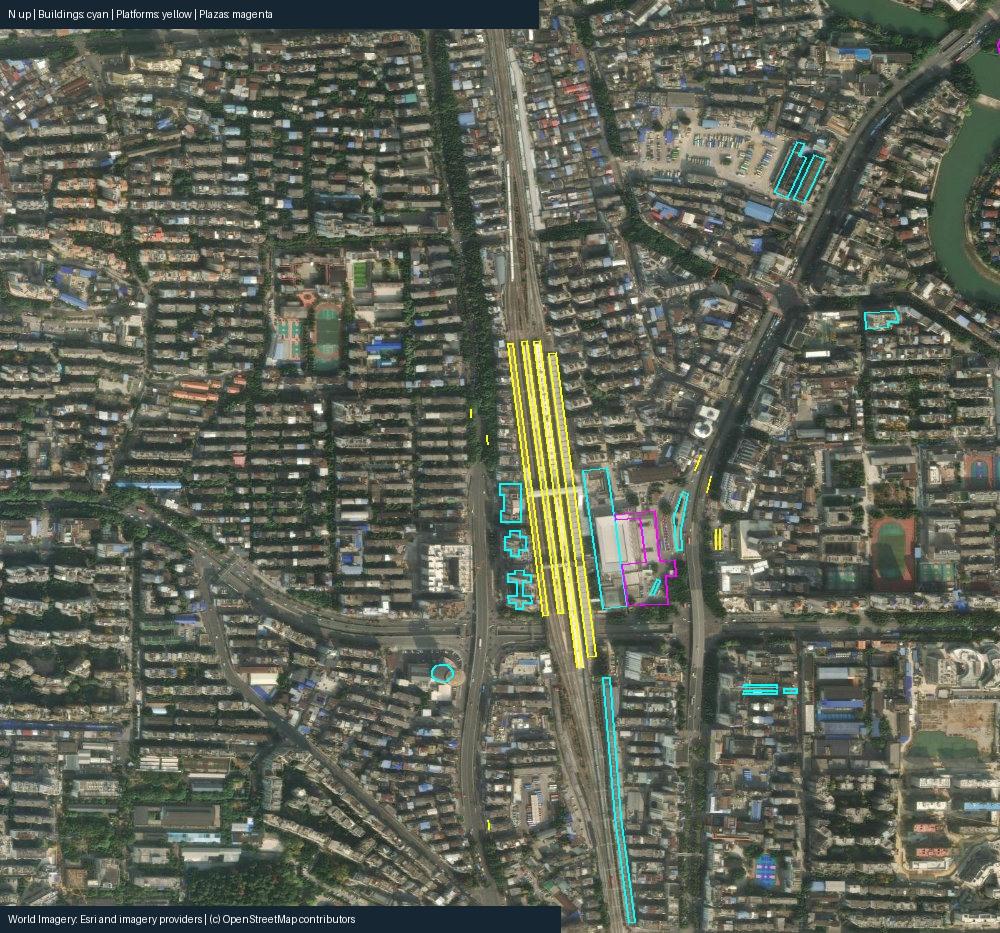

# 桂林站位置证据

桂林站节点 626322669 位于站场内。主楼在其东侧，面向广场和中山南路。以东侧广场向西为正立面参考机位。图中青色为建筑，黄色为站台（含沿街公交站台），品红为步行广场。

| 构件 | OSM 几何 | 对位依据 |
|---|---|---|
| 站房 | way/819178841 | 南北长边顺轨道走向，东界 110.2784085°E，南北范围 25.2628731–25.2649667°N。建模取多边形，节点仅用于地点检索。 |
| 广场 | way/1056261582 | 主楼与中山南路间的折线步行区，东界 110.2791496°E。图中部分铺装与树冠重合，不能从屋顶投影推算地面边缘。 |
| 铁路站台 | way/376029417、376029418、376029419、376029420 | 四条长轮廓位于主楼以西。项目流式分块中的站台块数与原始 OSM way 数分别统计。 |
| 公交候车设施 | way/265411027、265411036 | 道路站台有 highway=platform 与 shelter=yes 标签。公交棚与跨线旅客雨棚分别定位。 |

底图使用 2026-11-24 取得的 OSM 轮廓与 Esri World Imagery。两层均请求 WGS84（EPSG:4326），北向上，1000 × 933 像素，范围为 110.269–110.284°E、25.258–25.272°N。经纬向每像素约 1.5 m 和 1.7 m。影像拍摄日期未知，此图用来辨认平面关系；两米偏差需在项目的米制投影下用几何计算检验。

[© OpenStreetMap contributors，范围数据](https://api.openstreetmap.org/api/0.6/map?bbox=110.269,25.258,110.284,25.272) · [Esri World Imagery，原始范围](https://server.arcgisonline.com/ArcGIS/rest/services/World_Imagery/MapServer/export?bbox=110.269,25.258,110.284,25.272&bboxSR=4326&imageSR=4326&size=1000,933&format=jpg&f=image) · [实拍目录](../refs/guilin-station/README.md)
