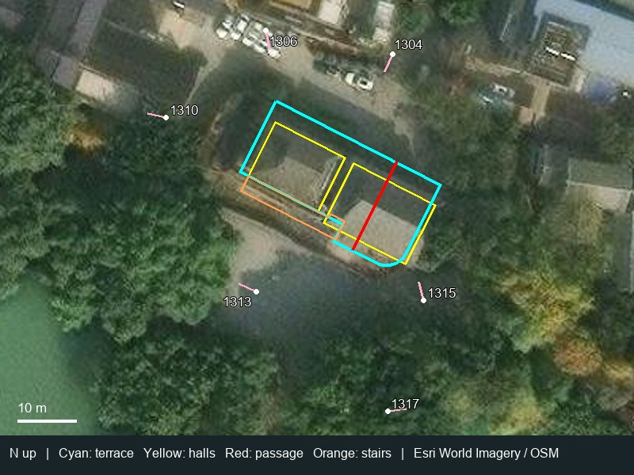
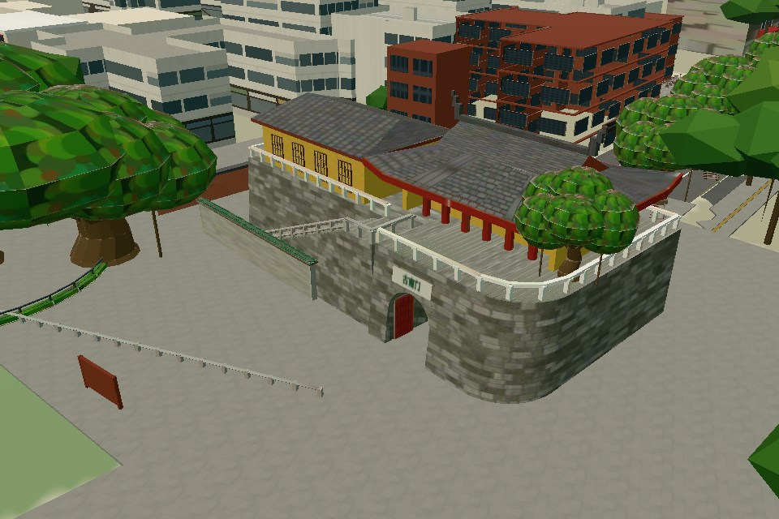
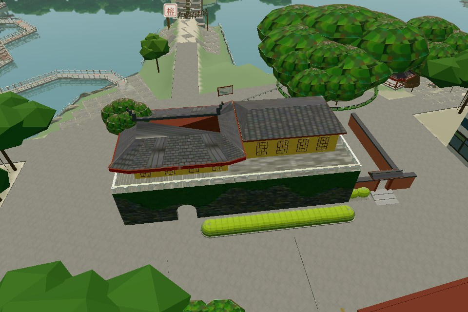

# 古南门城台与榕荫路广场

从榕荫路尽头向南看，左边门楼与右边黄楼坐在同一道城墙上。北墙从小门洞一直延伸到西端的绿篱后，墙顶白石栏贯穿两栋楼。绕至湖侧，仍能辨认同一门洞轴线，南侧洞口较宽。南墙用一整块微收分的条石正面收住门洞，东南端转为圆角，西半部可沿石阶登台。

图上北为真北。青线为城台墙脚，橙线为西侧石阶和上端平台，黄线为 OSM 两栋楼的轮廓，红线为通道轴线。粉线为现场照片记录的原始罗盘方向。底图来自 Esri World Imagery 第 19 级瓦片，建筑轮廓来自项目 2026 年 11 月 OpenStreetMap 快照。影像中屋面可辨，树冠遮挡了局部墙脚。[Esri World Imagery](https://services.arcgisonline.com/ArcGIS/rest/services/World_Imagery/MapServer) · [西楼](https://www.openstreetmap.org/way/521248472) · [东楼](https://www.openstreetmap.org/way/684946200)

## 形状和尺度

以两座楼的长边确定墙体走向，再用 1304、1305 的栏杆、门洞和绿篱相对位置限定北墙。南侧边界按 1313–1316 的门额、东端圆角和铺地确定。长墙轴向为真方位约 117°，向北广场的一面法线约 27°，向湖的一面约 207°。东西短边沿门道方向。

| 部位 | 模型尺寸与位置 | 现场依据 |
| --- | --- | --- |
| 城台主体 | 长 31.4 m、西楼下方进深约 13 m，两楼共用 6.70 m 标高的台顶。南墙拱门处进深 16.05 m（台顶）、16.80 m（墙脚）。 | 北面栏杆顶线连续，南面两楼之间可见同高墙冠。墙高按门洞和行人比例估算。 |
| 北墙 | 青灰毛石直立至顶，墙冠向下挂藤；从北面看，门在左、绿篱在右。洞口中心距东端 8.4 m，净宽 2.6 m，拱顶高 3.4 m。右侧花岗岩池沿露出广场约 0.3 m，池内是深绿地被和黄绿色圆顶灌木，灌木顶距铺装约 1.4 m。 | 1304 正面、1305 斜侧、1306 西端回望 |
| 南墙 | 通道沿同一轴线贯穿。湖侧洞口宽 3.6 m、高 4.6 m，门额在拱顶上方，墙脚至墙顶收分 0.75 m。东南转角半径约 3.6 m，其余南立面保持平直。 | 1313 全景、1314 正面、1315–1316 东端斜侧 |
| 两端 | 西侧石阶沿墙自西向东升高，长 15.4 m、宽 2.9 m，有石栏和上端转入台顶的平台。台阶西段前另有绿琉璃瓦压顶的矮院墙。树冠和围墙遮挡的短墙用直线闭合，墙脚随铺地地势变化。 | 1306、1308–1312、1315–1316 |
| 两座楼 | 西黄楼墙身 12.5 × 8.2 m，临北墙一侧开窗；东门楼压在通道上方，南面有柱廊。 | 卫星屋面和 OSM 约束楼位；立面、屋脊高低取自 1304 和 1313。 |

尺寸是建模估计。两栋 OSM 建筑分别约束各自楼位，台墙尺寸另由照片和影像推定。原点为城门节点 2596945561，模型坐标为东、上、南。两栋楼的竖向承托面均为城台顶面；打包后的楼底、台顶在每栋楼四个点分别检查。

## 25 个 GPS 机位的用途

| IMG | 可辨要素 |
| --- | --- |
| 1303、1307 | 临街店面和广场入口，限定城台外街道方向。 |
| 1304–1306 | 直墙、北门洞、栏杆和绿篱；1306 中西端衔接独立园门。 |
| 1308、1309 | 红院墙、上方黄楼和园门近景。 |
| 1310–1312 | 大榕树、环树花池、树周铺地，限定西侧行走空间。 |
| 1313–1316 | 南侧洞口、城台收分和东端。1313 原始罗盘为 294.3°，既有照片校正记录指向 355.1°。三联图沿用校正记录，并另附南立面补拍。 |
| 1317–1321、1331–1332 | 湖岸、桥面和入园路线，约束湖侧环境。1317 的镜头朝向水面。 |
| 1333–1336 | 园区导览牌、石渠和园路，是西侧范围参照。 |

广场沿既有步道边界进入世界人行道网格，在三角化前与邻接人行道合并，使用同一标高函数、石板贴图及 2 m 平铺尺度。门洞的渲染网格与碰撞网格采用相同拱券截面。快速步行分别验证从北广场穿过门洞抵达南广场，以及由西侧石阶上升、在顶端向北转弯并走上主台面。

## 现场与游戏对照

每张三联图依次为实拍、改前、改后。两列游戏图共用视点、方向、焦距和时段。下表改前为第一轮提交 6c929d0。

| 北面与西端 | 南面与周边 |
| --- | --- |
| [1304 北墙全景](idok-78/IMG_1304.jpg) | [1313 项目校正机位](idok-78/IMG_1313.jpg) |
| [1305 北墙斜侧](idok-78/IMG_1305.jpg) | [1313 南立面定向补拍](idok-78/south.jpg) |
| [1306 西端与园门](idok-78/IMG_1306.jpg) | [1315 东端与南墙收分](idok-78/IMG_1315.jpg) |
| [1310 榕树方向](idok-78/IMG_1310.jpg) | [1317 湖桥方向](idok-78/IMG_1317.jpg) |

榕荫路车行道和自行车道接入广场的地方设降缘。切片以广场边线和相邻路面的交线定位降缘，铺装在约 2 m 内渐接路面；其余人行道保持项目既有路缘高度。

1310、1317 的记录机位与主体方向仍有偏差。另附项目既有巡览机位的 [大榕树](idok-78/context-1310.jpg) 和 [湖桥](idok-78/context-1317.jpg) 定向对照，可用来辨认周边地物。
