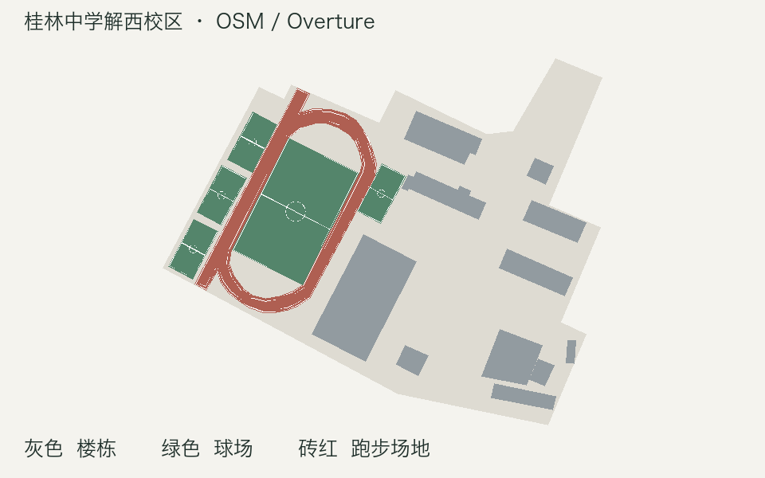

# 桂林中学解西校区

OSM 校界 `way/253811718`。

## 楼栋

- B1 · `way/690980799` · 2 层
- B2 · `f97d45ef-6943-4e73-8c4b-672340a7b8a7` · 6 层
- B3 · `way/682942537` · 4 层
- B4 · `way/682942536` · 5 层
- B5 · `way/683033683` · 5 层
- B6 · `way/682942535` · 5 层
- B7 · `way/682942534` · 5 层
- B8 · `2c0786a8-316f-4b14-a011-0bcfe23ec27e` · 3 层
- B9 · `72d24742-818c-4954-8a15-ceff8e95e9c8` · 4 层
- B10 · `a1feace1-6a08-44d0-ba70-99390d1b14a4` · 2 层
- B11 · `ba39af2f-b7b6-4a01-a907-790fc605a125` · 1 层

## 运动场地

- 足球场 · `way/221349775`
- 篮球场 · `way/682942538`
- 篮球场 · `way/682942541`
- 篮球场 · `way/682942543`
- 篮球场 · `way/1350892045`
- 跑步场地 · `relation/6137289`

## 推断

层数、高低关系、屋顶、配色、绿化和临街门型沿用游戏概化风格。场地画线为示意。

