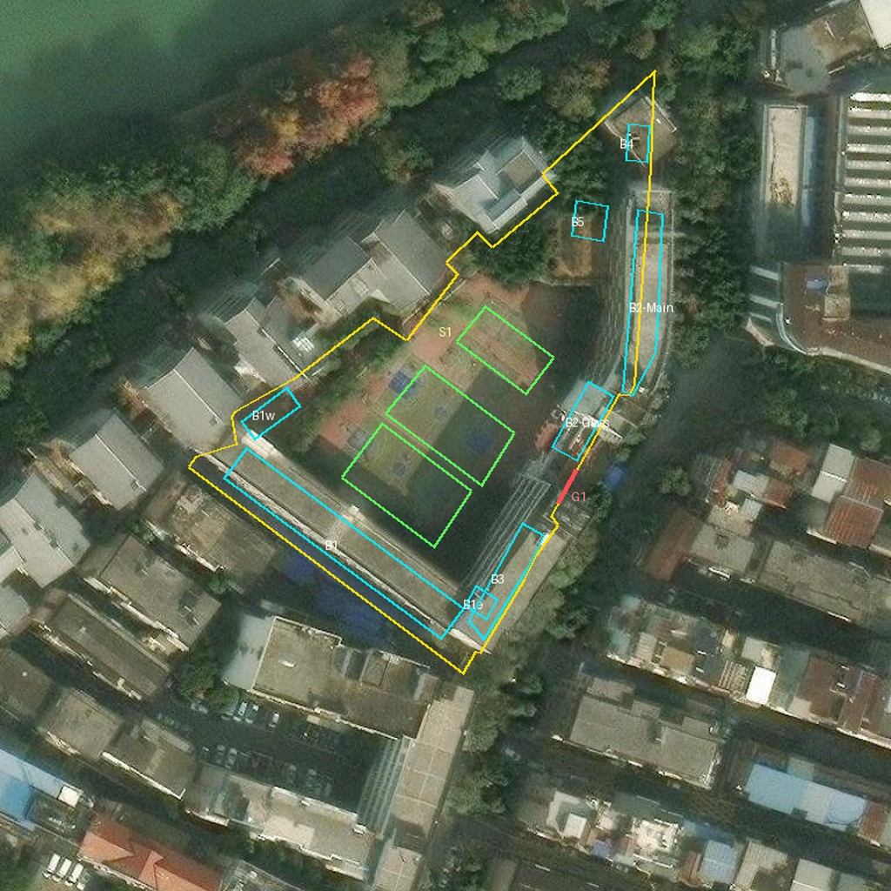

# 桂林市第十三中学 校内布局证据

- 地标标识：`guilin_thirteen`（桂林市秀峰区四会路 9 号）
- 校园锚点：`OSM way/669069474`（面积 6945.9 m²，基准形心 `110.290196°E, 25.286688°N` 左右；地形高差经实测由南角 `+2.31 m` 至北角 `-1.99 m`，全部建筑基脚与围墙分段按最终地形 `LandmarkSurface.ground(x, z)` 贴地）
- 证据底图：

## 多源定位与影像交叉核对

1. **卫星 / 航拍影像**：
   - Esri World Imagery（2024-12-24 WV03 0.31 m/px，`z=19`）
   - Bing Aerial（`z=19`）与 Google Satellite（`z=19`）三图逐栋核对 B1–B5、操场跑道与北东侧辅场。
2. **矢量底图与行政路网**：
   - OSM `way/669069474`（校园边界）、`way/691138804` / `way/691138805`（中央双篮球场）、`way/259011242`（四会路，tertiary 宽 10 m）、`way/221349745`（三皇路）、`way/627527309`（相邻南侧地块界）。
   - Overture Buildings `066329fa-3fb1-4834-9e1f-f7479d82b407`、`6719a1e1-eb46-4941-be0c-757a1e6a84ee`、`06dcb0bc-87b4-4953-ada3-0c5df6f6bb9d`。
   - 安全边界纠偏：OSM 东侧界与 Overture `6719a1e1` / `06dcb0bc` 在四会路方向分别压入人行道及路面（校园原面涉人行道 90.7 m²、`06dcb0bc` 原框涉路面 86.47 m²）；建模边界统一切除道路及人行道外退 ≥ 0.45 m，西北界外退 `c6e15c2d`、`8953a52b`、`ae4bcc78` 沿湖外部建筑 ≥ 0.50 m。
   - OSM Nominatim & Photon 检索：`way/669069474` 中心坐标与 Esri 影像吻合 < 2 m。
3. **公开户外实景资料（仅浏览参考，`viewOnly: true`，不入库不作纹理）**：
   - 维基共享资源 `File:桂林市第十三中学01.JPG`（东侧临四会路白红条砖外立面与檐口）
   - 搜狐地方教育图文 `1087662854`（西南 4F 白砖外廊楼 `B1`、绿蓝塑胶篮球场与绿柱球架及西北桂湖沿线环境）
   - 桂林广播电视台 `gltvs.com` 第 54 届田径运动会报道（校内红色环形跑道、西南楼东面与南角「德智体美」彩绘低翼及柱廊）
   - 桂林广播电视台 `gltvs.com` 第 53 届运动会报道（西北侧米白条砖主席台立面、旗杆及后侧树冠与黑檐小顶背景）
   - 头条号 `@书业工作者` 街景实拍 3 张（四会路正门「桂林市第十三中學」红字大理石竹简文化墙、门右侧 2F 深蓝玻璃幕墙斜转角段、北向白砖灰蓝斜檐立面及屋顶「十三中」白色金属桁架牌）
   - 桂林生活网街拍（四会路侧门前退台广场、横梁与白色关闭电动栏杆门、门南侧衔接楼角）

## 建筑与场地要素核对表（中性编号）

| 代号 | 形态与位置 | 层数 / 高度 | 屋面与外观 | 交叉来源 1 | 交叉来源 2 |
|---|---|---:|---|---|---|
| B1 | 西南沿界长条体量（`066329fa`） | 4F / 13.0 m | 灰平女儿墙；浅米白外墙；NE 面通长外廊栏杆+柱列；SW 带窗 | Overture `066329fa` / Esri/Bing | 搜狐 `1087662854` / 桂视网第 54 届报道 |
| B1w | B1 西北角端翼 | 2F / 6.4 m | 灰平顶；浅灰白外墙 | Esri / Google z19 | 桂视网 2026-09 航照对比 |
| B1e | B1 东南折角端翼 | 2F / 6.7 m | 灰平顶；米白墙配暖红腰线（「德智体美」段外观） | 桂视网第 54 届报道左景 | Esri / Google z19 |
| B2-Main | 东侧四会路主长体量（`6719a1e1` 退让后） | 4-5F / 13.8 m + 梯间 | 灰蓝阶梯斜装饰檐；白灰砖墙饰暖棕竖线；楼顶「十三中」桁架字 | Overture `6719a1e1` / Esri | 维基 `01.JPG` / 头条街拍 3 |
| B2-Glass | 校门北侧转角体量 | 4F / 13.4 m | 灰蓝斜檐；1-2F 深蓝玻璃幕墙斜立面；上层白色窗带 | 头条街拍 1/2 | 桂林生活网正门全景 / Esri |
| B3 | 校门南侧衔接体量（安全区取代 `06dcb0bc`） | 3F / 9.6 m | 灰平顶；浅灰白墙；临街首层红棕檐口饰带 | Overture `06dcb0bc` 退让 | 桂林生活网正门全景 / Google z19 |
| B4 | 最北尖角独立方体量 | 2F / 6.9 m | 灰平顶；浅灰米外墙 | Esri z19 | Bing / Google z19 |
| B5 | 北端内侧暖黄方体量 | 2F / 7.0 m | 暖米黄平顶与墙体 | Bing Aerial z19 | Google Sat z19 |
| S1 | 中央运动场、环道、2 主球场 + 1 辅场 + 西北主席台 | 地坪 / 台高 1.5 m | 红塑胶跑道及白线；草绿外框+宝蓝禁区球场+4 绿柱球架；米白条砖主席台与旗杆 | OSM `way/691138804/805` / Esri | 搜狐图 / 桂视网两篇运动会报道 |
| G1 | 四会路退台主门 + 文化墙 + 闭合围墙 | 墙高 2.15 m | 关闭白灰栏杆大门+红门楣；「桂林市第十三中學」大理石文化墙；米白砖脚+黑铁艺围墙（无岗亭/闸机/监控） | 桂林生活网 / 头条街拍 1 | OSM 四会路退让界 / Google z19 |
| T1 | 校内 15 株绿化乔木（IDOK-71 树种） | 7–10 m | 香樟、小叶榕、桂花、黄葛榕、秋枫、棕榈 | Esri / Google z19 树冠分布 | 搜狐与桂视网实景背景树冠 |
