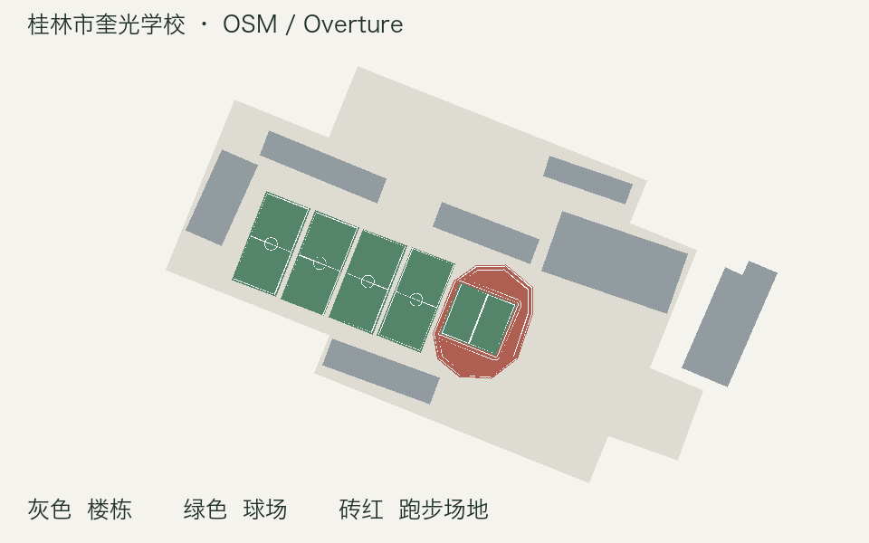

# 桂林市奎光学校

OSM 校界 `way/253811717`。

## 楼栋

- B1 · `way/683033673` · 5 层
- B2 · `way/683033672` · 4 层
- B3 · `way/683033678` · 4 层
- B4 · `way/692355780` · 4 层
- B5 · `way/683033675` · 3 层
- B6 · `way/701820464` · 5 层
- B7 · `way/683033677` · 2 层

## 运动场地

- 篮球场 · `way/683033679`
- 篮球场 · `way/683033680`
- 篮球场 · `way/683033681`
- 篮球场 · `way/683033682`
- 排球场 · `way/691456683`
- 跑步场地 · `way/691002264`

临街几何沿用项目的道路退距，以保留人行道和车道净空。

B1、B6 及低矮红砖翼墙沿用主分支的建筑模型。

## 推断

层数、高低关系、屋顶、配色、绿化和临街门型沿用游戏概化风格。场地画线为示意。

