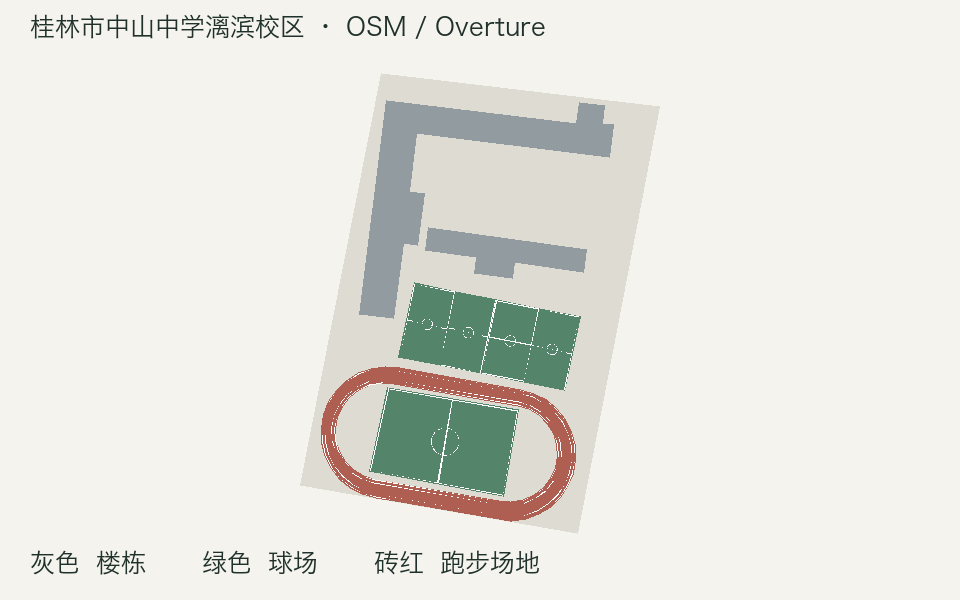

# 桂林市中山中学漓滨校区

OSM 校界 `way/675588260`。

## 楼栋

- B1 · `way/683033662` · 5 层
- B2 · `way/683033663` · 4 层

## 运动场地

- 足球场 · `way/221996841`
- 篮球场 · `way/683033664`
- 篮球场 · `way/683033665`
- 篮球场 · `way/683033666`
- 篮球场 · `way/683033667`
- 跑道 · `relation/9475535`

## 推断

层数、高低关系、屋顶、配色、绿化和临街门型沿用游戏概化风格。场地画线为示意。

