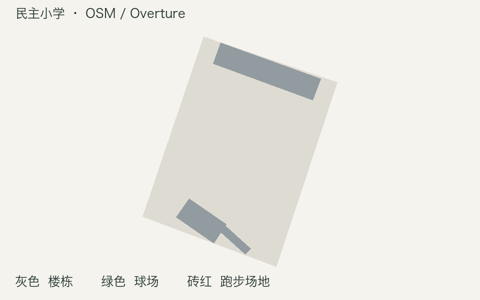

# 民主小学

OSM 校界 `way/970311799`。

## 楼栋

- B1 · `98dc0dcd-eab5-41b5-96bc-8593cd3a2546` · 5 层
- B2 · `e52c2561-b679-40c6-a84d-022cab694a44` · 4 层
- B3 · `2a8ab93a-f68f-431e-bd65-04e6a3d9feb9` · 3 层

## 运动场地

本地 OSM 快照在校界内未标注 pitch 或 track。

## 推断

层数、高低关系、屋顶、配色、绿化和临街门型沿用游戏概化风格。场地画线为示意。

