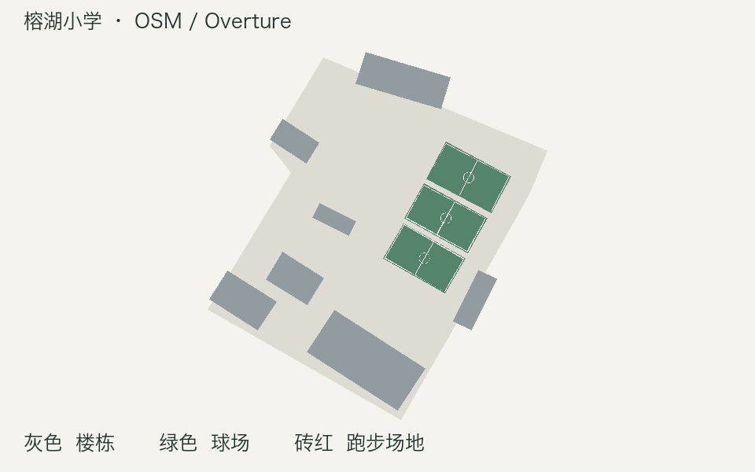

# 榕湖小学

OSM 校界 `way/686230935`。

## 楼栋

- B1 · `79568dcd-14fe-46b2-aa79-7caad830f19d` · 5 层
- B2 · `a51a05fd-8fbb-44da-ac6b-3d53cefe907e` · 4 层
- B3 · `e1315567-aac9-4f51-83cf-d06deb85a916` · 4 层
- B4 · `7a33574a-3274-471a-9f9b-8ae8e062f0da` · 2 层
- B5 · `10066d18-451b-49da-bc2b-c54fd156abfa` · 3 层
- B6 · `193caf84-2a3c-4949-9cf0-55bed91edc2d` · 3 层
- B7 · `c693ee13-ec1b-4e1c-a409-0ef415f03b50` · 3 层

## 运动场地

- 篮球场 · `way/701820455`
- 篮球场 · `way/701820456`
- 篮球场 · `way/701820457`

## 推断

层数、高低关系、屋顶、配色、绿化和临街门型沿用游戏概化风格。场地画线为示意。

