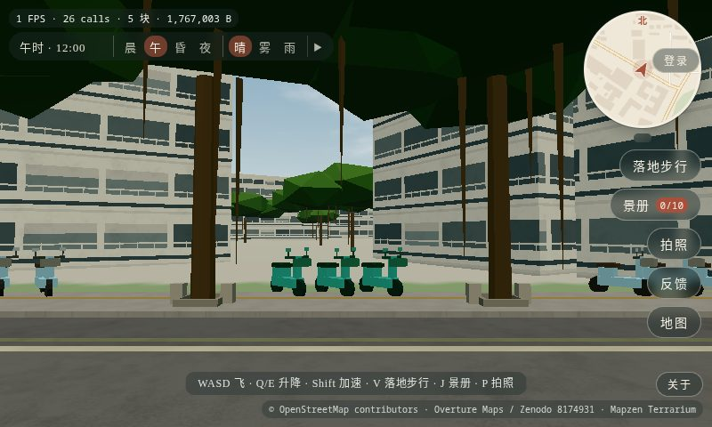
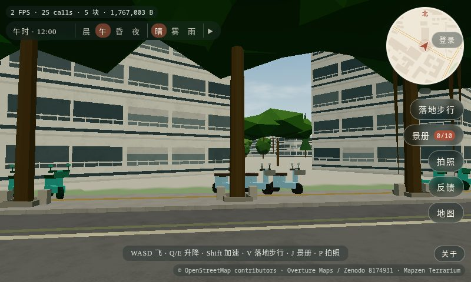
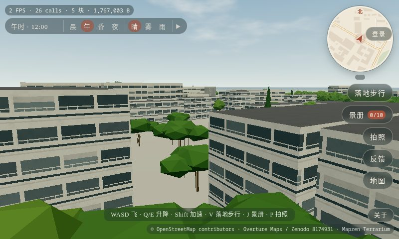

## 桂林市田家炳中学 · 公共街景

外观资料仅供对照，不作为贴图，不依据照片推测内部布局。配色是近似值，不是实测色。

– [桂林市田家炳中学弧形红墙校门、田家炳楼与四中主楼全景](https://5b0988e595225.cdn.sohucs.com/images/20190528/9b3a31d90cf44f4ab0f418935325ccb7.jpeg)（[来源页](http://www.sohu.com/a/316881166_500227)）
– [桂林市田家炳中学校门与主楼外景](https://q5.itc.cn/q_70/images03/20260804/bd2b29d7f27241efbf64869865f17da4.jpeg)（[来源页](http://www.sohu.com/a/1058748227_121117446)）
– [桂林市田家炳中学屏风路临街校门与主楼街景](https://wx4.sinaimg.cn/orj480/769984a7gy1iivtjgzctcj20zk0k0wgy.jpg)（[来源页](http://weibo.com/1989772455/Rqza1elRc)）

### 街道一侧对照

机位取自公共道路并采样最终地形；角度为近似街侧视角，未作照片相机标定。

| 公开照片（源站） | 游戏 | Draw calls / 三角形 |
|---|---|---:|
| [照片](https://5b0988e595225.cdn.sohucs.com/images/20190528/9b3a31d90cf44f4ab0f418935325ccb7.jpeg) |  | 26 / 328,863 |
| [照片](https://wx4.sinaimg.cn/orj480/769984a7gy1iivtjgzctcj20zk0k0wgy.jpg) |  | 25 / 323,015 |

斜视：26 draw calls，326,319 三角形（全帧，含周边场景）。
