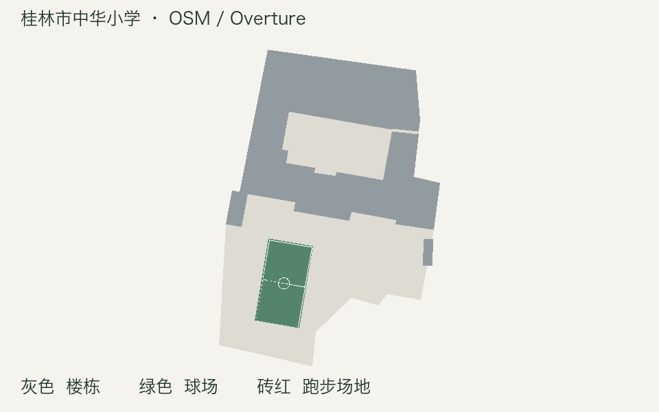

# 桂林市中华小学

OSM 校界 `way/1531318258`。

## 楼栋

- B1 · `2048ed26-fa86-4e34-8959-9b0b2e253237` · 5 层
- B2 · `608f802c-5541-4c52-9c03-5f3f8bcc362a` · 2 层

## 运动场地

- 篮球场 · `way/1554170680`

## 推断

层数、高低关系、屋顶、配色、绿化和临街门型沿用游戏概化风格。场地画线为示意。

