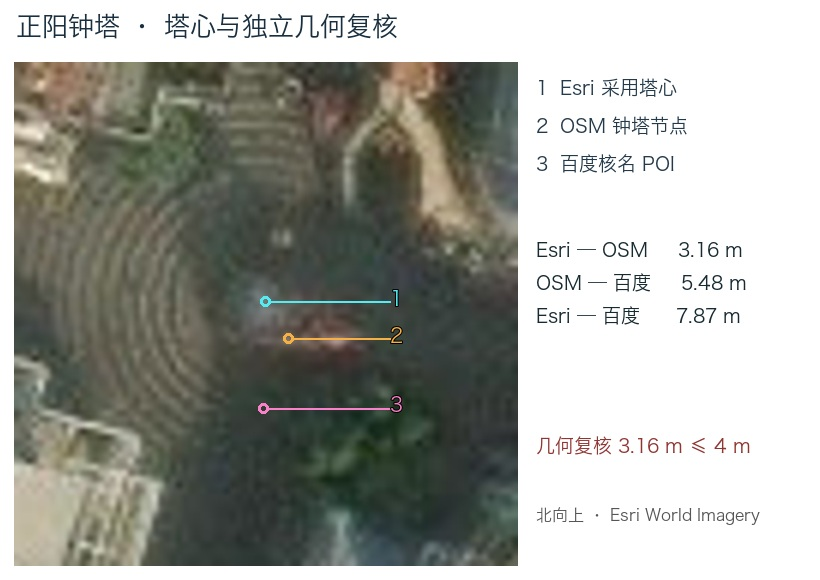

## 正阳步行街证据底图

GeoJSON 使用 WGS84，经度在前。北界为解放东路，南界为杉湖北路。两段步行街分别取 OSM 221821082、675600128。两段之间保留路口缺口，不把整条街连成可碰撞地板。北侧王城商厦沿用 IDOK-51 的定位与地标归属，解放东路通行空间由 IDOK-61 核查。

## 正阳钟塔

| 位置来源 | 经度 | 纬度 | 核对结果 |
|---|---:|---:|---|
| Esri World Imagery | 110.2934912 | 25.2782321 | 人工点取塔影与圆形铺装中心附近，塔脚受阴影影响 |
| 百度「正阳钟塔」 | 110.2934891 | 25.2781611 | 相对影像候选点偏南 7.87 m，偏西 0.21 m，平距约 7.9 m |
| OpenStreetMap | 110.2935074 | 25.2782077 | [节点 6326899999](https://www.openstreetmap.org/node/6326899999)，无名称，标签 man_made=tower、tower:type=bell_tower；距百度 5.48 m、距 Esri 3.16 m |
| 高德 | — | — | 公开查询未返回可用的塔心坐标 |

**采用 Esri 塔脚投影中心，OSM 作几何复核。** IDOK-68 验收确认两类几何来源的阈值为 4 m，实测 3.16 m。百度和高德的标签位置可核实名称，但其标注点可能偏离实体中心，故取消原来把 POI 纳入 2 m 残差的条件。百度「正阳钟塔」的 diPointX/Y 为 1227918123、289195358；除以 100 后逆百度墨卡托，BD-09 转 GCJ-02，再用 GCJ 正算迭代反解六次，得 WGS84 (110.2935288, 25.2781925)。沿用 IDOK-50/51 的 Δlon −0.0000397°、Δlat −0.0000314°，未重新拟合。街道、商店、大堂的 POI 均不参与塔心计算。[百度地点查询](https://map.baidu.com/?qt=s&c=142&wd=桂林市正阳路步行街-钟楼)

Esri 导出请求范围为 110.2918,25.2730 至 110.2952,25.2814，800 × 2100 px。用服务实际返回的 EPSG:3857 图幅 (12277619.2872, 2909313.9569, 12278013.2284, 2910348.0526) 换算，以左上角为原点，取点 (398,792)。地面约 0.45 m/px。POI 投影为 (397.51,809.77)。阴影与主体出自同一幅影像，只算一类证据。公开资料记载总高 17.5 m；照片按总高归一：近景的塔脚至塔顶约 710 px、塔脚至钟面中心约 466 px，对应钟心约 11.5 m。模型采用四根方形石柱，轴距 4.5 m，柱宽 1.02 m；红色开敞桁架向上收分，顶部交叉。方形截面沿街轴 9.6°。截面和朝向取照片比例与街轴关系，未作现场测量。[Esri 导出服务](https://server.arcgisonline.com/ArcGIS/rest/services/World_Imagery/MapServer/export) · [桂林摄影旅游](https://www.glvisit.com/scenery_view.asp?id=62)

## 建筑和街面

GeoJSON 收录与两段街道中心线 22 m 缓冲区相交的 OSM 建筑 19 个，另列 18 个 Overture 候选面。按建筑与 OSM 的交并比标出重合关系，Overture 来源字段为 OpenStreetMap 的记录视为同源。候选面可能只覆盖连排建筑的一部分。层数、屋顶、底商、骑楼分别记录；空值表示待定。街段两侧尚有屋顶相连、分栋界线不可辨的区域。[OSM 数据](https://www.openstreetmap.org/copyright) · [Overture 原始建筑来源](https://doi.org/10.5281/zenodo.8174931)

| 北口要素 | 独立证据与可用范围 |
|---|---|
| 东侧王城商厦 | OSM 264901525 和 Rock 04、06、09。九层体量、临街玻璃面与底部商铺沿用 dongxi-layout，不重复建楼 |
| 西侧港舍 | Rock 09 西侧转角与屋顶字标；百度解放东路 15 号酒店 (110.2936090,25.2806334) 及大堂 (110.2936944,25.2806668) 位于 Esri 屋顶内。图中单列屋顶；采用 R2 的登记底面和八层玻璃立面。沿用模型层高 3.45 m，檐高 27.6 m |
| 石碑、绿化与护栏 | 09 可辨石碑及前方绿化、隔离栏。GPS 为拍摄者位置；单张照片不足以确定三者的地面坐标 |
| 街心座椅、雕塑、灯杆、坡道和台阶 | 影像无法逐项辨认位置与尺寸，待定 |

影像和照片索引使用不同来源的原始坐标。Rock 1392–1398 的七个机位保留源文件路径、基础朝向和水平精度；七个机位均未用于钟楼定位。图中北口和南口的点表示 OSM 道路端点。

2018 年公开实拍 89738、89739 显示红色开敞桁架、交叉的塔顶、蓝色圆钟面及四个独立柱基；无法从单张透视图直接量出截面尺寸或钟面相对地面的高度。[公开近景](https://commons.wikimedia.org/wiki/File:89739-Guilin_(49040290878).jpg) · [街道远景](https://commons.wikimedia.org/wiki/File:89738-Guilin_(49040795886).jpg)

北段原地标按街道里程等距生成了两座东侧骑楼。将其墙体矩形变换到地图坐标后，第 2 块与商厦轮廓相交约 163 m²，第 3 块与商厦及相邻 way/675591853 分别相交约 93、37 m²。东侧这两处重复体量及其柱子、阳台和碰撞体已撤下。港舍的 3–8 楼可由公开报道核实；本次将 R2 改为八层。[桂林晚报，2025-05-30](https://epaper.guilinlife.com/glwbh5/glwb/20250530/Page10BC.htm)

西侧港舍底面与 IDOK-51 的 wangcheng_market.replacePolygons[1] 及 Overture 6c8b3dce 高度重合。旧正阳路第 1、2、3 块西侧骑楼分别侵入既有地标的 [1]/[18]、[18]、[60] 号轮廓约 109、63、109 m²。同步撤下这三块重复骑楼；西侧底楼与港舍立面的修改会涉及 IDOK-51 的模型归属。解放东路车道、隔离栏及通行碰撞体归 IDOK-61。改前实拍 09 的商厦远端立边约在画宽 38%，旧游戏机位约在 83%。实拍 03、05、07 的画面不能同时辨认两侧建筑边缘。

旧 GLB 的钟塔中心由地标 anchor 加局部偏移 (−11.5, 71.0) m 得 (110.2938048,25.2801319)，距 Esri 候选点约 212 m、距百度候选点约 220 m。已复看 Esri Wayback 2017-01-11、2019-12-12、2022-12-14、2026-11-18 四版，早期图层分辨率和树影不足以辨认四个柱脚；不同发布版本也不能作为独立 POI 或实测点。[Esri Wayback](https://livingatlas.arcgis.com/wayback/)

南端的曲水流觞石雕、马君武铜像及北口可见的设施以空几何入表，保留可核对的存在证据。OSM 中的咖啡馆 outdoor_seating 标签只表示商家提供户外座位，不能用来定位公共座椅。[桂林摄影旅游](https://www.glvisit.com/scenery_view.asp?id=62) · [南口实地游记](https://gs.ctrip.com/html5/you/comment/28/108721-sight.html)

西侧港舍的既有模型归属可精确到 dongxi-layout.geojson 的 R2，对应 Overture 6c8b3dce。本次覆盖 IDOK-51 对 R2 的三层估计，采用八层及临街深色竖向广告屏。R19、R61 也在该地标内。单纯移动正阳路 GLB 无法修正 R2 的层数。

独立地标 zhengyang_clock 自带四座柱脚碰撞和局部整平区；北段 zhengyang 保留铺装。新塔心在依仁路，距旧塔 212.4 m。北口横跨解放东路的通行范围仍由 IDOK-61 跟踪。

王城商厦的 OSM 底面保留到 7 m 高的裙楼。商厦上部玻璃幕墙采用卫星亮色主屋面的四角，以东北角与 OSM 对应角配准。IMG_1398 保留原 GPS 和焦距 29 mm，恢复原始真北航向 176.3°。同航向的 main 与 PR 截图另作对照，可单独检查主楼退台产生的位移。

### IMG_1398 商厦远端立边

每幅 720 × 960 px。从商厦上部玻璃墙与天空的分界读取 x；避开裙楼、屋檐和树冠。实拍取 y=484–539，游戏取 y=302–367，逐行找出墙体结束的位置并取中位数。不同图中的楼顶高度不同，故读取各自同一条竖边的连续中段。

| 画面 | 真北航向 | 边缘 x | 占画宽 |
|---|---:|---:|---:|
| Rock 实拍 | EXIF 176.3° | 273 | 37.92% |
| main 原标定 | 165.0° | 596 | 82.78% |
| main 同机位 | 176.3° | 431 | 59.86% |
| 本 PR 同机位 | 176.3° | 305 | 42.36% |

同航向只改建筑后立边移动 126 px，最终与实拍相差 32 px，即画宽的 **4.44%**（验收上限 36 px）。三种渲染使用同一 GPS 原点、29 mm 等效焦距和相机高度。

同一组 IMG_1398 画面的右侧，港舍朝向街心的外立边在实拍为 x=475，游戏为 x=501，偏差 26 px，即画宽的 **3.61%**。读数取 y=340–440 的中位数；在每行 x=430–549 内取第一个比相邻天空（x=395–419）的中位灰度低至少 44 级的像素。

在依仁路交界处，街面生成器从钟塔碰撞网格提取四座柱脚的平面轮廓，沿轮廓裁开原有路面；两柱之间保留连续路面。解放东路北口的车行道和碰撞范围由 IDOK-61 维护。
