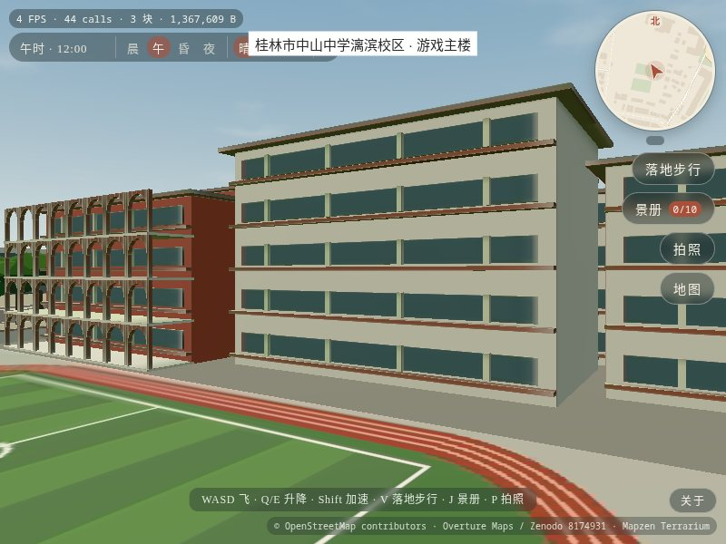
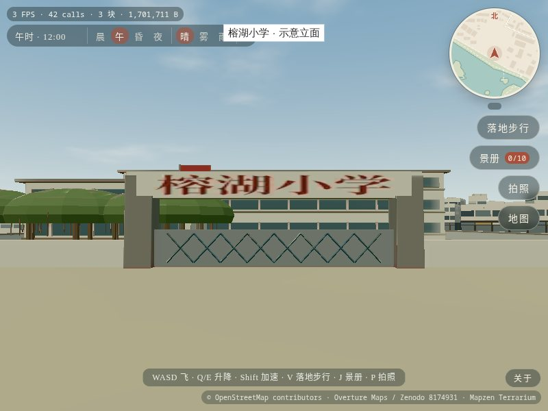

# 桂林学校地标

三所游戏模型均在原创院落内铺设硬地和草带，沿该院落设置连续低墙和关闭的原创校门；围墙不是实地校园边界的复刻，铺地也不代表整块 OSM 用地的地表。

## 桂林市中山中学漓滨校区

据中文维基百科「桂林市中山中学」（OSM `way/675588260` 的 `wikipedia` 标签），学校又名桂林市第九中学。游戏将「桂林市第九中学」「桂林九中」「九中」归入同一个搜索结果，不为 `node/9214622462` 另设地标。落点取漓滨路上的游戏坐标，不是实地校门定位。

简章全景用于核对建筑群和场地外观：游戏中五栋四至五层的红砖色与浅色教学楼错落排开。楼间位置和校门均为原创，OSM 仅用于地块。桂林市聋哑学校《党建共建手拉手，携手育人心连心》里的运动会在芦笛校区，不作为本校区依据。

拱跨数量、楼体进深与层高是游戏参数。LOD0 / LOD1：6,986 / 3,036 三角形，各 1 次可见 draw call；压缩 GLB 195,944 B。

[漓滨校区 2022 年高中招生简章](https://edu.guilinlife.com/index.php?s=/news/content/id/1111)明确提到运动场和篮球场。以下三幅取自同一简章，左栏链接指向发布方图片（不入库），右栏是游戏截图。比的是外观特征，不是同机位或平面位置。

| 实拍（点击原图） | 游戏 | 对照说明 |
|---|---|---|
| [校园运动场全景](http://img3.guilinlife.com/edu/News/image/202207/20220711143001_51255.png) |  | 实拍可见场地后方连续楼体；游戏以独立楼块表达，不复原围合关系。 |
| [校园建筑组图](http://img3.guilinlife.com/edu/News/image/202207/20220711143008_51363.png) |  | 对比连续开间、水平楼板。组图只计一次，不据此推断楼之间的通道。 |
| [场地活动照](http://img3.guilinlife.com/edu/News/image/202207/20220711143031_53289.png) |  | 对比红绿场面；跑道环、绿色条纹草皮及两侧蓝色硬地的整体形态取自第一行全景。 |

 

## 榕湖小学

按 OSM 的具名校园面替换程序楼，面内为原创游戏布局：教学楼甲三层、乙两层，色带、层数和篮球场均为暂定，非实拍认定。模型内铺硬地和草带，移除被替代的三个底图球场色块，保留邻近绿地。近 / 中景 2,952 / 634 三角形，各 1 个绘制批次；GLB 101,412 B。

**可核实的实拍对比：0 组。** 检索桂林生活网教育频道、桂林日报、公开校友图文，分别以「榕湖小学 榕湖北路 老校区」「榕湖本部 教学楼」「榕湖小学 本部 操场」限定校区。不能由图注核实是榕湖北路本部、或只有集团名称的图片不计；不把其他校区的立面移植到这里。

 

## 民主小学

临街墙段参考下图中的红砖墩柱、嵌框公告栏及后方浅色楼体。按 OSM 的具名校园面替换程序楼，面内为原创游戏布局：教学楼甲四层、乙两层，层数和运动场待照片核实。近 / 中景 3,696 / 1,234 三角形，各 1 个绘制批次；GLB 108,916 B。

| 实拍（点击原图） | 游戏 | 对照说明 |
|---|---|---|
| [民主小学临街外观](https://static.gxrb.com.cn/image/uploadpic/20241006/b8999cb68166eb26f12c37e1016b5a80.jpg) |  | [广西新闻网 2024-10-06 报道](https://gxxwfb.gxnews.com.cn/staticpages/20241006/newgx6701f190-21638051.shtml)，图注署名游拥军并明确标为民主小学。对比砖墩、公告栏和浅色背景楼，不比较入口。 |
| [桂林日报 2024-10-05 第 1 版：民主小学操场](https://epaper.guilinlife.com/glrbpc/glrb/20241005/01.pdf) |  | 记者李凯拍摄，图注指明是民主小学。节日期间车辆遮住了部分场地，不能从这张照片认定完整标线及配色。 |

**可核实的实拍对比：2 组。** 广西新闻网同篇报道中的操场全景图是逸仙中学；桂林晚报 2024-07-08 第 6 版是民主小学室内班会，两者都不计入外观对比。

## 少年宫

仅名称点，地块待核，未建模。交接 OSM `node/2597936160`（纬度 25.27697，经度 110.28072）。搜索落在附近公共街道，保留原有程序楼。

## 回民小学

仅名称点，地块待核，未建模。交接 OSM `node/3170011400`（纬度 25.27202，经度 110.27889）。搜索落在附近公共街道，保留原有程序楼。
