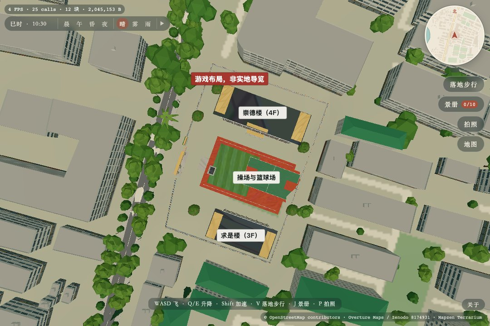
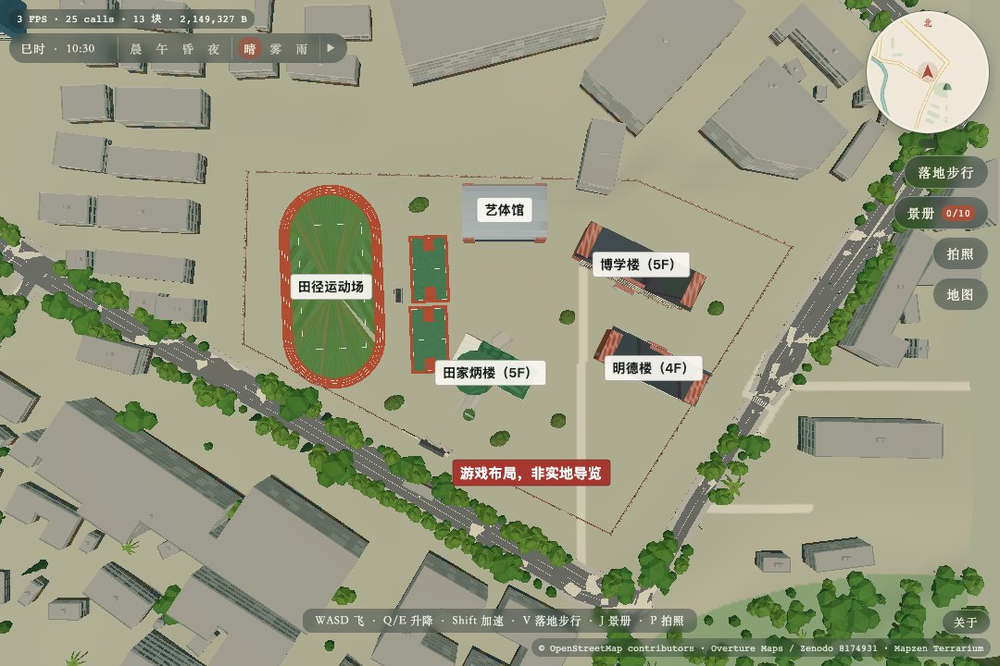
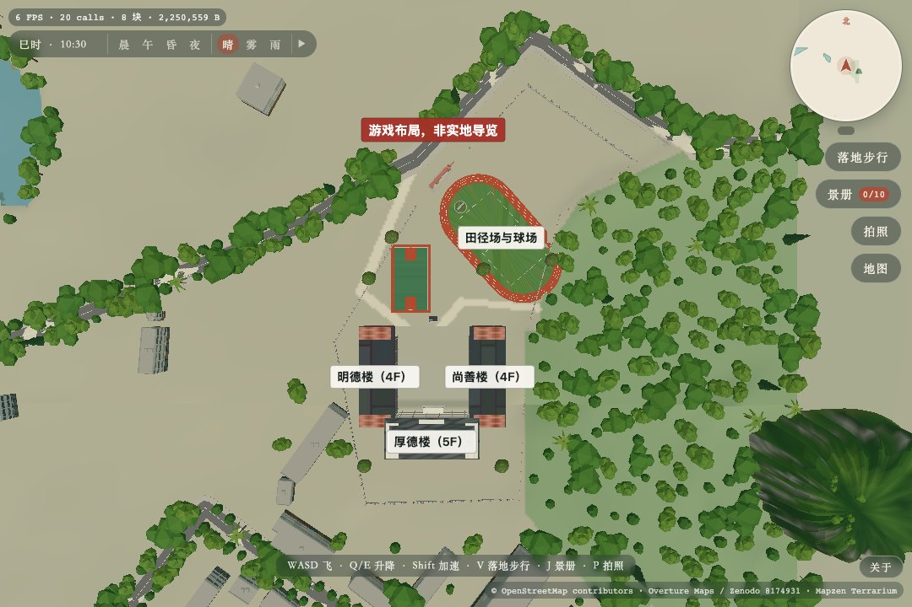

# 桂林学校地标

## M2.7-G3 漓江东七星学校指标汇总

| ID | 学校名称 | 类型与布局策略 | `viewOnly` 参考图 | LOD0 三角形 | LOD1 三角形 | 碰撞三角形 | Draw Calls | GLB 体积 | KTX2 贴图 | 道路碰撞重叠 |
|---|---|---|---:|---:|---:|---:|---:|---:|---:|---:|
| `glmu_dongcheng` | 桂林医科大学（东城校区） | 高校 · 实拍核对布局 | 18 | 31,507 | 5,685 | 3,512 | 2 | 942.2 KB | 447.0 KB | 0.00 m² |
| `glut_primary` | 桂林理工大学附属小学 | 小学 · 临街实拍 + 校内游戏布局 | 20 | 10,466 | 1,005 | 776 | 2 | 625.5 KB | 447.0 KB | 0.00 m² |
| `tianjiabing` | 桂林市田家炳中学 | 中学 · 临街实拍 + 校内游戏布局 | 20 | 21,905 | 1,581 | 1,494 | 2 | 766.1 KB | 447.0 KB | 0.00 m² |
| `chenshan_primary` | 桂林市辰山小学 | 小学 · 临街实拍 + 校内游戏布局 | 20 | 17,493 | 1,462 | 1,228 | 2 | 706.6 KB | 447.0 KB | 0.00 m² |
| `lijiang_primary` | 漓江小学 | 小学 · 临街实拍 + 校内游戏布局 | 18 | 8,352 | 1,125 | 668 | 2 | 595.7 KB | 447.0 KB | 0.00 m² |
| `longyin_primary` | 龙隐小学 | 小学 · 临街实拍 + 校内游戏布局 | 20 | 15,841 | 1,524 | 1,130 | 2 | 694.0 KB | 447.0 KB | 0.00 m² |

## 桂林医科大学（东城校区）

高校校区按实拍图与 OSM 建筑面核对还原（不建岗亭、门禁闸机、监控）。锚点取校园 `way/627526148` 形心 `(693.95, -1396.14)`，地面在避让周边市政道路走廊后压平至 `152.2 m`，地图搜索“桂林医科大学（东城校区）”及“弘德楼”等别名均落点于环城北二路正门外公共街道 `(678, -1701)`。参考照片见 `pipeline/landmark-refs.json` 中 `glmu_dongcheng` 条目（18 张 `viewOnly` 参考图）。

### 各建筑布局与实拍依据

| 建筑 / 场地 | 层数与朝向 | 实拍依据（`glmu_dongcheng` 零基序号） | 与地图数据对照及处理 |
|---|---|---|---|
| 环城北二路正门与校名石 | 门架高 6.4 m，朝东北向环城北二路（109 号） | `00`（官网东城校区大门）、`05` / `13`（校名石） | 对应 `way/672579553` 接入环城北二路 `way/370743375` 北口；左侧白色悬挑门架、右侧深红花岗岩“桂林医科大学”照壁，敞开无安防设施 |
| 附属口腔医院楼 | 6 层，朝东北向环城北二路 | `15`、`16`、`17`（附属口腔医院外景） | Overture 在正门西北沿街仅有零星碎块，按实拍在正门西侧校园红线内补齐 6 层白墙蓝灰饰带门诊楼并避让环城北二路路幅 |
| 东城图书馆 | 主体 6 层、中塔 7 层，内凹弧形柱廊朝东北 | `03`（官网东城校区图书馆外景） | 与 OSM `way/459580291` 扇形内凹轮廓一致，还原陶红两翼柱廊与中央白色“图书馆”门楼及前庭圆形花坛 |
| 弘德楼与“弘德善医”校训石 | 7 层，主立面朝西北向中心庭院 | `04`（官网弘德善医校训石与弘德楼）、`06` | 与 OSM `way/671760495` 位置一致，白墙配陶红竖向分格，西侧庭院设圆形花坛与校训石 |
| 科教楼与多功能报告厅 | 6 层（西翼 5 层）合院 + 2 层八角报告厅 | `01`（官网科教楼与多功能报告厅） | 对应 OSM `way/672633239` 大体量合院，拆分为北翼、东翼、西翼外廊教学楼并在内院还原陶红色八角报告厅 |
| 第二教学实验楼 | 6 层，主立面朝西北 | `01`、`04` 背景楼群 | 按 OSM `way/671790070` 位置布置浅米色配陶红饰带教学楼 |
| 标准田径运动场与水塔 | 400 m 跑道南北向，西侧遮阳看台，西北高水塔 | `02`（官网东城校区标准田径运动场） | 与 OSM `way/672634658` 足球场面吻合，补齐红跑道、绿草坪、西侧看台、三旗杆升旗台及实拍可见的白色高水塔 |
| 学生公寓群与南区实验楼 | 西侧宿舍 6 层（南北向陈列），南区实验楼 5 层 | `02`、`08`（学生公寓北区及灰白橙檐宿舍楼） | 对应 `way/672633244`–`672633251` 及南区 `way/672659167`、`672659168`，南界内收避让屏风路车行道与人行道 |

## 桂林理工大学附属小学

**游戏布局，非实地导览。** 锚点取校园 `way/473969804` 形心 `(979.45, -385.83)`，压平高程 `154.1 m` 与西侧建干路路面齐平；地图搜索“桂林理工大学附属小学”或“理工大附小”落点在建干路公共街道 `(933, -399)`。参考照片见 `pipeline/landmark-refs.json` 中 `glut_primary` 条目（20 张 `viewOnly` 参考图）。

临街校门（朝西偏北向建干路 10 号）依据参考图 `01`、`03` 还原米白与暖黄石材现代平挑雨棚门头、“桂林理工大学附属小学”校名匾额与花坛铭牌景墙，主车行门洞设关闭状态不锈钢伸缩门，不建岗亭、门禁、监控与侧后门。校内沿 Overture 既有南北建筑轮廓采用游戏布局：北侧崇德楼（4 层暖米黄配浅赭壁柱及首层外廊，参考图 `02`、`05`、`23`）、南侧求是楼（3 层浅白教学楼），中部设红塑胶运动场、绿茵活动区、篮球场与升旗台（参考图 `04`、`07`、`17`）。

## 桂林市田家炳中学

**游戏布局，非实地导览。** 锚点取校园 `way/658142453` 形心 `(1076.26, -1041.03)`，避让西南侧屏风路与东侧建干路走廊后压平至 `155.0 m`；地图搜索“桂林市田家炳中学”或“桂林四中”落点在屏风路公共街道 `(1032, -965)`。参考照片见 `pipeline/landmark-refs.json` 中 `tianjiabing` 条目（20 张 `viewOnly` 参考图）。

屏风路 2 号主校门依据参考图 `00`、`02`、`12` 还原陶红砖柱配米白横梁门楼、左侧弧形红砖照壁、顶部“桂林市田家炳中学”字牌与圆徽，车行门洞设关闭状态不锈钢伸缩门，不建岗亭、门禁、监控与侧后门。校内按公开宣传及 70 周年校庆航拍（参考图 `03`、`04`、`05`、`09`）的体量色系采用游戏布局：临街内侧设半圆弧立面绿琉璃檐顶的田家炳楼（5 层，参考图 `00`），中部设银灰圆拱屋面艺体馆（参考图 `03`、`05`），东侧设白墙陶红饰带的博学楼（5 层）与明德楼（4 层），西侧设红色塑胶跑道田径场、绿茵球场、双丙烯酸篮球场与三旗杆升旗台。

## 桂林市辰山小学

**游戏布局，非实地导览。** 锚点取校园 `way/671777304` 形心 `(1131.63, -2354.08)`，避让西北侧市政街巷后压平至 `153.1 m`；地图搜索“桂林市辰山小学”或“辰山小学”落点在西北校门外公共街道 `(1110, -2413)`。参考照片见 `pipeline/landmark-refs.json` 中 `chenshan_primary` 条目（20 张 `viewOnly` 参考图）。

西北临街校门依据参考图 `01`、`03` 还原暖砂岩门柱、“桂林市辰山小学”牌匾与铁艺围墙，主门洞设关闭状态不锈钢伸缩门，不建岗亭、门禁、监控与侧后门。校内沿 OSM `way/1475475421` 公开轮廓采用游戏布局：南侧合院教学楼按参考图 `00`、`04`、`05`、`14` 还原中央 5 层陶红砖主楼（灰瓦坡顶，厚德楼）及东西两侧 4 层白墙水平外廊教学翼楼（明德楼、尚善楼），北侧设红塑胶跑道田径场、红边绿面丙烯酸球场与升旗台（参考图 `00`、`08`、`11`）。

## 漓江小学

**游戏布局，非实地导览。** 锚点取 2026-11 OSM 快照新增的校园面 `way/1563350367` 形心 `(1125.48, 56.46)`，压平至 `152.5 m`；地图搜索“漓江小学”或“七星区漓江小学”落点在南门外连接芳香路的公共街巷 `(1111, 102)`。参考照片见 `pipeline/landmark-refs.json` 中 `lijiang_primary` 条目（18 张 `viewOnly` 参考图）。

南侧临街校门与沿街立面依据实拍图 `00`、`01`、`09` 还原米黄石材门柱、“桂林市漓江小学”校名牌匾、左翼蓝白相间校园文化围墙及关闭状态不锈钢伸缩门，不建岗亭、门禁、监控与侧后门。校门后紧邻 5 层米白配深灰竖向饰带坡屋顶主楼（尚善楼，屋顶设校名牌，参考图 `00`、`09`），校内北侧按游戏布局布置 4 层白墙蓝饰带教学楼（致远楼），中东部还原红塑胶铺装环绕的双绿红丙烯酸球场与升旗台（参考俯拍图 `05`）。

## 龙隐小学

**游戏布局，非实地导览。** 锚点取校园 `way/1027048356` 形心 `(905.52, 1052.41)`，避让西南侧七星路主干道走廊后压平至 `153.2 m`（与七星路路面齐平）；地图搜索“龙隐小学”或“桂林市龙隐小学”落点在七星路公共街道 `(835, 1106)`。参考照片见 `pipeline/landmark-refs.json` 中 `longyin_primary` 条目（20 张 `viewOnly` 参考图）。

七星路 5 号临街校门依据参考图 `00`、`04` 还原青灰花岗岩门柱、绿琉璃坡檐门楼与“桂林市龙隐小学”匾额，车行门洞设关闭状态不锈钢伸缩门，不建岗亭、门禁、监控与侧后门，并通过 `replacePolygons` 清除门前七星路路侧一处重叠的 Overture 碎块。校内沿 OSM 既有楼群与运动场面（`way/1488495381`–`1488495388`、`way/1474986236`–`1474986237`）采用游戏布局：入口香樟林荫庭院还原银色腾龙不锈钢雕塑（参考图 `08`），西侧设 4 层暖黄立面崇文楼（参考图 `05`、`10`），中部设 4 层白墙陶红饰带明德楼与北侧 4 层陶橙山墙坡顶博学楼（参考图 `11`、`14`），东侧还原四道红色塑胶跑道、绿色人工草坪小足球场、丙烯酸篮球场与升旗台（参考图 `18`）。

