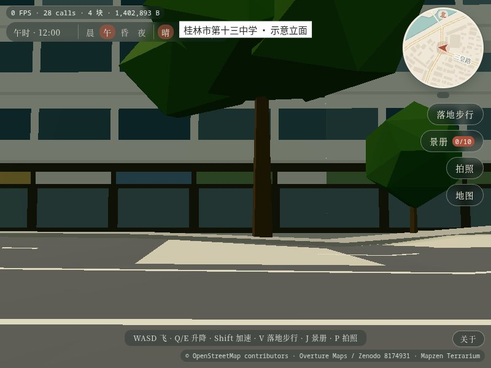
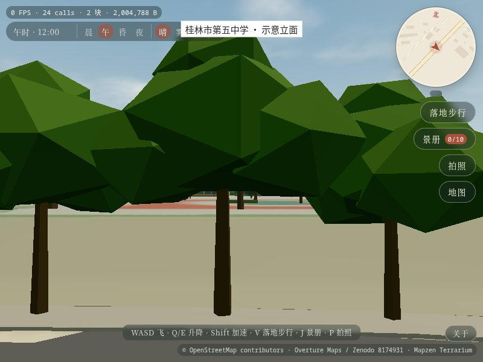
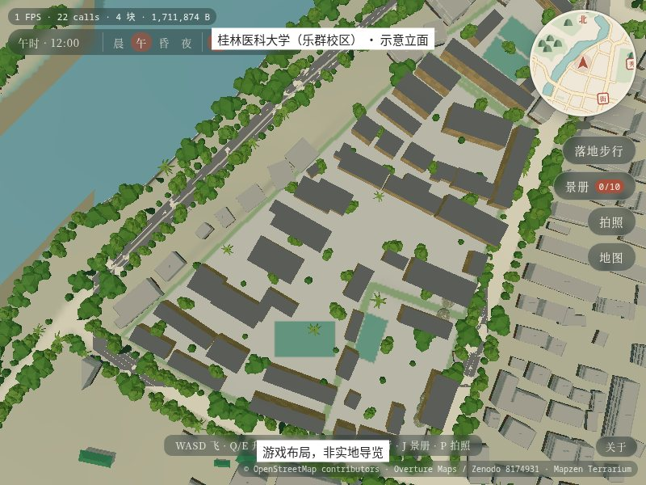
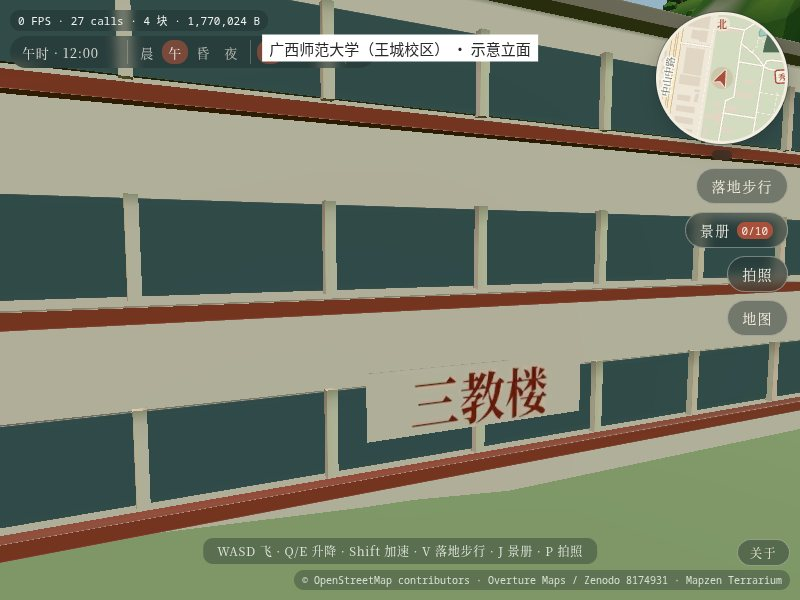
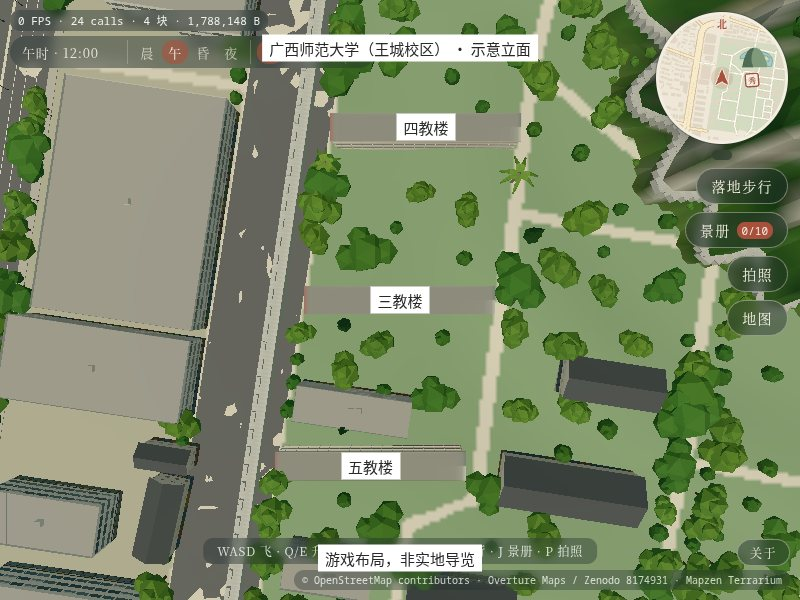
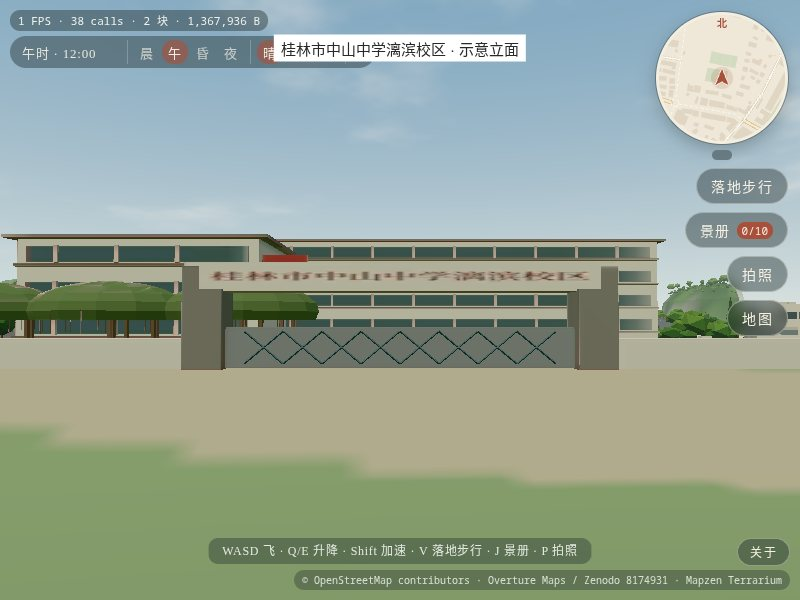
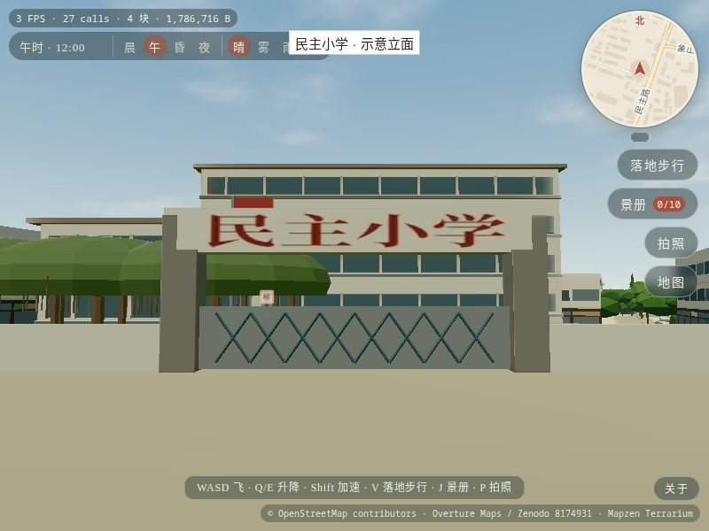
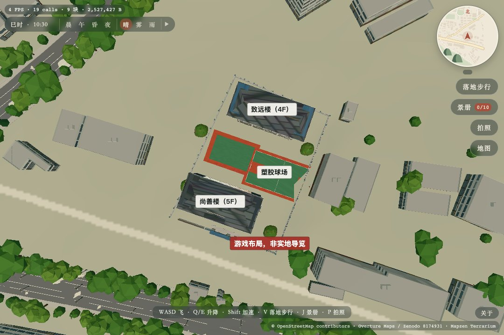
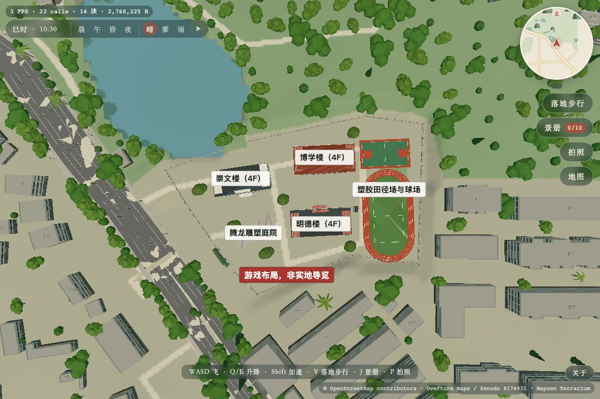

# 桂林学校地标

## 资料与分类

G1 共 11 项：解西与奎光的临街外观依据实拍，7 所使用示意立面，2 个待核点不建模。示意场景不是校舍现状的测绘。搜索以公共街道为游戏落点，不标实地出入口。

| 条目 | 已能确认 | 仍缺什么 |
| --- | --- | --- |
| 桂林市第五中学 | 《桂林日报》2024-07-08 教育版的配图明确题为「桂林市第五中学鸟瞰图」。原文和图片分别登记在 `guilin_fifth` 的 `page` 和 `thumb`。 | 该图不作为街面细节依据。同版教师团队照片不计入建筑参考。 |
| 宝贤中学 | 任务与 OSM 使用「宝贤中学」；本轮未核实门额实拍。 | 不把其他带「宝贤」简称的学校照片当作本校资料，核清校名与时期再绘门额。 |
| 桂林小学、凌风高中 | 本组指定的是两个 OSM 点，不是校园轮廓。 | 尚无可交叉核对的本地校方资料；不借用其他城市同名学校照片，不据点位推算范围。 |
| 桂林医科大学乐群校区 | [校方 90 周年校庆作品征集通知](https://www.glmu.edu.cn/xqw/info/1016/1284.htm) 在投稿说明中列出乐群校区。 | 通知不是校舍现状图。校庆资料须核对拍摄年代和校区，不能用临桂或东城照片替代。 |

## 桂林中学解西校区

**游戏布局，非实地导览。** 解放西路的主校门、白色两翼、绿色琉璃檐口及奎光楼沿用 C 组模型，依据 `pipeline/landmark-refs.json` 的 `guilin_middle` 条目（2019 年《桂林中学解西校区校门》《桂林奎光楼正面》《桂林奎光楼侧面》）。校门加上关闭的伸缩门，地图搜索的落点在解放西路一侧。

Rock 第八批 `IMG_1373–1375` 校正临街门楼：平白门楣和红字下悬灯笼，绿琉璃檐口留在两翼，石狮落在门前地面。街面有斑马线、信号灯和装饰性黄黑栏杆。门下粉色格子吊顶仅表现街上可见的底面；没有生成内侧闸机、安检设施或通道。

保留底图校舍；地标不再生成教学楼或跑道。运动场仅使用 OSM 已有面。

地标包：`guilin_middle.glb`。校园分块建筑另计。

## 桂林市奎光学校

**游戏布局，非实地导览。** Rock 的 `IMG_1295` 是临街立面的依据：校名位于住宅楼底层而非独立门楼；两侧为蓝卷帘商铺，白底红字横额下挂双灯笼。底层格栅做成封闭立面，街面绘黄色网格，黄黑色作为装饰色，不复刻挡车设施布局。校名为程序绘字，未使用实拍贴图。

不使用门洞内部照片，也不根据宣传照推测教学楼和球场的位置。保留底图校舍及 OSM 运动场。

地标包：`kuiguang_school.glb`。校园分块建筑另计。

## 桂林市第十三中学

底图缺楼处留空，不再补建。

补查词：「桂林市第十三中学 校园文化」。本次网页检索未取得可核验校名的临街配图，新增可用 0 张。

`facade: "schematic"`。未确认临街图片；不从同名的外地十三中移用校舍外观。保留世界分块建筑，并补充未匹配的公开轮廓；OSM 校园地址为四会路，仅在该街一侧放围墙名牌，不建门。

地标包：`guilin_thirteen.glb`。校园分块建筑另计。

 

## 乐群小学

补查词：「乐群小学 校园 桂林」。本次网页检索未取得能确认本校的临街配图，新增可用 0 张。

`facade: "schematic"`。未取得可核实的现状街面图；不使用医科大学乐群校区资料代替。保留世界分块建筑，并补充未匹配的公开轮廓；OSM 校园面没有街道地址，不放校门或名牌。

地标包：`lequn_primary.glb`。校园分块建筑另计。

 

## 宝贤中学

补查词：「桂林 宝贤中学 校园风采」。本次网页检索未取得可核对校名与拍摄时期的临街配图，新增可用 0 张。

`facade: "schematic"`。沿用任务的学校名称；不以简称推断校名题字、校色或楼名。保留世界分块建筑，并补充未匹配的公开轮廓；OSM 校园地址为中山北路，仅在该街一侧放围墙名牌，不建门。

地标包：`baoxian_school.glb`。校园分块建筑另计。

 

## 桂林市中华小学

底图缺楼处留空，不再补建。

补查词：「中华小学 校园风采 桂林市 教育 新闻」。本次网页检索未取得可核对校名的临街配图，新增可用 0 张。

`facade: "schematic"`。11 月 OSM 含校园面；不把旧交接底图中的学校点当作一栋教学楼。保留世界分块建筑，并补充未匹配的公开轮廓；OSM 校园面没有街道地址，不放校门或名牌。

地标包：`zhonghua_primary.glb`。校园分块建筑另计。

 

## 桂林市第五中学

补查词：「桂林日报 桂林市第五中学 鸟瞰图 2024」。已登记 1 张有图注的报道配图；它不是临街视角，不能据此绘制门额。

`facade: "schematic"`。日报鸟瞰图用于校区身份和整体量感，不是校门或楼层数的证据。保留世界分块建筑，并补充未匹配的公开轮廓；OSM 校园面没有街道地址，不放校门或名牌。

地标包：`guilin_fifth.glb`。校园分块建筑另计。

 

## 桂林医科大学（乐群校区）

**待 Rock 补拍**：乐群校区校门正面、综合楼正面。本 PR 按示意交付，不计入实拍验收；取得现状照片后另开 issue。

此校未录得公开 `pitch/track` 面；场地按可容纳的空地生成，仅作游戏用途。尚缺能确认是乐群综合楼的现状外观照，不能用历史校门照代替三张教学楼对比。

补查词：「乐群校区 校园风光 校庆 site:glmu.edu.cn」。已有官网校庆通知（见上表）；本轮未确认新的临街立面照，可用于门额的照片 0 张。

| 检索词 | 来源与核对结果 |
| --- | --- |
| 乐群校区 校园环境 老照片 | 官网《历史回眸——校园环境》（`glmu.edu.cn/info/1356/48224.htm`）有 1 张明确标为升本后乐群校门的历史图；不能当作现状。 |
| 乐群校区 综合楼 校园风光 | 官网《校园风光》（`glmu.edu.cn/info/1355/48219.htm`）；页脚同时列三校区，不能以页脚代替图片图注。 |
| 乐群校区 老洋房 | 《桂林日报》2024-01-11《老洋房的前世今生》配图明确为本校历史建筑，不是综合楼。 |
| 桂林医学院 乐群校区 历史沿革 | 官网 `glmu.edu.cn/gygk/lsyg.htm` 能核对迁校年代，不是现状立面证据。 |
| 乐群校区 校庆 作品征集 | 校方 90 周年专题的通知能核校区名，不能核现状门额。 |

`facade: "schematic"`。校方校庆通知核实校区名称，不提供乐群临街建筑现状；未借用临桂、东城校区照片。保留世界分块建筑，并补充未匹配的公开轮廓；校名牌为游戏示意，不据此判定实际楼名。

地标 GLB：近景 1,608、中景 154 三角形；两级分别 1/1 个可见绘制批次。GLB 71,816 B，内嵌贴图 19,036 B。校园分块建筑另计。

 

## 广西师范大学（王城校区）

**待 Rock 补拍**：王城校区校门正面，以及三教、四教、五教各自的正面。本 PR 按示意交付，不计入实拍验收；取得现状照片后另开 issue。

补查词：「广西师范大学 王城校区 校园风光 site:gxnu.edu.cn 教学楼」。查校方基建处王城校区栏目，未取得可核对三教楼名牌的原图；新增可用 0 张。「三教楼」为游戏楼名牌，不作实拍认定。

校方基建处 `jjc.gxnu.edu.cn/wcxq/list.psp` 的图集题名为国学堂、雕塑等；新闻网 `news.gxnu.edu.cn/2022/1011/c1337a248549/pagem.htm` 区分了三校区风光，但王城照片未标具体教学楼。这两处均不计作三教、四教、五教的同机位对比。

`facade: "schematic"`。仅补三教、四教、五教的简化教学体量；保留城墙、承运门和独秀峰，不另造城门、运动场。游戏楼层为 3、3、3 层，是示意值，不作现状断言。楼块位于公开建筑轮廓，未按照片推测校内联系。

地标 GLB：近景 4,178、中景 506 三角形；两级分别 1/1 个可见绘制批次。GLB 93,884 B，内嵌贴图 16,431 B。

 

## 待核（仅搜索）

核对 2026 年 11 月 OSM 和交接的 Overture 建筑面：桂林小学点不在具名校园面或建筑面内；凌风高中点不在具名校园面内，只落在一块没有名称、类型或用途的建筑面。未找到能把校名和该地块对应的校方资料，不判定迁址或停办。两项均保留带「待核」的校名搜索，不替换街区建筑。

## G2a 学校

三所游戏模型均在原创院落内铺设硬地和草带，沿该院落设置连续低墙和关闭的原创校门；围墙不是实地校园边界的复刻，铺地也不代表整块 OSM 用地的地表。

## 桂林市中山中学漓滨校区

据中文维基百科「桂林市中山中学」（OSM `way/675588260` 的 `wikipedia` 标签），学校又名桂林市第九中学。游戏将「桂林市第九中学」「桂林九中」「九中」归入同一个搜索结果，不为 `node/9214622462` 另设地标。落点取漓滨路上的游戏坐标，不是实地校门定位。

简章全景用于核对建筑群和场地外观：游戏中五栋四至五层的红砖色与浅色教学楼错落排开。楼间位置和校门均为原创，OSM 仅用于地块。桂林市聋哑学校《党建共建手拉手，携手育人心连心》里的运动会在芦笛校区，不作为本校区依据。

拱跨数量、楼体进深与层高是游戏参数。LOD0 / LOD1：6,986 / 3,036 三角形，各 1 次可见 draw call；压缩 GLB 219,176 B。

[漓滨校区 2022 年高中招生简章](https://edu.guilinlife.com/index.php?s=/news/content/id/1111)明确提到运动场和篮球场。以下三幅取自同一简章，左栏链接指向发布方图片（不入库），右栏是游戏截图。比的是外观特征，不是同机位或平面位置。

| 实拍（点击原图） | 游戏 | 对照说明 |
|---|---|---|
| [校园运动场全景](http://img3.guilinlife.com/edu/News/image/202207/20220711143001_51255.png) |  | 实拍可见场地后方连续楼体；游戏以独立楼块表达，不复原围合关系。 |
| [校园建筑组图](http://img3.guilinlife.com/edu/News/image/202207/20220711143008_51363.png) |  | 对比连续开间、水平楼板。组图只计一次，不据此推断楼之间的通道。 |
| [场地活动照](http://img3.guilinlife.com/edu/News/image/202207/20220711143031_53289.png) |  | 对比红绿场面；跑道环、绿色条纹草皮及两侧蓝色硬地的整体形态取自第一行全景。 |

 

## 榕湖小学

按 OSM 的具名校园面替换程序楼，面内为原创游戏布局：教学楼甲三层、乙两层，色带、层数和篮球场均为暂定，非实拍认定。模型内铺硬地和草带，移除被替代的三个底图球场色块，保留邻近绿地。近 / 中景 2,952 / 634 三角形，各 1 个绘制批次；GLB 92,156 B。

**实拍对比待补（0 组）。** 检索桂林生活网教育频道、桂林日报、公开校友图文，分别以「榕湖小学 榕湖北路 老校区」「榕湖本部 教学楼」「榕湖小学 本部 操场」限定校区。不能由图注核实是榕湖北路本部、或只有集团名称的图片不计；不把其他校区的立面移植到这里。

 

## 民主小学

临街墙段参考下图中的红砖墩柱、嵌框公告栏及后方浅色楼体。按 OSM 的具名校园面替换程序楼，面内为原创游戏布局：教学楼甲四层、乙两层，层数和运动场待照片核实。近 / 中景 3,696 / 1,234 三角形，各 1 个绘制批次；GLB 105,156 B。

| 实拍（点击原图） | 游戏 | 对照说明 |
|---|---|---|
| [民主小学临街外观](https://static.gxrb.com.cn/image/uploadpic/20241006/b8999cb68166eb26f12c37e1016b5a80.jpg) |  | [广西新闻网 2024-10-06 报道](https://gxxwfb.gxnews.com.cn/staticpages/20241006/newgx6701f190-21638051.shtml)，图注署名游拥军并明确标为民主小学。对比砖墩、公告栏和浅色背景楼，不比较入口。 |
| [桂林日报 2024-10-05 第 1 版：民主小学操场](https://epaper.guilinlife.com/glrbpc/glrb/20241005/01.pdf) |  | 记者李凯拍摄，图注指明是民主小学。节日期间车辆遮住了部分场地，不能从这张照片认定完整标线及配色。 |

**可核实的实拍对比：2 组。** 广西新闻网同篇报道中的操场全景图是逸仙中学；桂林晚报 2024-07-08 第 6 版是民主小学室内班会，两者都不计入外观对比。

## 原创牌匾近景

以下均为压缩模型在游戏中的截图，没有叠加校名文字。

## 少年宫

仅名称点，地块待核，未建模。交接 OSM `node/2597936160`（纬度 25.27697，经度 110.28072）。搜索落在附近公共街道，保留原有程序楼。

## 回民小学

仅名称点，地块待核，未建模。交接 OSM `node/3170011400`（纬度 25.27202，经度 110.27889）。搜索落在附近公共街道，保留原有程序楼。

---

## M2.7-G3 漓江东七星学校指标汇总

| ID | 学校名称 | 轮廓与定位依据 | `viewOnly` 参考图 | LOD0 三角形 | LOD1 三角形 | 碰撞三角形 | Draw Calls | GLB 体积 | 嵌入 KTX2 | 道路碰撞重叠 | 最大楼体偏移 / 朝向差 |
|---|---|---|---:|---:|---:|---:|---:|---:|---:|---:|---:|
| `glmu_dongcheng` | 桂林医科大学（东城校区） | 13 栋 OSM + 4 栋 Overture + 6 处 OSM 球场 | 15 | 49,145 | 4,925 | 3,676 | 2 | 666.3 KB | 48.3 KB | 0.00 m² | 0.14 m / 0.02° |
| `glut_primary` | 桂林理工大学附属小学 | 3 栋 OSM + 1 栋 Overture + 2 处 OSM 球场 | 16 | 9,138 | 1,128 | 680 | 2 | 202.2 KB | 51.0 KB | 0.00 m² | 0.01 m / 0.03° |
| `tianjiabing` | 桂林市田家炳中学 | 14 栋 Overture + 2 栋卫星图描绘 + 卫星图描绘操场 | 17 | 23,589 | 2,483 | 1,788 | 2 | 388.8 KB | 46.8 KB | 0.00 m² | 0.01 m / 0.02° |
| `chenshan_primary` | 桂林市辰山小学 | 2 栋 OSM + 卫星图描绘斜向运动场 | 16 | 17,476 | 1,902 | 1,182 | 2 | 283.0 KB | 36.1 KB | 0.00 m² | 0.97 m / 0.30° |
| `lijiang_primary` | 漓江小学 | 2 栋卫星图描绘 + 卫星图描绘球场（底图无子楼） | 7 | 7,606 | 1,332 | 524 | 2 | 176.3 KB | 42.1 KB | 0.00 m² | 卫星图描绘 |
| `longyin_primary` | 龙隐小学 | 8 栋 OSM + 2 栋 Overture + 2 处 OSM 球场 | 15 | 15,388 | 1,776 | 1,120 | 2 | 259.1 KB | 29.1 KB | 0.00 m² | 0.01 m / 0.02° |

## 桂林医科大学（东城校区）

高校校区按实拍图与 OSM / Overture 全量建筑面核对还原（不建岗亭、门禁闸机、监控）。锚点取校园 `way/627526148` 形心 `(693.95, -1396.14)`，校园内部铺设浅灰硬地广场、主干步道、路缘绿化带与香樟树池，避让周边市政道路走廊压平至 `152.2 m`；地图搜索“桂林医科大学（东城校区）”及“弘德楼”等别名落点于环城北二路正门外公共街道 `(678, -1701)`。参考照片见 `pipeline/landmark-refs.json` 中 `glmu_dongcheng` 条目（15 张建筑外景 `viewOnly` 参考图）。

### 各建筑与场地底图对照清单（全覆盖校园内 13 栋 OSM 建筑 + 4 栋 Overture 建筑 + 6 处 OSM 球场）

| 建筑 / 场地 | 底图要素 ID | 层数与朝向 | 实拍依据（`glmu_dongcheng`） | 处理说明 |
|---|---|---|---|---|
| 环城北二路正门与照壁 | 北口接入 `way/370743375` | 门架高 5.4 m，朝东北向环城北二路 109 号 | 官网正门实拍、正门俯瞰图 | 左侧白色悬挑 V 形门架，右侧深红花岗岩“桂林医科大学”照壁与绿篱，敞开无安防设施 |
| 东城图书馆 | OSM `way/459580291` | 主体 6 层、中央门楼 7 层，内凹弧形柱廊朝西南向校内广场 | 官网图书馆外景 | 严格沿 `way/459580291` 轮廓挤出陶红弧翼、西南内凹白色通高柱廊、中央“图书馆 / LIBRARY”玻璃幕墙门楼与玻璃雨棚 |
| 弘德楼与“弘德善医”校训石 | OSM `way/671760495` | 7 层，西向中心广场 | 官网弘德善医校训石与弘德楼 | 沿 `way/671760495` 轮廓建模，西侧广场设圆形花坛与“弘德善医”景石 |
| 第二教学实验楼 | OSM `way/671790070` | 6 层，H 形合院轮廓 | 弘德楼与科教楼背景实拍 | 沿 `way/671790070` 完整多边形建浅米白配陶红饰带教学楼 |
| 科教楼合院与多功能报告厅 | OSM `way/672633239` + Overture `c584f92b` | 东/北翼 6 层、西翼 5 层 + 内院 2 层八角报告厅 | 官网科教楼与多功能报告厅 | 合并 OSM 与 Overture 西翼围合成完整科教楼院落，内院还原陶红八角报告厅 |
| 北区与西区学生公寓群（7 栋） | OSM `way/672633244`、`672633246`、`672633248`、`672633249`、`672633251`、`672633450`、`672633451` | 公寓 5–6 层、配楼 4 层，南北向阵列 | 官网运动场西侧背景及学生公寓北区外景 | 全部 7 栋 OSM 宿舍与教学配楼逐栋按原轮廓建模，楼间设绿化带与步道 |
| 标准田径运动场与水塔 | OSM `way/672634658` | 400 m 跑道南北向，平行条纹绿茵场，西北 27 m 水塔 | 官网标准田径运动场 | 沿 `way/672634658` 布置红跑道、平行修剪条纹足球场、西侧遮阳看台、三旗杆升旗台与白色高水塔 |
| 西北球场区与南区球场群 | OSM `way/671760725`、`671760840`、`671763132`、`672638634`、`672638635` | 篮球、排球、网球场共 8 片 | 卫星图与运动场周边实拍 | 通过 `replacePitches` 替换底图粗糙色块，按原位置铺设红绿/蓝绿标准球场 |
| 南区室内体育馆、博学实验楼及配楼 | OSM `way/672659167`、`672659168` + Overture `83eb4160`、`6eb6d7a6`、`93816175` | 体育馆银灰屋面高 16.4 m，实验楼 5 层，连廊与配楼 2–3 层 | 卫星图核对补齐 | 完整补齐校园南区全部 OSM 与 Overture 建筑体块，消除空地 |

## 桂林理工大学附属小学

**游戏布局，非实地导览。** 锚点取校园 `way/473969804` 形心 `(979.45, -385.83)`，压平高程 `154.1 m` 并铺装浅灰硬地、绿化带与树池；地图搜索“桂林理工大学附属小学”或“理工大附小”落点在建干路公共街道 `(933, -399)`。参考照片见 `pipeline/landmark-refs.json` 中 `glut_primary` 条目（16 张建筑外景 `viewOnly` 参考图）。

- **校门（OSM `node/4679984928`）**：位于西侧建干路真实门点 `(-30.6, -6.8)`，按实拍还原白色平顶大雨棚、白色宽檐口嵌灰色立体大字“桂林理工大学附属小学”、檐下黑底红字 LED 横屏、关闭状态不锈钢伸缩门（紧凑电机头 `0.38×0.52 m`）及左侧浅赭石材铭牌景墙；不建岗亭、闸机、监控与侧后门。
- **建筑与运动场（OSM + Overture 全量轮廓）**：北侧 4 层暖米黄回字形主教学楼崇德楼按 Overture `253e76b1` 原轮廓建模（首层南向设白色柱廊）；南侧 3 层求是楼按 OSM `way/473969842`、西南 2 层配楼按 OSM `way/473969841`、西北 1 层用房按 OSM `way/692355779` 精确挤出；中部按 OSM `way/692355777`、`way/692355778` 位置还原红色塑胶运动区、平行条纹绿茵队列场、绿面篮球场与升旗台。

## 桂林市田家炳中学

**游戏布局，非实地导览。** 锚点取校园 `way/658142453` 形心 `(1076.26, -1041.03)`，避让屏风路与建干路走廊压平至 `155.0 m` 并满铺浅灰校园硬地、主干道、绿化带与树池；地图搜索“桂林市田家炳中学”或“桂林四中”落点在屏风路公共街道 `(1032, -965)`。参考照片见 `pipeline/landmark-refs.json` 中 `tianjiabing` 条目（17 张建筑外景 `viewOnly` 参考图）。

- **屏风路校门与临街主楼群**：按 OSM 主入口 `node/2642072481` 与街景实拍还原左侧红色弧形矮墙（金字“桂林市田家炳中学”与红旗杆墩座）、关闭状态不锈钢伸缩门及右侧红白竖条围墙；弧形红墙后沿 Overture `8bacc23a` 原轮廓还原 5 层白色田家炳主楼（正面弧形玻璃幕墙、楼顶波浪弧形挑檐与“田家炳中学”字牌），东侧按 **「卫星图描绘」** 补齐 Overture 漏绘的 4 层白色“桂林市第四中学”临街教学楼（蓝竖饰带与双层白色连廊）及中区 5 层教学楼。
- **校内建筑与场地**：西侧按 Overture `425575f2` 轮廓还原红坡顶艺体馆，其余 12 栋 Overture 教学与实验楼（`b9a88ac4`、`bada84f5`、`b0a360ec`、`c35d545f`、`db6316de` 等）逐栋按原轮廓挤出；最西侧按 **「卫星图描绘」** 还原南北向红色塑胶跑道与平行条纹绿茵足球场，中部还原四片红边绿面篮球/羽毛球场与升旗台。

## 桂林市辰山小学

**游戏布局，非实地导览。** 锚点取校园 `way/671777304` 形心 `(1131.63, -2354.08)`，压平至 `153.1 m` 并铺设浅灰硬地、绿化带与树池；地图搜索“桂林市辰山小学”或“辰山小学”落点在西北校门外公共街道 `(1110, -2413)`。参考照片见 `pipeline/landmark-refs.json` 中 `chenshan_primary` 条目（16 张建筑外景 `viewOnly` 参考图）。

- **西北临街校门**：严格按实拍做成暖黄墙面门柱、右侧门柱挂竖向拉丝不锈钢“东城教育集团 / 桂林市辰山小学”校牌、门洞设关闭状态暗红色铁栅双开门（不加横梁拱门，不建岗亭、闸机、监控与侧后门）。
- **建筑与运动场**：南半部多翼教学楼沿 OSM `way/1475475421` 精确轮廓挤出（中央脊线还原 5 层陶红砖坡屋顶厚德主楼，各翼为 4 层白墙教学楼），东北角 2 层配楼沿 OSM `way/1475475422` 轮廓建模（东北角微收 0.8 m 避让街巷路缘）；东北部运动场按 **「卫星图描绘」** 沿东北—西南向布置红色塑胶跑道及内场并排两片红边绿面篮球场。

## 漓江小学

**游戏布局，非实地导览。** 锚点取 2026-11 OSM 校园面 `way/1563350367` 形心 `(1125.48, 56.46)`，压平至 `152.5 m` 并满铺浅灰校园硬地与树池；地图搜索“漓江小学”或“七星区漓江小学”落点在南门外连接芳香路的公共街巷 `(1111, 102)`。参考照片见 `pipeline/landmark-refs.json` 中 `lijiang_primary` 条目（7 张可核实本校建筑外景的 `viewOnly` 参考图）。

- **临街校门与 5 层坡顶主楼（「卫星图描绘」）**：因 OSM / Overture 在 `way/1563350367` 内暂无子建筑面，依据公开卫星图描绘南北两栋楼体与中东部球场位置。南侧临街 5 层尚善主楼按实拍还原米白墙面、首层陶红砖基、四坡灰瓦挑檐屋顶（屋脊设红色“漓江小学”大字）、中轴及两端通高蓝色反光玻璃幕墙楼梯间；沿街门线左段设蓝白文化围墙、中部设竖排校名米黄石柱与关闭状态伸缩门、右段设白色平顶门头并悬挂黑底红字 LED 欢迎屏（不建岗亭、闸机、监控与侧后门）。
- **北楼与塑胶球场（「卫星图描绘」）**：北侧按卫星图位置布置 4 层白墙蓝饰带坡顶致远楼，中东部还原红塑胶铺装环绕的双绿红丙烯酸球场与升旗台。

## 龙隐小学

**游戏布局，非实地导览。** 锚点取校园 `way/1027048356` 形心 `(905.52, 1052.41)`，避让七星路主干道走廊压平至 `153.2 m` 并满铺浅灰硬地、林荫广场、绿化带与树池；地图搜索“龙隐小学”或“桂林市龙隐小学”落点在七星路公共街道 `(835, 1106)`。参考照片见 `pipeline/landmark-refs.json` 中 `longyin_primary` 条目（15 张建筑外景 `viewOnly` 参考图）。

- **七星路 5 号临街校门**：位于校园西端接入七星路的真实入口凸出部 `(-93.5, -4.5)`，按实拍还原米黄面砖门柱、柱身竖排金色“桂林市龙隐小学”大字、高低错落双层绿琉璃瓦坡檐、主车行道关闭状态不锈钢伸缩门及敞开人行副门洞（无岗亭/闸机/监控，并通过 `replacePolygons` 清除路侧一处重叠 Overture 碎块）。
- **全量建筑与运动场**：入口林荫庭院还原拉丝不锈钢腾龙雕塑；校内 8 栋 OSM 建筑（`way/1488495381`–`1488495388`：含西北 4 层暖黄崇文楼、西中 3 层浅粉白楼、东侧 4 层陶红坡顶博学楼与 L 形明德楼等）及 2 栋 Overture 北侧配楼（`b3f90c74`、`cb0f874f`）全部按原轮廓精确挤出；东侧沿 OSM `way/1474986237` 与 `way/1474986236` 还原四道红塑胶跑道、平行条纹人工草坪小足球场与北侧红边绿面篮球场。

## G4 穿山、塔山：两校临街建模，四校仅搜索

下表只登记可核对校区的来源，不代表已完成实拍对比。原图不作为游戏贴图；照片页见 `pipeline/landmark-refs.json`。

| 学校 | 已核对的照片及缺口 |
|---|---|
| 旅游职业中专 | Commons 2024-02-17 照片标题明确写 **Chuanshan campus（穿山校区）**；不是清风校区。缺其余临街角度。 |
| 穿山小学 | 查过 Rock 定位照片及「桂林市穿山小学 校门」公开图片线索，未确认临街角度。仅搜索，待 Rock 补拍。 |
| 穿山中学 | 查过 Rock 定位照片及「桂林市穿山中学 校园风光」公开图片线索，未确认临街角度。仅搜索，待 Rock 补拍。 |
| 塔山小学 | 查过 Rock 定位照片及「桂林市塔山小学 校门」公开图片线索，未确认临街角度。仅搜索，待 Rock 补拍。 |
| 英才教育集团樟木小学 | 查过 Rock 定位照片及「桂林 樟木小学 七星」公开图片线索，未确认临街角度。仅搜索，待 Rock 补拍。 |
| 桂林技师学院 | 学院官网「校园风光 → 学院正门」，页脚校址为五里店路。缺临街楼和街景角度。 |

仓库中 Rock 的 126 张定位照片距上述学校范围最近仍超过 2 km，未用作校门对比。不要把学校面中心当作校门。

旅游职中按穿山东路实拍制作白色悬挑门廊、左侧帆形墙与竖匾、浅青绿临街墙、灯笼及右侧屏。技师学院按官网照片制作浅灰左墙嵌铭牌、黑石金字碑和右弧墙。蓝白七层楼面及白墙青绿窗框均是附在现有程序楼面上的薄层，不替换轮廓。关闭的伸缩门、门柱和墙有独立碰撞网格；不建值班室内部或校内通行路线。

技师学院官网正门照看向校内，主楼蓝色中轴在门洞之后，但没有 GPS、指南针方位，也看不到拍摄者身后的对街地标。以官网五里店路地址为起点，选路南侧校界上对向现有七层体量的点；视线由街道朝南，底图道路中心线距此约 10.5 m，属于取景尺度参考，**不是实测路宽**。原始道路没有宽度标签，不能靠路宽或对面楼房反推出唯一门址，故沿街位置仍标「估计，待 Rock 补拍」。

| 门面 | 近景 / 中景三角形 | 每级 draw call | GLB 字节 |
|---|---:|---:|---:|
| 旅游职中（穿山） | 2,808 / 1,432 | 1 | 144,032 |
| 桂林技师学院 | 1,306 / 578 | 1 | 125,552 |

以上为最终压缩 GLB 的索引数 / 3 与 primitive 数。实拍只看不入库；游戏侧截图可用 `CHROMIUM=/usr/bin/chromium node scripts/g4-frontages.mjs` 重拍。

**程序楼回归**：在未加街侧资产的基线执行 `uv run python pipeline/check_g4_frontages.py --record raw/g4-before.json`，在相同原始数据和依赖下加资产后执行 `uv run python pipeline/check_g4_frontages.py --compare raw/g4-before.json`。它对实际生成的轮廓（校园及邻街 20 m 内，与世界范围相交的部分）计数并计算与遍历顺序无关的几何摘要；不输出逐栋坐标。
