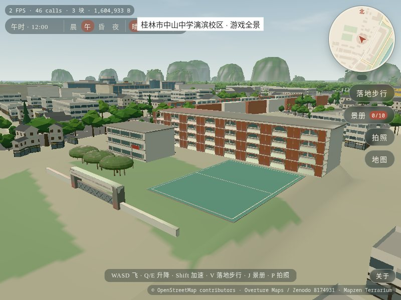

# 桂林学校地标

## 桂林市中山中学漓滨校区

据中文维基百科「桂林市中山中学」（OSM `way/675588260` 的 `wikipedia` 标签），学校又名桂林市第九中学。游戏将「桂林市第九中学」「桂林九中」「九中」归入同一个搜索结果，不为 `node/9214622462` 另设地标。落点取漓滨路上的游戏坐标，不是实地校门定位。

**示意样件，未通过实拍对比验收。** OSM 仅用于校园地块，地块内是原创布局：游戏教学楼甲四层、乙三层，窗带、配色和运动场是示意设计，不是对现状的认定。检索时发现桂林市聋哑学校《党建共建手拉手，携手育人心连心》明示运动会在芦笛校区，故不采用其中的操场照片代表漓滨校区。

模型采用红棕色拱廊和浅色楼板；拱跨数量、楼体进深与层高是游戏参数。LOD0 / LOD1：5,784 / 2,194 三角形，各 1 次可见 draw call。压缩 GLB 146,624 B（含贴图 33,970 B）。

[漓滨校区 2022 年高中招生简章](https://edu.guilinlife.com/index.php?s=/news/content/id/1111)明确提到运动场和篮球场。以下三幅取自同一简章，左栏链接指向发布方图片（不入库），右栏是游戏截图。比的是外观特征，不是同机位或平面位置。

| 实拍（点击原图） | 游戏 | 对照说明 |
|---|---|---|
| [校园运动场全景](http://img3.guilinlife.com/edu/News/image/202207/20220711143001_51255.png) |  | 实拍可见场地后方连续楼体；游戏以独立楼块表达，不复原围合关系。 |
| [校园建筑组图](http://img3.guilinlife.com/edu/News/image/202207/20220711143008_51363.png) |  | 对比连续开间、水平楼板。组图只计一次，不据此推断楼之间的通道。 |
| [场地活动照](http://img3.guilinlife.com/edu/News/image/202207/20220711143031_53289.png) |  | 仅比较活动背景中的红、绿场面；模型简化为有白色线标的绿色球场，没有还原跑道。 |

 

## 榕湖小学

按 OSM 的具名校园面替换程序楼，面内为原创游戏布局：教学楼甲三层、乙两层，色带、层数和篮球场均为暂定，非实拍认定。近 / 中景 2,832 / 514 三角形，各 1 个绘制批次；GLB 96,072 B，内嵌贴图 39,326 B。

**可核实的实拍对比：0 组。** 检索桂林生活网教育频道、桂林日报、公开校友图文，分别以「榕湖小学 榕湖北路 老校区」「榕湖本部 教学楼」「榕湖小学 本部 操场」限定校区。不能由图注核实是榕湖北路本部、或只有集团名称的图片不计；不把其他校区的立面移植到这里。

 

## 民主小学

按 OSM 的具名校园面替换程序楼，面内为原创游戏布局：教学楼甲四层、乙两层，冷灰色带和场地是示意值。近 / 中景 3,024 / 562 三角形，各 1 个绘制批次；GLB 90,400 B，内嵌贴图 31,188 B。

| 实拍（点击原图） | 游戏 | 对照说明 |
|---|---|---|
| [民主小学临街外观](https://static.gxrb.com.cn/image/uploadpic/20241006/b8999cb68166eb26f12c37e1016b5a80.jpg) |  | [广西新闻网 2024-10-06 报道](https://gxxwfb.gxnews.com.cn/staticpages/20241006/newgx6701f190-21638051.shtml)，图注署名游拥军并明确标为民主小学。只作整体临街尺度对照，原创校名牌不比对入口。 |

**可核实的实拍对比：1 组。** 补查桂林生活网教育频道、广西新闻网、桂林日报的「桂林 民主小学 教学楼」「象山区 民主小学 操场」；上述报道中的操场全景图图注明确是逸仙中学，未挪用为民主小学依据。

## 少年宫

仅名称点，地块待核，未建模。交接 OSM `node/2597936160`（纬度 25.27697，经度 110.28072）。搜索落在附近公共街道，保留原有程序楼。

## 回民小学

仅名称点，地块待核，未建模。交接 OSM `node/3170011400`（纬度 25.27202，经度 110.27889）。搜索落在附近公共街道，保留原有程序楼。
