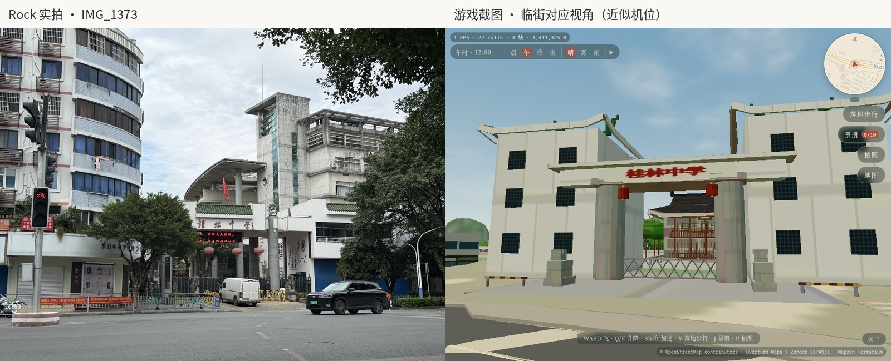
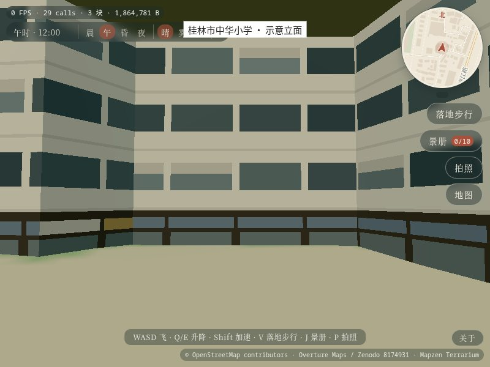
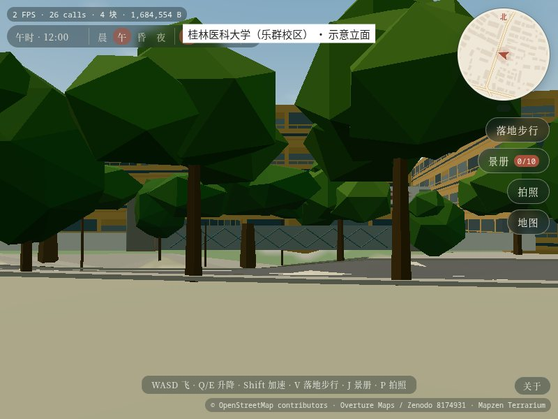
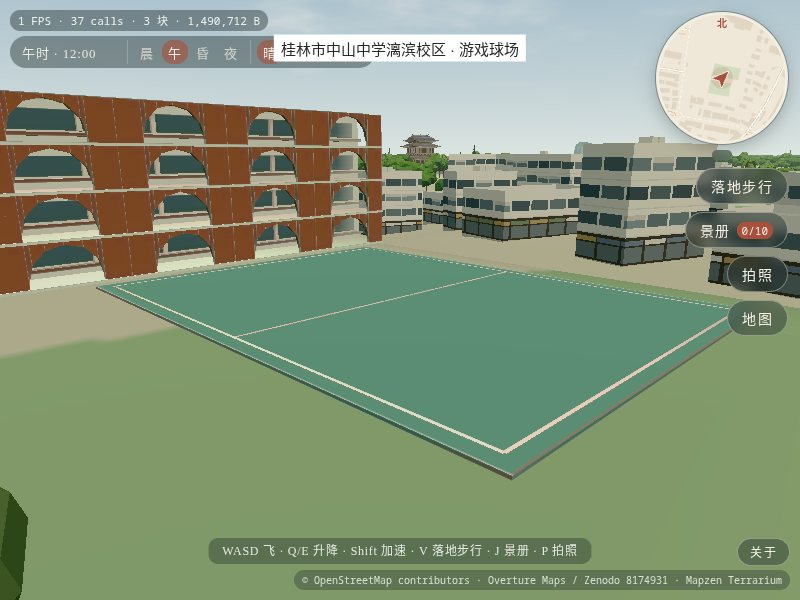
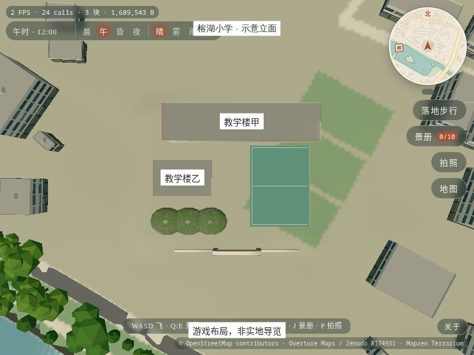
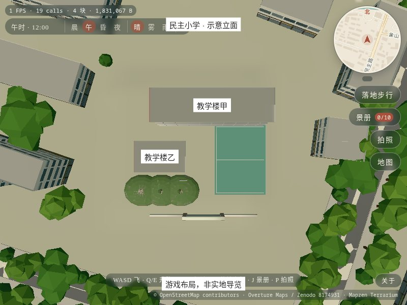

# 桂林学校地标

## 资料与分类

G1 共 11 项：解西与奎光的临街外观依据实拍，7 所使用示意立面，2 个待核点不建模。示意场景不是校舍现状的测绘。搜索以公共街道为游戏落点，不标实地出入口。

| 条目 | 已能确认 | 仍缺什么 |
| --- | --- | --- |
| 桂林市第五中学 | 《桂林日报》2024-07-08 教育版的配图明确题为「桂林市第五中学鸟瞰图」。原文和图片分别登记在 `guilin_fifth` 的 `page` 和 `thumb`。 | 该图不作为街面细节依据。同版教师团队照片不计入建筑参考。 |
| 宝贤中学 | 任务与 OSM 使用「宝贤中学」；本轮未核实门额实拍。 | 不把其他带「宝贤」简称的学校照片当作本校资料，核清校名与时期再绘门额。 |
| 桂林小学、凌风高中 | 本组指定的是两个 OSM 点，不是校园轮廓。 | 尚无可交叉核对的本地校方资料；不借用其他城市同名学校照片，不据点位推算范围。 |
| 桂林医科大学乐群校区 | [校方 90 周年校庆作品征集通知](https://www.glmu.edu.cn/xqw/info/1016/1284.htm) 在投稿说明中列出乐群校区。 | 通知不是校舍现状图。校庆资料须核对拍摄年代和校区，不能用临桂或东城照片替代。 |

## 桂林中学解西校区

**游戏布局，非实地导览。** 解放西路的主校门、白色两翼、绿色琉璃檐口及奎光楼沿用 C 组模型，依据 `pipeline/landmark-refs.json` 的 `guilin_middle` 条目（2019 年《桂林中学解西校区校门》《桂林奎光楼正面》《桂林奎光楼侧面》）。校门加上关闭的伸缩门，地图搜索的落点在解放西路一侧。

Rock 第八批 `IMG_1373–1375` 校正临街门楼：平白门楣和红字下悬灯笼，绿琉璃檐口留在两翼，石狮落在门前地面。街面有斑马线、信号灯和装饰性黄黑栏杆。门下粉色格子吊顶仅表现街上可见的底面；没有生成内侧闸机、安检设施或通道。

保留底图校舍；地标不再生成教学楼或跑道。运动场仅使用 OSM 已有面。

地标包：`guilin_middle.glb`。校园分块建筑另计。

## 桂林市奎光学校

**游戏布局，非实地导览。** Rock 的 `IMG_1295` 是临街立面的依据：校名位于住宅楼底层而非独立门楼；两侧为蓝卷帘商铺，白底红字横额下挂双灯笼。底层格栅做成封闭立面，街面绘黄色网格，黄黑色作为装饰色，不复刻挡车设施布局。校名为程序绘字，未使用实拍贴图。

不使用门洞内部照片，也不根据宣传照推测教学楼和球场的位置。保留底图校舍及 OSM 运动场。

地标包：`kuiguang_school.glb`。校园分块建筑另计。

## 桂林市第十三中学

底图缺楼处留空，不再补建。

补查词：「桂林市第十三中学 校园文化」。本次网页检索未取得可核验校名的临街配图，新增可用 0 张。

`facade: "schematic"`。未确认临街图片；不从同名的外地十三中移用校舍外观。保留世界分块建筑，并补充未匹配的公开轮廓；OSM 校园地址为四会路，仅在该街一侧放围墙名牌，不建门。

地标包：`guilin_thirteen.glb`。校园分块建筑另计。

 

## 乐群小学

补查词：「乐群小学 校园 桂林」。本次网页检索未取得能确认本校的临街配图，新增可用 0 张。

`facade: "schematic"`。未取得可核实的现状街面图；不使用医科大学乐群校区资料代替。保留世界分块建筑，并补充未匹配的公开轮廓；OSM 校园面没有街道地址，不放校门或名牌。

地标包：`lequn_primary.glb`。校园分块建筑另计。

 

## 宝贤中学

补查词：「桂林 宝贤中学 校园风采」。本次网页检索未取得可核对校名与拍摄时期的临街配图，新增可用 0 张。

`facade: "schematic"`。沿用任务的学校名称；不以简称推断校名题字、校色或楼名。保留世界分块建筑，并补充未匹配的公开轮廓；OSM 校园地址为中山北路，仅在该街一侧放围墙名牌，不建门。

地标包：`baoxian_school.glb`。校园分块建筑另计。

 

## 桂林市中华小学

底图缺楼处留空，不再补建。

补查词：「中华小学 校园风采 桂林市 教育 新闻」。本次网页检索未取得可核对校名的临街配图，新增可用 0 张。

`facade: "schematic"`。11 月 OSM 含校园面；不把旧交接底图中的学校点当作一栋教学楼。保留世界分块建筑，并补充未匹配的公开轮廓；OSM 校园面没有街道地址，不放校门或名牌。

地标包：`zhonghua_primary.glb`。校园分块建筑另计。

 

## 桂林市第五中学

补查词：「桂林日报 桂林市第五中学 鸟瞰图 2024」。已登记 1 张有图注的报道配图；它不是临街视角，不能据此绘制门额。

`facade: "schematic"`。日报鸟瞰图用于校区身份和整体量感，不是校门或楼层数的证据。保留世界分块建筑，并补充未匹配的公开轮廓；OSM 校园面没有街道地址，不放校门或名牌。

地标包：`guilin_fifth.glb`。校园分块建筑另计。

 

## 桂林医科大学（乐群校区）

**待 Rock 补拍**：乐群校区校门正面、综合楼正面。本 PR 按示意交付，不计入实拍验收；取得现状照片后另开 issue。

此校未录得公开 `pitch/track` 面；场地按可容纳的空地生成，仅作游戏用途。尚缺能确认是乐群综合楼的现状外观照，不能用历史校门照代替三张教学楼对比。

补查词：「乐群校区 校园风光 校庆 site:glmu.edu.cn」。已有官网校庆通知（见上表）；本轮未确认新的临街立面照，可用于门额的照片 0 张。

| 检索词 | 来源与核对结果 |
| --- | --- |
| 乐群校区 校园环境 老照片 | 官网《历史回眸——校园环境》（`glmu.edu.cn/info/1356/48224.htm`）有 1 张明确标为升本后乐群校门的历史图；不能当作现状。 |
| 乐群校区 综合楼 校园风光 | 官网《校园风光》（`glmu.edu.cn/info/1355/48219.htm`）；页脚同时列三校区，不能以页脚代替图片图注。 |
| 乐群校区 老洋房 | 《桂林日报》2024-01-11《老洋房的前世今生》配图明确为本校历史建筑，不是综合楼。 |
| 桂林医学院 乐群校区 历史沿革 | 官网 `glmu.edu.cn/gygk/lsyg.htm` 能核对迁校年代，不是现状立面证据。 |
| 乐群校区 校庆 作品征集 | 校方 90 周年专题的通知能核校区名，不能核现状门额。 |

`facade: "schematic"`。校方校庆通知核实校区名称，不提供乐群临街建筑现状；未借用临桂、东城校区照片。保留世界分块建筑，并补充未匹配的公开轮廓；校名牌为游戏示意，不据此判定实际楼名。

地标 GLB：近景 1,608、中景 154 三角形；两级分别 1/1 个可见绘制批次。GLB 71,816 B，内嵌贴图 19,036 B。校园分块建筑另计。

 

## 广西师范大学（王城校区）

**待 Rock 补拍**：王城校区校门正面，以及三教、四教、五教各自的正面。本 PR 按示意交付，不计入实拍验收；取得现状照片后另开 issue。

补查词：「广西师范大学 王城校区 校园风光 site:gxnu.edu.cn 教学楼」。查校方基建处王城校区栏目，未取得可核对三教楼名牌的原图；新增可用 0 张。「三教楼」为游戏楼名牌，不作实拍认定。

校方基建处 `jjc.gxnu.edu.cn/wcxq/list.psp` 的图集题名为国学堂、雕塑等；新闻网 `news.gxnu.edu.cn/2022/1011/c1337a248549/pagem.htm` 区分了三校区风光，但王城照片未标具体教学楼。这两处均不计作三教、四教、五教的同机位对比。

`facade: "schematic"`。仅补三教、四教、五教的简化教学体量；保留城墙、承运门和独秀峰，不另造城门、运动场。游戏楼层为 3、3、3 层，是示意值，不作现状断言。楼块位于公开建筑轮廓，未按照片推测校内联系。

地标 GLB：近景 4,178、中景 506 三角形；两级分别 1/1 个可见绘制批次。GLB 93,884 B，内嵌贴图 16,431 B。

 

## 待核（仅搜索）

核对 2026 年 11 月 OSM 和交接的 Overture 建筑面：桂林小学点不在具名校园面或建筑面内；凌风高中点不在具名校园面内，只落在一块没有名称、类型或用途的建筑面。未找到能把校名和该地块对应的校方资料，不判定迁址或停办。两项均保留带「待核」的校名搜索，不替换街区建筑。

## G2a 学校

三所游戏模型均在原创院落内铺设硬地和草带，沿该院落设置连续低墙和关闭的原创校门；围墙不是实地校园边界的复刻，铺地也不代表整块 OSM 用地的地表。

## 桂林市中山中学漓滨校区

据中文维基百科「桂林市中山中学」（OSM `way/675588260` 的 `wikipedia` 标签），学校又名桂林市第九中学。游戏将「桂林市第九中学」「桂林九中」「九中」归入同一个搜索结果，不为 `node/9214622462` 另设地标。落点取漓滨路上的游戏坐标，不是实地校门定位。

简章全景用于核对建筑群和场地外观：游戏中五栋四至五层的红砖色与浅色教学楼错落排开。楼间位置和校门均为原创，OSM 仅用于地块。桂林市聋哑学校《党建共建手拉手，携手育人心连心》里的运动会在芦笛校区，不作为本校区依据。

拱跨数量、楼体进深与层高是游戏参数。LOD0 / LOD1：6,986 / 3,036 三角形，各 1 次可见 draw call；压缩 GLB 219,176 B。

[漓滨校区 2022 年高中招生简章](https://edu.guilinlife.com/index.php?s=/news/content/id/1111)明确提到运动场和篮球场。以下三幅取自同一简章，左栏链接指向发布方图片（不入库），右栏是游戏截图。比的是外观特征，不是同机位或平面位置。

| 实拍（点击原图） | 游戏 | 对照说明 |
|---|---|---|
| [校园运动场全景](http://img3.guilinlife.com/edu/News/image/202207/20220711143001_51255.png) |  | 实拍可见场地后方连续楼体；游戏以独立楼块表达，不复原围合关系。 |
| [校园建筑组图](http://img3.guilinlife.com/edu/News/image/202207/20220711143008_51363.png) |  | 对比连续开间、水平楼板。组图只计一次，不据此推断楼之间的通道。 |
| [场地活动照](http://img3.guilinlife.com/edu/News/image/202207/20220711143031_53289.png) |  | 对比红绿场面；跑道环、绿色条纹草皮及两侧蓝色硬地的整体形态取自第一行全景。 |

 

## 榕湖小学

按 OSM 的具名校园面替换程序楼，面内为原创游戏布局：教学楼甲三层、乙两层，色带、层数和篮球场均为暂定，非实拍认定。模型内铺硬地和草带，移除被替代的三个底图球场色块，保留邻近绿地。近 / 中景 2,952 / 634 三角形，各 1 个绘制批次；GLB 92,156 B。

**实拍对比待补（0 组）。** 检索桂林生活网教育频道、桂林日报、公开校友图文，分别以「榕湖小学 榕湖北路 老校区」「榕湖本部 教学楼」「榕湖小学 本部 操场」限定校区。不能由图注核实是榕湖北路本部、或只有集团名称的图片不计；不把其他校区的立面移植到这里。

 

## 民主小学

临街墙段参考下图中的红砖墩柱、嵌框公告栏及后方浅色楼体。按 OSM 的具名校园面替换程序楼，面内为原创游戏布局：教学楼甲四层、乙两层，层数和运动场待照片核实。近 / 中景 3,696 / 1,234 三角形，各 1 个绘制批次；GLB 105,156 B。

| 实拍（点击原图） | 游戏 | 对照说明 |
|---|---|---|
| [民主小学临街外观](https://static.gxrb.com.cn/image/uploadpic/20241006/b8999cb68166eb26f12c37e1016b5a80.jpg) |  | [广西新闻网 2024-10-06 报道](https://gxxwfb.gxnews.com.cn/staticpages/20241006/newgx6701f190-21638051.shtml)，图注署名游拥军并明确标为民主小学。对比砖墩、公告栏和浅色背景楼，不比较入口。 |
| [桂林日报 2024-10-05 第 1 版：民主小学操场](https://epaper.guilinlife.com/glrbpc/glrb/20241005/01.pdf) |  | 记者李凯拍摄，图注指明是民主小学。节日期间车辆遮住了部分场地，不能从这张照片认定完整标线及配色。 |

**可核实的实拍对比：2 组。** 广西新闻网同篇报道中的操场全景图是逸仙中学；桂林晚报 2024-07-08 第 6 版是民主小学室内班会，两者都不计入外观对比。

## 原创牌匾近景

以下均为压缩模型在游戏中的截图，没有叠加校名文字。

## 少年宫

仅名称点，地块待核，未建模。交接 OSM `node/2597936160`（纬度 25.27697，经度 110.28072）。搜索落在附近公共街道，保留原有程序楼。

## 回民小学

仅名称点，地块待核，未建模。交接 OSM `node/3170011400`（纬度 25.27202，经度 110.27889）。搜索落在附近公共街道，保留原有程序楼。
