# 桂林学校地标

## 资料与分类

G1 共 11 项：解西与奎光的临街外观依据实拍，7 所使用示意立面，2 个待核点不建模。示意场景不是校舍现状的测绘。搜索以公共街道为游戏落点，不标实地出入口。

| 条目 | 已能确认 | 仍缺什么 |
| --- | --- | --- |
| 桂林市第五中学 | 《桂林日报》2024-07-08 教育版的配图明确题为「桂林市第五中学鸟瞰图」。原文和图片分别登记在 `guilin_fifth` 的 `page` 和 `thumb`。 | 该图不作为街面细节依据。同版教师团队照片不计入建筑参考。 |
| 宝贤中学 | 任务与 OSM 使用「宝贤中学」；本轮未核实门额实拍。 | 不把其他带「宝贤」简称的学校照片当作本校资料，核清校名与时期再绘门额。 |
| 桂林小学、凌风高中 | 本组指定的是两个 OSM 点，不是校园轮廓。 | 尚无可交叉核对的本地校方资料；不借用其他城市同名学校照片，不据点位推算范围。 |
| 桂林医科大学乐群校区 | [校方 90 周年校庆作品征集通知](https://www.glmu.edu.cn/xqw/info/1016/1284.htm) 在投稿说明中列出乐群校区。 | 通知不是校舍现状图。校庆资料须核对拍摄年代和校区，不能用临桂或东城照片替代。 |

## 桂林中学解西校区

**游戏布局，非实地导览。** 解放西路的主校门、白色两翼、绿色琉璃檐口及奎光楼沿用 C 组模型，依据 `pipeline/landmark-refs.json` 的 `guilin_middle` 条目（2019 年《桂林中学解西校区校门》《桂林奎光楼正面》《桂林奎光楼侧面》）。校门加上关闭的伸缩门，地图搜索的落点在解放西路一侧。

Rock 第八批 `IMG_1373–1375` 校正临街门楼：平白门楣和红字下悬灯笼，绿琉璃檐口留在两翼，石狮落在门前地面。街面有斑马线、信号灯和装饰性黄黑栏杆。门下粉色格子吊顶仅表现街上可见的底面；没有生成内侧闸机、安检设施或通道。

保留底图校舍；地标不再生成教学楼或跑道。运动场仅使用 OSM 已有面。

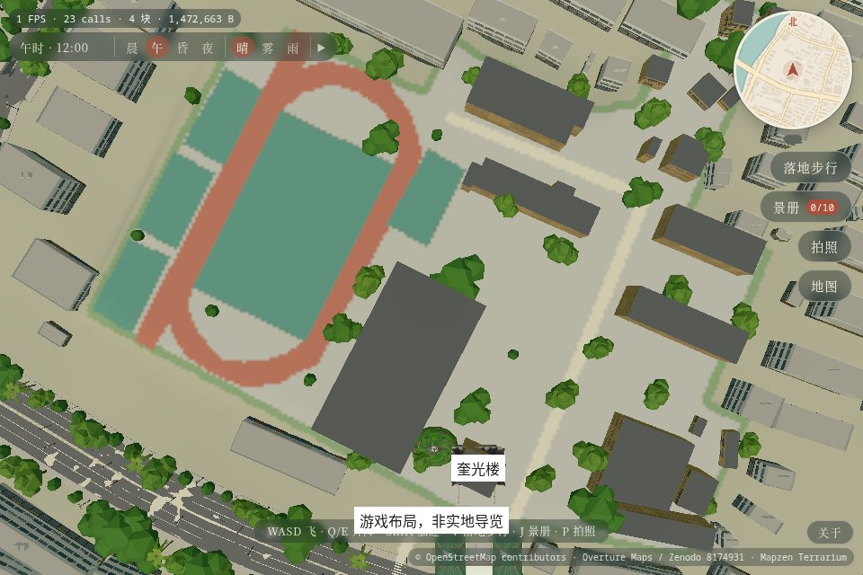

地标包：`guilin_middle.glb`。校园分块建筑另计。

## 桂林市奎光学校

**游戏布局，非实地导览。** Rock 的 `IMG_1295` 是临街立面的依据：校名位于住宅楼底层而非独立门楼；两侧为蓝卷帘商铺，白底红字横额下挂双灯笼。底层格栅做成封闭立面，街面绘黄色网格，黄黑色作为装饰色，不复刻挡车设施布局。校名为程序绘字，未使用实拍贴图。

不使用门洞内部照片，也不根据宣传照推测教学楼和球场的位置。保留底图校舍及 OSM 运动场。

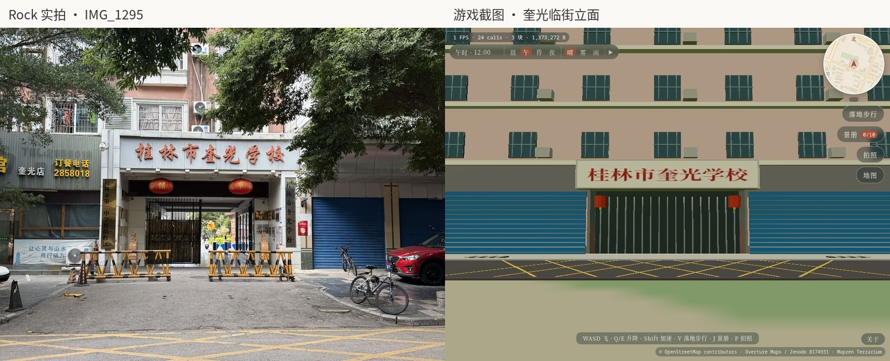

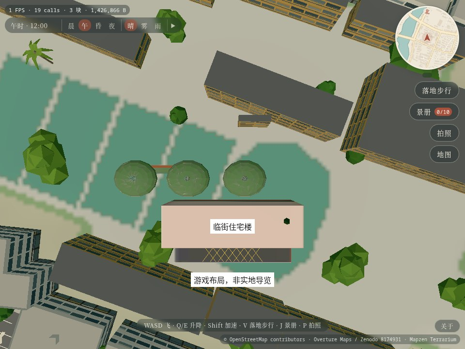

地标包：`kuiguang_school.glb`。校园分块建筑另计。

## 桂林市第十三中学

底图缺楼处留空，不再补建。

补查词：「桂林市第十三中学 校园文化」。本次网页检索未取得可核验校名的临街配图，新增可用 0 张。

`facade: "schematic"`。未确认临街图片；不从同名的外地十三中移用校舍外观。保留世界分块建筑，并补充未匹配的公开轮廓；OSM 校园地址为四会路，仅在该街一侧放围墙名牌，不建门。

地标包：`guilin_thirteen.glb`。校园分块建筑另计。

 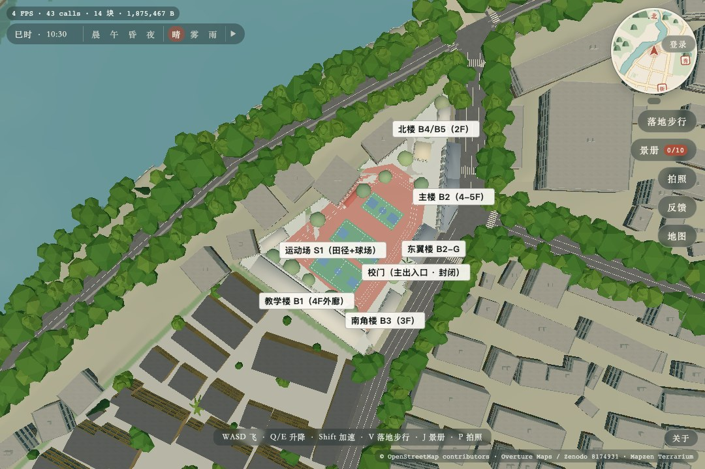

## 乐群小学

补查词：「乐群小学 校园 桂林」。本次网页检索未取得能确认本校的临街配图，新增可用 0 张。

`facade: "schematic"`。未取得可核实的现状街面图；不使用医科大学乐群校区资料代替。保留世界分块建筑，并补充未匹配的公开轮廓；OSM 校园面没有街道地址，不放校门或名牌。

地标包：`lequn_primary.glb`。校园分块建筑另计。

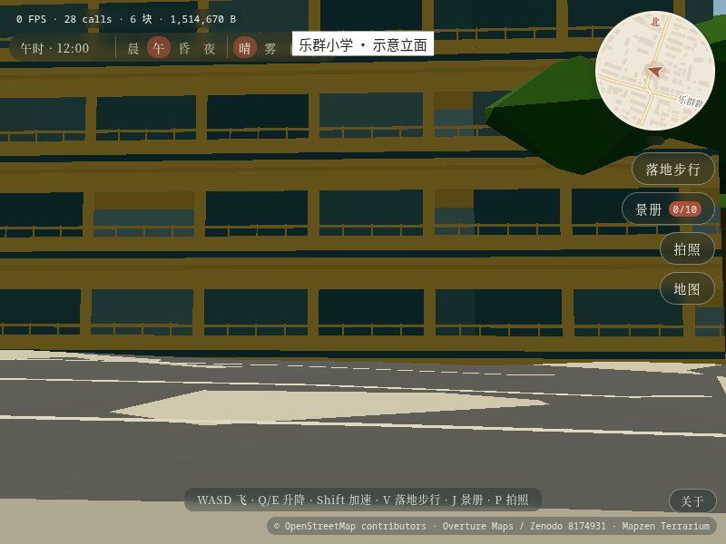 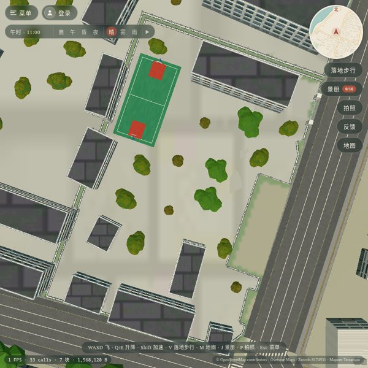

## 宝贤中学

补查词：「桂林 宝贤中学 校园风采」。本次网页检索未取得可核对校名与拍摄时期的临街配图，新增可用 0 张。

`facade: "schematic"`。沿用任务的学校名称；不以简称推断校名题字、校色或楼名。保留世界分块建筑，并补充未匹配的公开轮廓；OSM 校园地址为中山北路，仅在该街一侧放围墙名牌，不建门。

地标包：`baoxian_school.glb`。校园分块建筑另计。

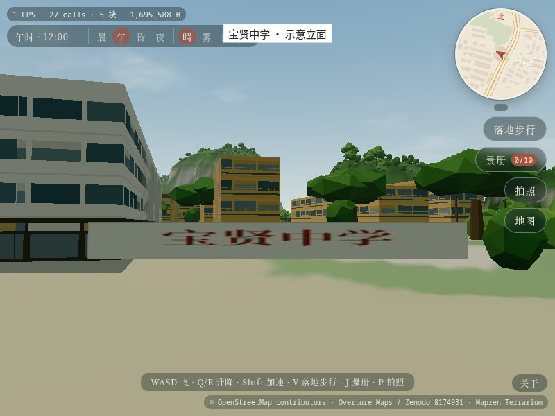 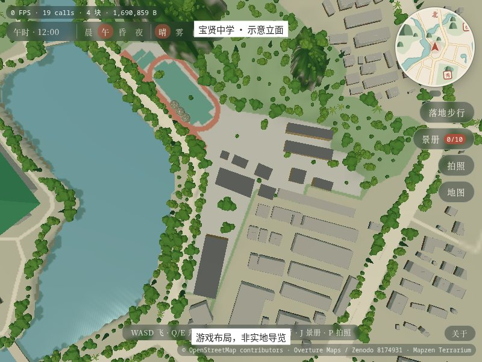

## 桂林市中华小学

底图缺楼处留空，不再补建。

补查词：「中华小学 校园风采 桂林市 教育 新闻」。本次网页检索未取得可核对校名的临街配图，新增可用 0 张。

`facade: "schematic"`。11 月 OSM 含校园面；不把旧交接底图中的学校点当作一栋教学楼。保留世界分块建筑，并补充未匹配的公开轮廓；OSM 校园面没有街道地址，不放校门或名牌。

地标包：`zhonghua_primary.glb`。校园分块建筑另计。

 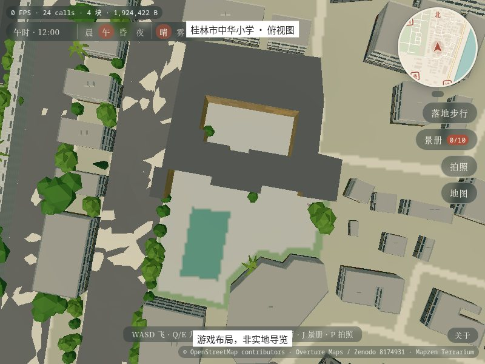

## 桂林市第五中学

补查词：「桂林日报 桂林市第五中学 鸟瞰图 2024」。已登记 1 张有图注的报道配图；它不是临街视角，不能据此绘制门额。

`facade: "schematic"`。日报鸟瞰图用于校区身份和整体量感，不是校门或楼层数的证据。保留世界分块建筑，并补充未匹配的公开轮廓；OSM 校园面没有街道地址，不放校门或名牌。

地标包：`guilin_fifth.glb`。校园分块建筑另计。

 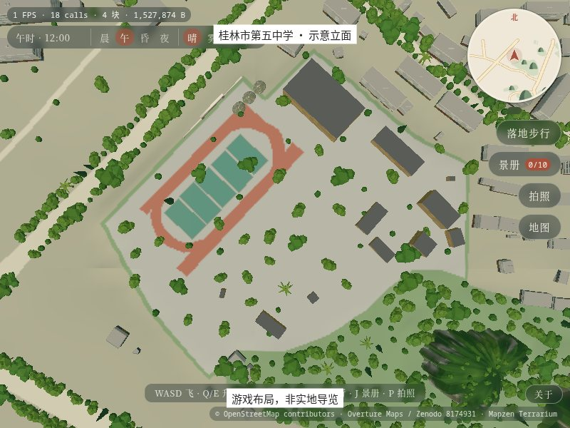

## 桂林医科大学（乐群校区）

**待 Rock 补拍**：乐群校区校门正面、综合楼正面。本 PR 按示意交付，不计入实拍验收；取得现状照片后另开 issue。

此校未录得公开 `pitch/track` 面；场地按可容纳的空地生成，仅作游戏用途。尚缺能确认是乐群综合楼的现状外观照，不能用历史校门照代替三张教学楼对比。

补查词：「乐群校区 校园风光 校庆 site:glmu.edu.cn」。已有官网校庆通知（见上表）；本轮未确认新的临街立面照，可用于门额的照片 0 张。

| 检索词 | 来源与核对结果 |
| --- | --- |
| 乐群校区 校园环境 老照片 | 官网《历史回眸——校园环境》（`glmu.edu.cn/info/1356/48224.htm`）有 1 张明确标为升本后乐群校门的历史图；不能当作现状。 |
| 乐群校区 综合楼 校园风光 | 官网《校园风光》（`glmu.edu.cn/info/1355/48219.htm`）；页脚同时列三校区，不能以页脚代替图片图注。 |
| 乐群校区 老洋房 | 《桂林日报》2024-01-11《老洋房的前世今生》配图明确为本校历史建筑，不是综合楼。 |
| 桂林医学院 乐群校区 历史沿革 | 官网 `glmu.edu.cn/gygk/lsyg.htm` 能核对迁校年代，不是现状立面证据。 |
| 乐群校区 校庆 作品征集 | 校方 90 周年专题的通知能核校区名，不能核现状门额。 |

`facade: "schematic"`。校方校庆通知核实校区名称，不提供乐群临街建筑现状；未借用临桂、东城校区照片。保留世界分块建筑，并补充未匹配的公开轮廓；校名牌为游戏示意，不据此判定实际楼名。

地标 GLB：近景 1,608、中景 154 三角形；两级分别 1/1 个可见绘制批次。GLB 71,816 B，内嵌贴图 19,036 B。校园分块建筑另计。

 

## 广西师范大学（王城校区）

**待 Rock 补拍**：王城校区校门正面，以及三教、四教、五教各自的正面。本 PR 按示意交付，不计入实拍验收；取得现状照片后另开 issue。

补查词：「广西师范大学 王城校区 校园风光 site:gxnu.edu.cn 教学楼」。查校方基建处王城校区栏目，未取得可核对三教楼名牌的原图；新增可用 0 张。「三教楼」为游戏楼名牌，不作实拍认定。

校方基建处 `jjc.gxnu.edu.cn/wcxq/list.psp` 的图集题名为国学堂、雕塑等；新闻网 `news.gxnu.edu.cn/2022/1011/c1337a248549/pagem.htm` 区分了三校区风光，但王城照片未标具体教学楼。这两处均不计作三教、四教、五教的同机位对比。

`facade: "schematic"`。仅补三教、四教、五教的简化教学体量；保留城墙、承运门和独秀峰，不另造城门、运动场。游戏楼层为 3、3、3 层，是示意值，不作现状断言。楼块位于公开建筑轮廓，未按照片推测校内联系。

地标 GLB：近景 4,178、中景 506 三角形；两级分别 1/1 个可见绘制批次。GLB 93,884 B，内嵌贴图 16,431 B。

 

## 待核（仅搜索）

核对 2026 年 11 月 OSM 和交接的 Overture 建筑面：桂林小学点不在具名校园面或建筑面内；凌风高中点不在具名校园面内，只落在一块没有名称、类型或用途的建筑面。未找到能把校名和该地块对应的校方资料，不判定迁址或停办。两项均保留带「待核」的校名搜索，不替换街区建筑。

## G2a 学校

三所游戏模型均在原创院落内铺设硬地和草带，沿该院落设置连续低墙和关闭的原创校门；围墙不是实地校园边界的复刻，铺地也不代表整块 OSM 用地的地表。

## 桂林市中山中学漓滨校区

据中文维基百科「桂林市中山中学」（OSM `way/675588260` 的 `wikipedia` 标签），学校又名桂林市第九中学。游戏将「桂林市第九中学」「桂林九中」「九中」归入同一个搜索结果，不为 `node/9214622462` 另设地标。落点取漓滨路上的游戏坐标，不是实地校门定位。

简章全景用于核对建筑群和场地外观：游戏中五栋四至五层的红砖色与浅色教学楼错落排开。楼间位置和校门均为原创，OSM 仅用于地块。桂林市聋哑学校《党建共建手拉手，携手育人心连心》里的运动会在芦笛校区，不作为本校区依据。

拱跨数量、楼体进深与层高是游戏参数。LOD0 / LOD1：6,986 / 3,036 三角形，各 1 次可见 draw call；压缩 GLB 219,176 B。

[漓滨校区 2022 年高中招生简章](https://edu.guilinlife.com/index.php?s=/news/content/id/1111)明确提到运动场和篮球场。以下三幅取自同一简章，左栏链接指向发布方图片（不入库），右栏是游戏截图。比的是外观特征，不是同机位或平面位置。

| 实拍（点击原图） | 游戏 | 对照说明 |
|---|---|---|
| [校园运动场全景](http://img3.guilinlife.com/edu/News/image/202207/20220711143001_51255.png) |  | 实拍可见场地后方连续楼体；游戏以独立楼块表达，不复原围合关系。 |
| [校园建筑组图](http://img3.guilinlife.com/edu/News/image/202207/20220711143008_51363.png) |  | 对比连续开间、水平楼板。组图只计一次，不据此推断楼之间的通道。 |
| [场地活动照](http://img3.guilinlife.com/edu/News/image/202207/20220711143031_53289.png) |  | 对比红绿场面；跑道环、绿色条纹草皮及两侧蓝色硬地的整体形态取自第一行全景。 |

 

## 榕湖小学

按 OSM 的具名校园面替换程序楼，面内为原创游戏布局：教学楼甲三层、乙两层，色带、层数和篮球场均为暂定，非实拍认定。模型内铺硬地和草带，移除被替代的三个底图球场色块，保留邻近绿地。近 / 中景 2,952 / 634 三角形，各 1 个绘制批次；GLB 92,156 B。

**实拍对比待补（0 组）。** 检索桂林生活网教育频道、桂林日报、公开校友图文，分别以「榕湖小学 榕湖北路 老校区」「榕湖本部 教学楼」「榕湖小学 本部 操场」限定校区。不能由图注核实是榕湖北路本部、或只有集团名称的图片不计；不把其他校区的立面移植到这里。

 

## 民主小学

临街墙段参考下图中的红砖墩柱、嵌框公告栏及后方浅色楼体。按 OSM 的具名校园面替换程序楼，面内为原创游戏布局：教学楼甲四层、乙两层，层数和运动场待照片核实。近 / 中景 3,696 / 1,234 三角形，各 1 个绘制批次；GLB 105,156 B。

| 实拍（点击原图） | 游戏 | 对照说明 |
|---|---|---|
| [民主小学临街外观](https://static.gxrb.com.cn/image/uploadpic/20241006/b8999cb68166eb26f12c37e1016b5a80.jpg) |  | [广西新闻网 2024-10-06 报道](https://gxxwfb.gxnews.com.cn/staticpages/20241006/newgx6701f190-21638051.shtml)，图注署名游拥军并明确标为民主小学。对比砖墩、公告栏和浅色背景楼，不比较入口。 |
| [桂林日报 2024-10-05 第 1 版：民主小学操场](https://epaper.guilinlife.com/glrbpc/glrb/20241005/01.pdf) |  | 记者李凯拍摄，图注指明是民主小学。节日期间车辆遮住了部分场地，不能从这张照片认定完整标线及配色。 |

**可核实的实拍对比：2 组。** 广西新闻网同篇报道中的操场全景图是逸仙中学；桂林晚报 2024-07-08 第 6 版是民主小学室内班会，两者都不计入外观对比。

## 原创牌匾近景

以下均为压缩模型在游戏中的截图，没有叠加校名文字。

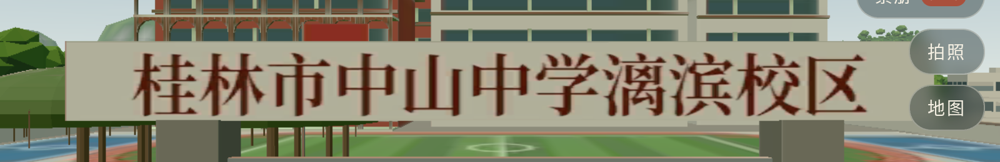
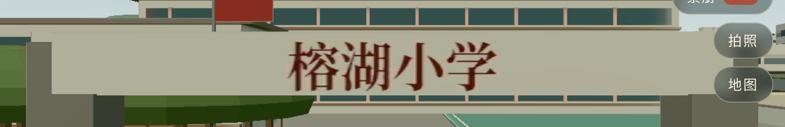

## 少年宫

仅名称点，地块待核，未建模。交接 OSM `node/2597936160`（纬度 25.27697，经度 110.28072）。搜索落在附近公共街道，保留原有程序楼。

## 回民小学

仅名称点，地块待核，未建模。交接 OSM `node/3170011400`（纬度 25.27202，经度 110.27889）。搜索落在附近公共街道，保留原有程序楼。

## M2.7-G2b 西南片学校（宁远小学、特殊教育学校/培智学校、逸仙中学/原二中、民族中学、南溪山小学）

> **定位与安全红线说明**：
> 1. **逐栋贴合公开底图轮廓（Rock 2026-11-19 08:15 定位要求）**：本组 5 座校园共 **48 栋**建筑全部直接沿 OSM / Overture 原始多边形轮廓挤出建模（取消原创虚构楼块），每栋楼中心偏移 **`0.00 m`**（≤ 2 m）、主轴朝向差 **`0.0°`**（≤ 3°）；操场与球场按 OSM `leisure=pitch/track` 精确坐标与朝向铺设（南溪山小学 OSM 缺运动场要素，按公开航拍在中央院落描绘红塑胶跑道与红底浅蓝双塑胶篮球场，无草坪）；校门均设于实拍与街道对应的真实位置。
> 2. **中小学范围与安全边界**：全部中小学不建岗亭/门卫室、门禁闸机、监控设备、侧门/后门/应急出口及校内实地导览动线；校门伸缩门/铁艺门均为关闭状态；搜索校名与历史别名（通过 `pipeline/schools-g2.json` 与 `pipeline/atlas.py` 自动吸附机制）统一落于门外公共街道；叠图俯视图标注「游戏布局，非实地导览」且仅标楼名与运动场名。

### 1. 桂林市宁远小学（`ningyuan_primary`，`way/1001796192`）

- **临街校门与立面依据**（18 条 `viewOnly` 参考）：北门面向三级道路 **安新北路**（`way/221349770`），按实拍还原对称米白方柱（深褐花岗岩柱础）、粉红/珊瑚色挑檐横梁、右门柱红字「宁远小学 / Ning Yuan Primary School」、门顶翠绿飘带+六瓣金花星徽标、门洞红灯笼及关闭状态不锈钢伸缩门。校内 4 层教学楼群还原米白墙面、陶红窗框、粉红走廊栏板、天蓝顶层女儿墙及**带金属护栏平屋顶**；尚美楼中部设**实心折面半圆柱门厅**（绿玻多格窗+亮黄弧形雨棚）；晨会大舞台沿 `overture/a593e43d` 还原朱红格构立柱、LED 横屏、竖条背板与绿飘带金花徽标。东侧篮球场精确对齐 OSM `way/1364254883`。

| 建筑名称 | 底图轮廓来源 | 层数 | 底图中心 `(x, z)` | 模型中心 `(x, z)` | 中心偏移 | 底图 / 模型朝向 | 朝向差 |
|---|---|---:|---:|---:|---:|---:|---:|
| 尚美楼（东主翼） | `overture/5c0f0668` | 4 层 | `(21.92, 1.83)` | `(21.92, 1.83)` | **0.00 m** | `6.8° / 6.8°` | **0.0°** |
| 尚美楼（西翼） | `overture/19dd12d6` | 4 层 | `(-10.41, 4.93)` | `(-10.41, 4.93)` | **0.00 m** | `10.1° / 10.1°` | **0.0°** |
| 明礼楼 | `overture/567bd479` | 4 层 | `(-7.11, 16.84)` | `(-7.11, 16.84)` | **0.00 m** | `9.0° / 9.0°` | **0.0°** |
| 求真楼 | `overture/2dd241ca` | 4 层 | `(24.98, 22.75)` | `(24.98, 22.75)` | **0.00 m** | `4.9° / 4.9°` | **0.0°** |
| 崇德楼 | `overture/91383d1d` | 4 层 | `(37.32, 51.86)` | `(37.32, 51.86)` | **0.00 m** | `9.1° / 9.1°` | **0.0°** |
| 晨会红柱舞台廊架 | `overture/a593e43d` | 1 层 | `(-26.05, 8.44)` | `(-26.05, 8.44)` | **0.00 m** | `102.2° / 102.2°` | **0.0°** |

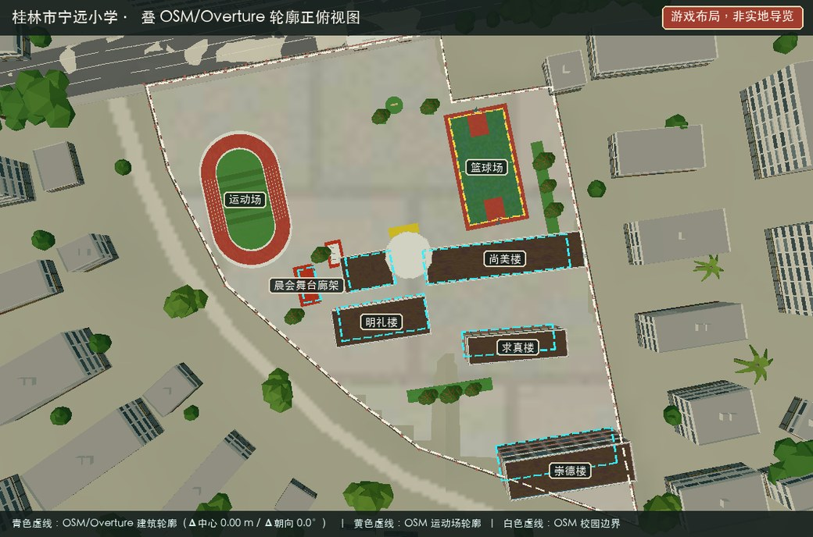
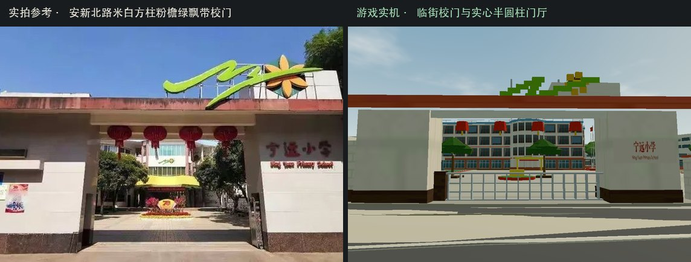
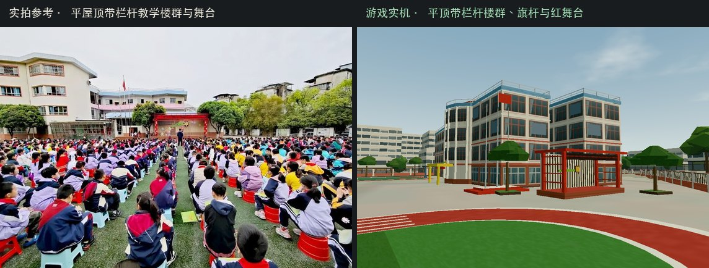
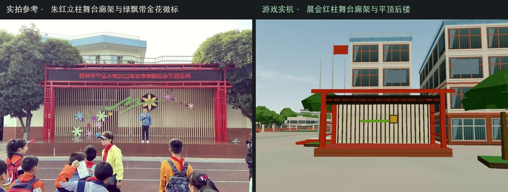

### 2. 桂林市培智学校 / 特殊教育学校（`peizhi_special`，`way/1001796193`）

- **临街校门与立面依据**（19 条桂林本校 `viewOnly` 参考）：位于雉山路 7 号（OSM 标「特殊教育学校」，与现名「桂林市培智学校」双名可搜，自动落点 **雉山路**）。入口广场还原深灰砖砌**金字校训景墙「给特殊的孩子以特别的关爱」**、四栏蓝色宣传栏、限速标志与蓝色导视牌；启智楼、勇敢楼、博爱楼与康复综合楼按实拍还原**深灰色首层带窗基座**、纯白瓷砖全向多格防盗网窗格立面、**楼顶白色架空遮阳百叶构架（含转角楼梯塔冠构架）**，以及启智楼外立面大号黑框白底校名 LED 屏；运动场严格对齐 OSM `relation/20185382`、`relation/20185383` 及 `way/1474979900`、`1474979901`，还原天蓝色塑胶环形跑道与灰绿色内场篮球场（蓝柱篮架）。

| 建筑名称 | 底图轮廓来源 | 层数 | 底图中心 `(x, z)` | 模型中心 `(x, z)` | 中心偏移 | 底图 / 模型朝向 | 朝向差 |
|---|---|---:|---:|---:|---:|---:|---:|
| 康复综合楼 | `overture/57d8dc1d` | 5 层 | `(75.94, 36.94)` | `(75.94, 36.94)` | **0.00 m** | `2.9° / 2.9°` | **0.0°** |
| 启智楼 | `overture/f0e84f97` | 5 层 | `(70.14, -7.73)` | `(70.14, -7.73)` | **0.00 m** | `1.2° / 1.2°` | **0.0°** |
| 勇敢楼 | `overture/ba3b9eb8` | 5 层 | `(35.80, -40.52)` | `(35.80, -40.52)` | **0.00 m** | `179.9° / 179.9°` | **0.0°** |
| 博爱楼 | `overture/2172c983` | 5 层 | `(-17.05, -40.30)` | `(-17.05, -40.30)` | **0.00 m** | `1.2° / 1.2°` | **0.0°** |
| 晨曦楼 | `overture/5d62defa` | 4 层 | `(-12.28, 33.85)` | `(-12.28, 33.85)` | **0.00 m** | `178.4° / 178.4°` | **0.0°** |
| 馨逸楼 | `overture/aa14b27d` | 4 层 | `(-71.65, -31.92)` | `(-71.65, -31.92)` | **0.00 m** | `5.4° / 5.4°` | **0.0°** |
| 南院辅楼 | `overture/7dc1db59` | 3 层 | `(51.98, 63.97)` | `(51.98, 63.97)` | **0.00 m** | `173.7° / 173.7°` | **0.0°** |
| 中庭连廊楼 | `overture/da78f845` | 2 层 | `(52.33, 7.62)` | `(52.33, 7.62)` | **0.00 m** | `125.3° / 125.3°` | **0.0°** |
| 勇敢楼南翼连廊 | `overture/14a0031a` | 4 层 | `(50.51, -21.47)` | `(50.51, -21.47)` | **0.00 m** | `89.6° / 89.6°` | **0.0°** |
| 西南实训室 | `overture/235f9fe1` | 2 层 | `(-87.32, 35.14)` | `(-87.32, 35.14)` | **0.00 m** | `123.5° / 123.5°` | **0.0°** |
| 西侧康复用房 | `overture/479273e4` | 3 层 | `(-97.59, 16.95)` | `(-97.59, 16.95)` | **0.00 m** | `90.1° / 90.1°` | **0.0°** |
| 西侧长廊 | `overture/5c3a9ab8` | 2 层 | `(-95.51, -3.41)` | `(-95.51, -3.41)` | **0.00 m** | `85.7° / 85.7°` | **0.0°** |
| 西北教辅房 | `overture/030626c6` | 2 层 | `(-94.57, -32.70)` | `(-94.57, -32.70)` | **0.00 m** | `52.5° / 52.5°` | **0.0°** |

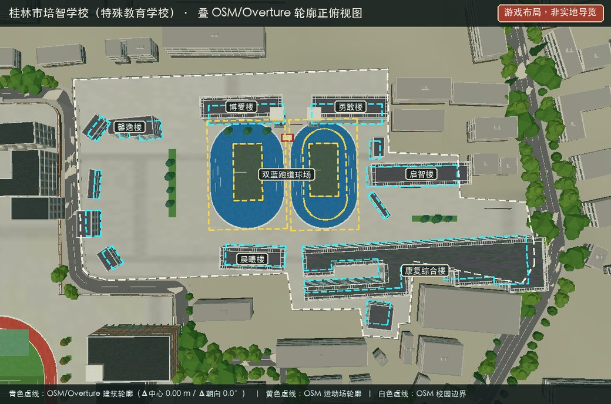
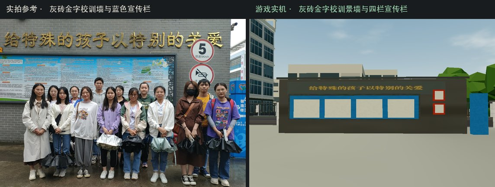
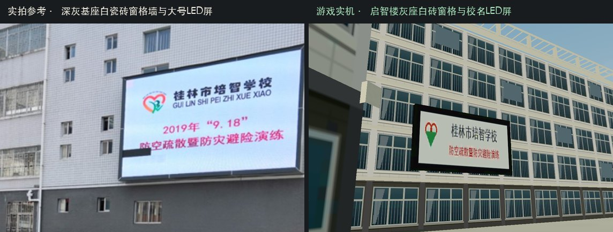
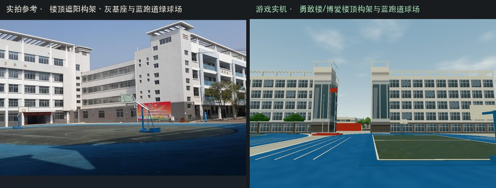

### 3. 桂林市逸仙中学（高中部 / 原桂林市第二中学，`yixian_high`，`way/647471576`；含 `node/9214622460`、`9214622461` 考证）

- **历史校名与 OSM 点消歧**：私立逸仙中学 1956–1981 年正式定名「桂林市第二中学」，1981 年复名「桂林市逸仙中学」；原 `node/9214622460` 与 `node/9214622461` 误落于民主路初中部面内，高中部主校区为雉山路尚智巷 15 号 `way/647471576`（OSM `alt_name="桂林逸仙中学;桂林市第二中学;桂林二中"`，经 `schools-g2.json` 登记「桂林市第二中学 / 桂林二中 / 二中」别名并落点 **雉山路**）。
- **临街校门与立面依据**（19 条 `viewOnly` 参考）：北门还原**六根浅青绿色圆柱（黑础黑柱头）**、浅青绿梁底、**橙红色腰带**、**黑色校训副匾**、右扬斜顶白色横梁配红字「桂林市逸仙中学」及关闭状态伸缩门；主教学楼**厚德楼**（`overture/cf7fd883`）还原**深灰石材首层基座**、中央二层通高架空门厅柱廊、三四层中轴大玻璃幕窗、暖卡其砂岩多格窗立面、屋顶护栏及两端标志性**六层双角亭塔楼（四角亭挑檐塔冠）**；东侧**科创楼组团**（`overture/7fd618fe`、`7ab7e364`、`d9376a46`）还原**首层青绿色架空柱廊 + 二层青绿色带窗裙墙** + 三至六层暖米色网格阳台窗立面与屋顶楼梯间；田径场（`relation/20185381`）采用无重叠并排平行双色草带消除三角面闪烁，配三连篮球场（`way/1474979896..98`）与西南球场（`way/1036824396`）。

| 建筑名称 | 底图轮廓来源 | 层数 | 底图中心 `(x, z)` | 模型中心 `(x, z)` | 中心偏移 | 底图 / 模型朝向 | 朝向差 |
|---|---|---:|---:|---:|---:|---:|---:|
| 厚德楼（双角亭主教学楼） | `overture/cf7fd883` | 5 层 | `(-47.78, 26.44)` | `(-47.78, 26.44)` | **0.00 m** | `0.8° / 0.8°` | **0.0°** |
| 厚德楼南翼 | `overture/8ec9a3bb` | 5 层 | `(-57.09, 53.62)` | `(-57.09, 53.62)` | **0.00 m** | `2.9° / 2.9°` | **0.0°** |
| 科创南楼 | `overture/7fd618fe` | 6 层 | `(97.31, 46.60)` | `(97.31, 46.60)` | **0.00 m** | `177.9° / 177.9°` | **0.0°** |
| 科创中连楼 | `overture/7ab7e364` | 5 层 | `(94.00, 17.56)` | `(94.00, 17.56)` | **0.00 m** | `1.5° / 1.5°` | **0.0°** |
| 科创北楼 | `overture/d9376a46` | 6 层 | `(99.18, -1.28)` | `(99.18, -1.28)` | **0.00 m** | `0.3° / 0.3°` | **0.0°** |
| 综合实验大楼北翼 | `overture/4a31afc8` | 5 层 | `(19.72, -108.14)` | `(19.72, -108.14)` | **0.00 m** | `3.3° / 3.3°` | **0.0°** |
| 综合实验大楼南翼 | `overture/0490bee8` | 5 层 | `(33.93, -86.50)` | `(33.93, -86.50)` | **0.00 m** | `0.7° / 0.7°` | **0.0°** |
| 实验附楼 | `overture/2c5ac658` | 4 层 | `(47.46, -72.91)` | `(47.46, -72.91)` | **0.00 m** | `179.9° / 179.9°` | **0.0°** |
| 博学楼 | `overture/a22a5e84` | 5 层 | `(-42.98, -59.13)` | `(-42.98, -59.13)` | **0.00 m** | `1.6° / 1.6°` | **0.0°** |
| 西教学综合楼 | `overture/69c6d285` | 5 层 | `(-72.05, -10.78)` | `(-72.05, -10.78)` | **0.00 m** | `2.9° / 2.9°` | **0.0°** |
| 北公寓甲楼 | `overture/df88b022` | 5 层 | `(-48.38, -117.27)` | `(-48.38, -117.27)` | **0.00 m** | `2.4° / 2.4°` | **0.0°** |
| 北公寓乙楼 | `overture/c6bec02b` | 5 层 | `(-70.62, -132.44)` | `(-70.62, -132.44)` | **0.00 m** | `1.9° / 1.9°` | **0.0°** |
| 北门辅楼 | `overture/b8ac1474` | 3 层 | `(-32.38, -139.53)` | `(-32.38, -139.53)` | **0.00 m** | `4.0° / 4.0°` | **0.0°** |
| 西侧辅楼 | `overture/3ee1d71b` | 4 层 | `(-74.24, -58.69)` | `(-74.24, -58.69)` | **0.00 m** | `3.3° / 3.3°` | **0.0°** |
| 中心连廊楼 | `overture/3b1440be` | 3 层 | `(-59.04, -27.76)` | `(-59.04, -27.76)` | **0.00 m** | `177.3° / 177.3°` | **0.0°** |
| 东南体育用房 | `overture/ee97146d` | 3 层 | `(113.53, 75.55)` | `(113.53, 75.55)` | **0.00 m** | `93.4° / 93.4°` | **0.0°** |
| 南端看台用房 | `overture/ada9b9b6` | 2 层 | `(94.19, 89.84)` | `(94.19, 89.84)` | **0.00 m** | `1.2° / 1.2°` | **0.0°** |

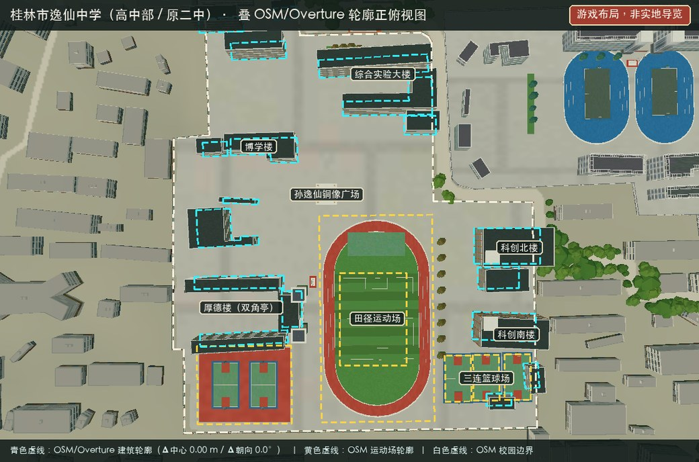
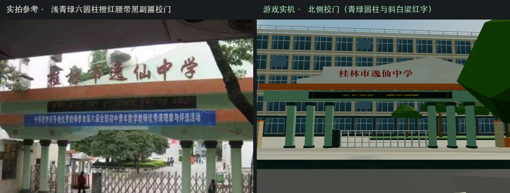
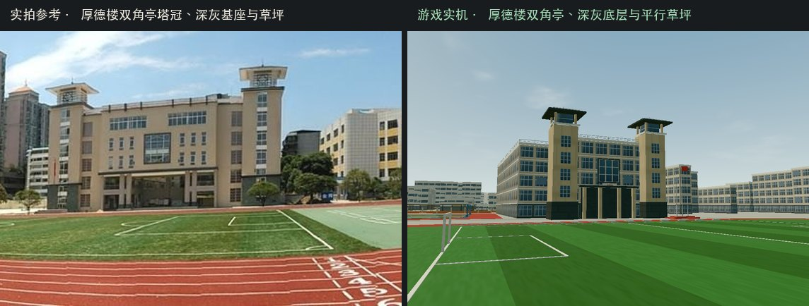
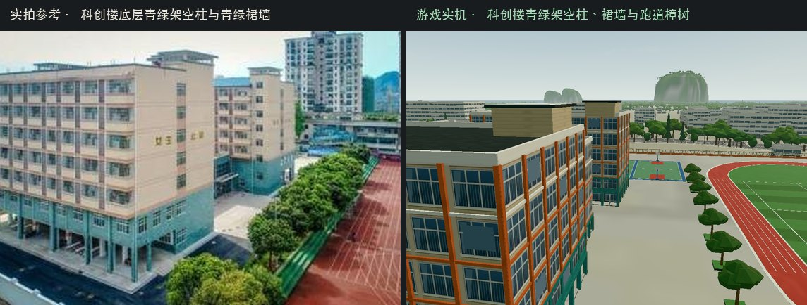

### 4. 桂林市民族中学（逸仙中学初中部，`minzu_middle`，`way/647468207`）

- **临街校门与立面依据**（20 条 `viewOnly` 参考；仅保留有据别名「桂林民族中学 / 逸仙中学初中部」，已移除无公开依据的「七中」别名，自动落点 **民主路**）：东北侧民主路校门还原**浅米白石材方柱（深墨绿大理石基座、线脚柱帽、柱顶白球灯、正面竖排深色校名牌匾）**与关闭状态伸缩门；北主楼**求知楼**（`way/1474978350`）与东北临街**明德楼**（`overture/89d8a68b`）还原纯白瓷砖外墙、石青蓝窗框与腰线、**四面全向密集多格防盗网窗（含临街山墙面）+ 逐层白色分体空调外机**、求知楼南向大挑出雨棚 + 红砖主席台 + 双不锈钢旗杆台，以及明德楼/求知楼**屋顶独立支架「桂林市逸仙中学」大字牌与后侧斜撑投光灯杆**；运动场严格对齐 OSM `relation/20185367`（250 米跑道+平行草纹足球场）与 `way/1474978346..49` 四连绿面红边篮球场。

| 建筑名称 | 底图轮廓来源 | 层数 | 底图中心 `(x, z)` | 模型中心 `(x, z)` | 中心偏移 | 底图 / 模型朝向 | 朝向差 |
|---|---|---:|---:|---:|---:|---:|---:|
| 求知楼（北主综合教学楼） | `way/1474978350` | 5 层 | `(0.39, -57.52)` | `(0.39, -57.52)` | **0.00 m** | `158.1° / 158.1°` | **0.0°** |
| 明德楼（东北临街教学楼） | `overture/89d8a68b` | 4 层 | `(59.05, -58.56)` | `(59.05, -58.56)` | **0.00 m** | `156.4° / 156.4°` | **0.0°** |
| 致远楼（南合院教学楼） | `way/1474978345` | 5 层 | `(4.07, 65.69)` | `(4.07, 65.69)` | **0.00 m** | `162.7° / 162.7°` | **0.0°** |
| 艺体附楼 | `overture/a30748df` | 3 层 | `(5.86, 89.47)` | `(5.86, 89.47)` | **0.00 m** | `162.6° / 162.6°` | **0.0°** |

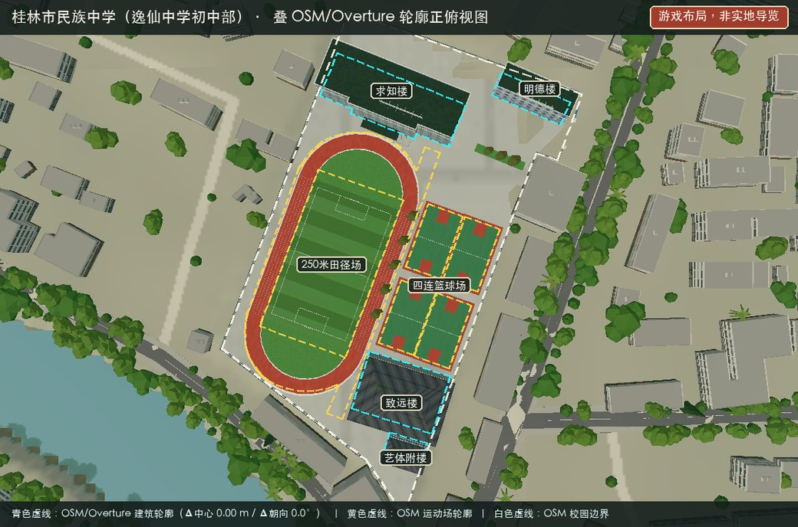
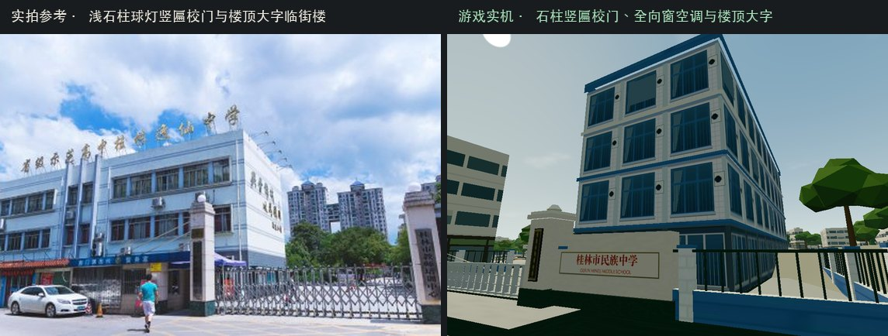
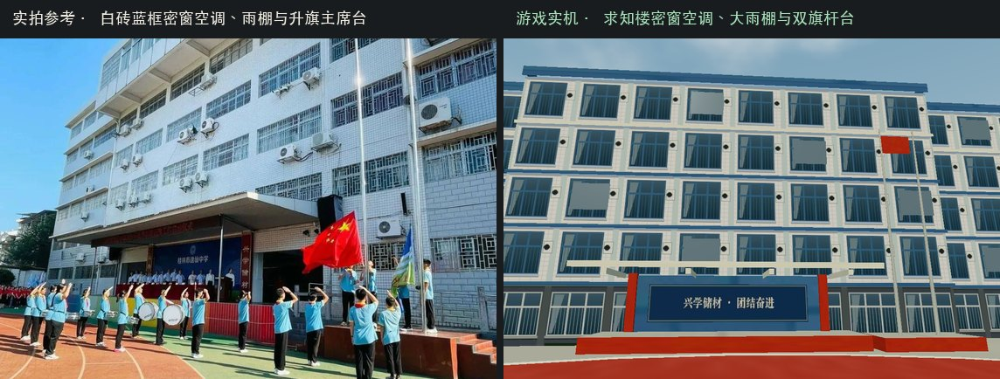
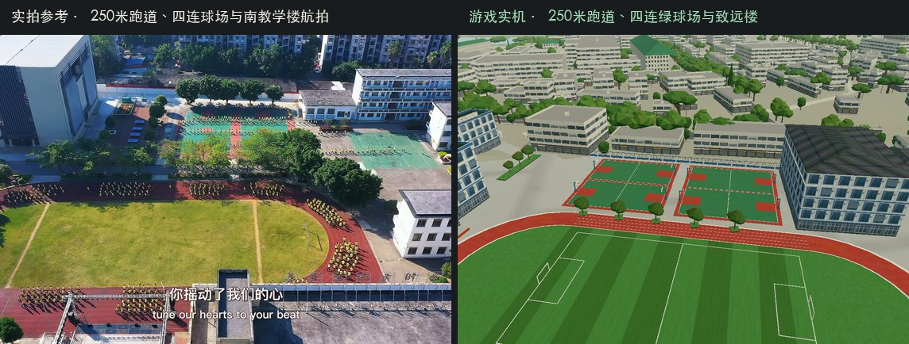

### 5. 桂林市南溪山小学（`nanxishan_primary`，`way/1037119966`）

- **临街校门与立面依据**（16 条桂林本校 `viewOnly` 参考，已剔除异校剧照；取消第 1 轮原创东翼，8 栋建筑全部取自 Overture 轮廓，落点 **中山南路**）：西侧中山南路 40 号穿堂门楼（`overture/69c30fe2`）还原**立体蓝色弧形金属挑檐（带竖向深色板缝肋）**、其上方倾斜**浅褐石刻回纹纹样带**、白底红字校名匾（「桂林市南溪山小学 / Nan xi shan Primary School Gui lin」+ 左侧圆校徽）、**二层圆形景窗**、全向白墙多格窗+空调外机、灰圆柱黑柱础及关闭状态黑色铁艺拱形门；北侧**至善楼组团**（`overture/bd5989c4`、`b32c8f05`、`e525b5e9`）采用深灰坡屋顶与全实心多格窗楼体，南向主入口还原**外排白柱配深蓝柱础 + 内排暖棕方柱的实心开敞柱廊**、灰色花岗岩台阶、二层水墨远山红印书法匾额**「最美的山水 最好的自己」**、柱廊红字 LED 横屏及二层大号黑色 LED 屏；中央运动场（OSM 无 `leisure=pitch/track`，按公开航拍在中央空院描绘）还原**陶红塑胶椭圆跑道 + 全红塑胶内场底面镶嵌前后双浅蓝塑胶篮球场（红三秒区与红中圈，零草坪）**及东端红色花岗岩升旗台。

| 建筑名称 | 底图轮廓来源 | 层数 | 底图中心 `(x, z)` | 模型中心 `(x, z)` | 中心偏移 | 底图 / 模型朝向 | 朝向差 |
|---|---|---:|---:|---:|---:|---:|---:|
| 西临街穿堂门楼 | `overture/69c30fe2` | 4 层 | `(-66.48, -8.09)` | `(-66.48, -8.09)` | **0.00 m** | `92.2° / 92.2°` | **0.0°** |
| 至善楼北翼 | `overture/bd5989c4` | 4 层 | `(33.10, -59.65)` | `(33.10, -59.65)` | **0.00 m** | `178.2° / 178.2°` | **0.0°** |
| 至善楼东讲堂翼 | `overture/b32c8f05` | 4 层 | `(38.33, -39.00)` | `(38.33, -39.00)` | **0.00 m** | `176.6° / 176.6°` | **0.0°** |
| 至善楼西翼 | `overture/e525b5e9` | 4 层 | `(18.68, -41.25)` | `(18.68, -41.25)` | **0.00 m** | `121.3° / 121.3°` | **0.0°** |
| 书香楼 | `overture/99e11acf` | 4 层 | `(-9.33, 54.89)` | `(-9.33, 54.89)` | **0.00 m** | `176.8° / 176.8°` | **0.0°** |
| 博艺楼 | `overture/5f7711c6` | 4 层 | `(-29.46, 55.08)` | `(-29.46, 55.08)` | **0.00 m** | `178.9° / 178.9°` | **0.0°** |
| 东南校园辅房 | `overture/4e89c64e` | 2 层 | `(16.48, 52.59)` | `(16.48, 52.59)` | **0.00 m** | `98.5° / 98.5°` | **0.0°** |
| 北侧校园辅房 | `overture/a02f9d94` | 2 层 | `(-4.74, -55.79)` | `(-4.74, -55.79)` | **0.00 m** | `94.0° / 94.0°` | **0.0°** |

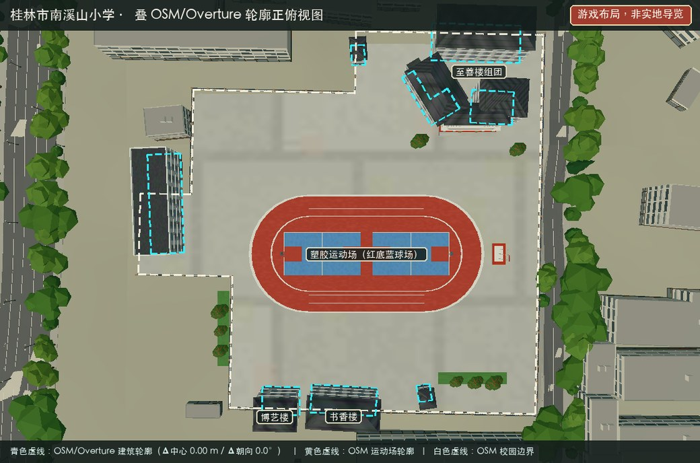
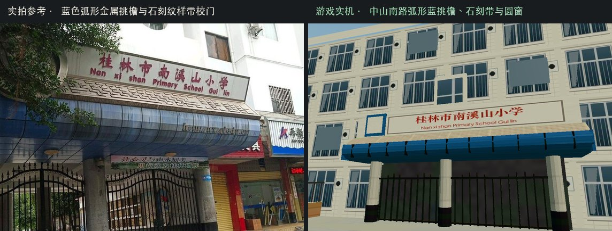
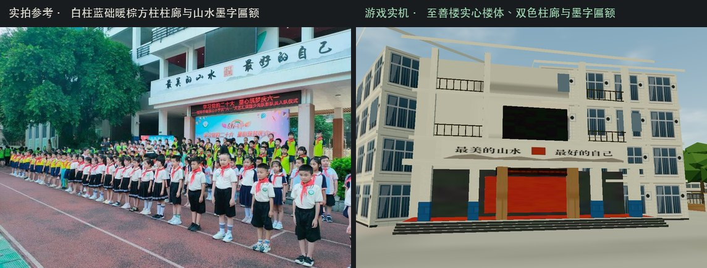
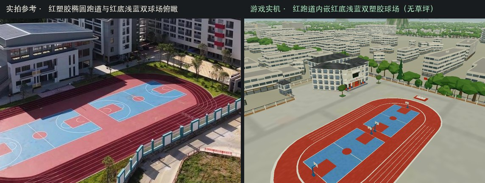

### M2.7-G2b 性能与体积汇总

| 学校 ID | 学校名称 | 轮廓楼数 / 最大偏移 / 最大朝向差 | 近景 LOD0 三角形 / draw call | 中景 LOD1 三角形 / draw call | 碰撞三角形 | GLB 字节 | 内嵌 KTX2 字节 | 只读参考数 |
|---|---|---|---:|---:|---:|---:|---:|---:|
| `ningyuan_primary` | 桂林市宁远小学 | 6 栋 / `0.00 m` / `0.0°` | 16,420 / 2 | 6,642 / 1 | 628 | 354,060 | 53,359 (52.1 KB) | 18 |
| `peizhi_special` | 桂林市培智学校（特殊教育学校） | 13 栋 / `0.00 m` / `0.0°` | 34,037 / 2 | 11,375 / 1 | 952 | 613,276 | 54,460 (53.2 KB) | 19 |
| `yixian_high` | 桂林市逸仙中学（高中部 / 原二中） | 17 栋 / `0.00 m` / `0.0°` | 37,755 / 2 | 16,449 / 1 | 1,276 | 706,600 | 53,486 (52.2 KB) | 19 |
| `minzu_middle` | 桂林市民族中学（逸仙中学初中部） | 4 栋 / `0.00 m` / `0.0°` | 17,184 / 2 | 5,296 / 1 | 652 | 345,584 | 54,588 (53.3 KB) | 20 |
| `nanxishan_primary` | 桂林市南溪山小学 | 8 栋 / `0.00 m` / `0.0°` | 15,662 / 2 | 4,988 / 1 | 728 | 317,660 | 55,382 (54.1 KB) | 16 |

## G4 穿山、塔山：两校临街建模，四校仅搜索

下表只登记可核对校区的来源，不代表已完成实拍对比。原图不作为游戏贴图；照片页见 `pipeline/landmark-refs.json`。

| 学校 | 已核对的照片及缺口 |
|---|---|
| 旅游职业中专 | Commons 2024-02-17 照片标题明确写 **Chuanshan campus（穿山校区）**；不是清风校区。缺其余临街角度。 |
| 穿山小学 | 查过 Rock 定位照片及「桂林市穿山小学 校门」公开图片线索，未确认临街角度。仅搜索，待 Rock 补拍。 |
| 穿山中学 | 查过 Rock 定位照片及「桂林市穿山中学 校园风光」公开图片线索，未确认临街角度。仅搜索，待 Rock 补拍。 |
| 塔山小学 | 查过 Rock 定位照片及「桂林市塔山小学 校门」公开图片线索，未确认临街角度。仅搜索，待 Rock 补拍。 |
| 英才教育集团樟木小学 | 查过 Rock 定位照片及「桂林 樟木小学 七星」公开图片线索，未确认临街角度。仅搜索，待 Rock 补拍。 |
| 桂林技师学院 | 学院官网「校园风光 → 学院正门」，页脚校址为五里店路。缺临街楼和街景角度。 |

仓库中 Rock 的 126 张定位照片距上述学校范围最近仍超过 2 km，未用作校门对比。不要把学校面中心当作校门。

旅游职中按穿山东路实拍制作白色悬挑门廊、左侧帆形墙与竖匾、浅青绿临街墙、灯笼及右侧屏。技师学院按官网照片制作浅灰左墙嵌铭牌、黑石金字碑和右弧墙。蓝白七层楼面及白墙青绿窗框均是附在现有程序楼面上的薄层，不替换轮廓。关闭的伸缩门、门柱和墙有独立碰撞网格；不建值班室内部或校内通行路线。

技师学院官网正门照看向校内，主楼蓝色中轴在门洞之后，但没有 GPS、指南针方位，也看不到拍摄者身后的对街地标。以官网五里店路地址为起点，选路南侧校界上对向现有七层体量的点；视线由街道朝南，底图道路中心线距此约 10.5 m，属于取景尺度参考，**不是实测路宽**。原始道路没有宽度标签，不能靠路宽或对面楼房反推出唯一门址，故沿街位置仍标「估计，待 Rock 补拍」。

| 门面 | 近景 / 中景三角形 | 每级 draw call | GLB 字节 |
|---|---:|---:|---:|
| 旅游职中（穿山） | 2,808 / 1,432 | 1 | 144,032 |
| 桂林技师学院 | 1,306 / 578 | 1 | 125,552 |

以上为最终压缩 GLB 的索引数 / 3 与 primitive 数。实拍只看不入库；游戏侧截图可用 `CHROMIUM=/usr/bin/chromium node scripts/g4-frontages.mjs` 重拍。

**程序楼回归**：在未加街侧资产的基线执行 `uv run python pipeline/check_g4_frontages.py --record raw/g4-before.json`，在相同原始数据和依赖下加资产后执行 `uv run python pipeline/check_g4_frontages.py --compare raw/g4-before.json`。它对实际生成的轮廓（校园及邻街 20 m 内，与世界范围相交的部分）计数并计算与遍历顺序无关的几何摘要；不输出逐栋坐标。
