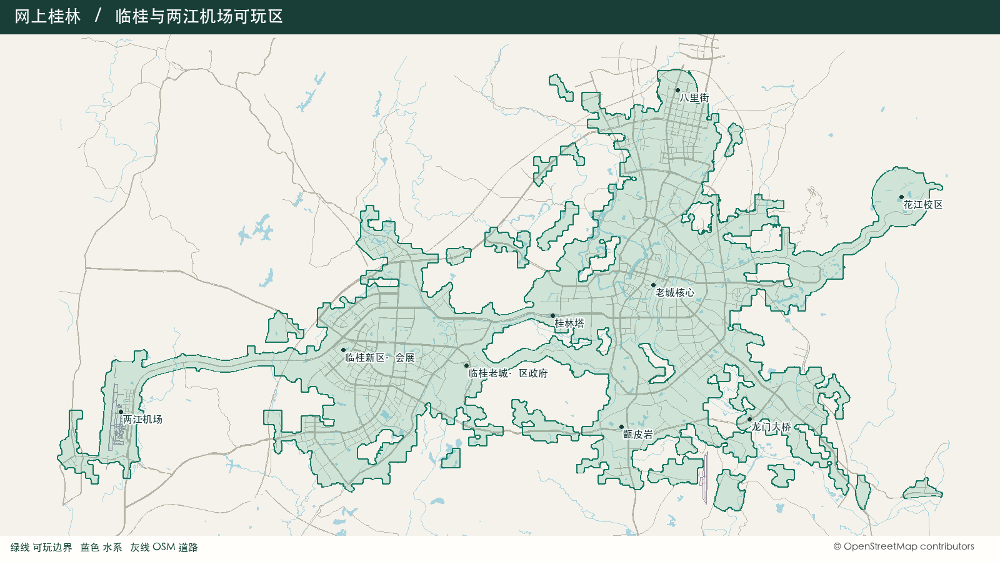
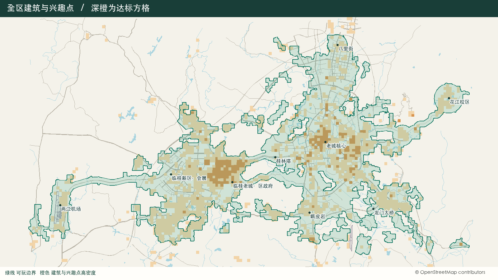
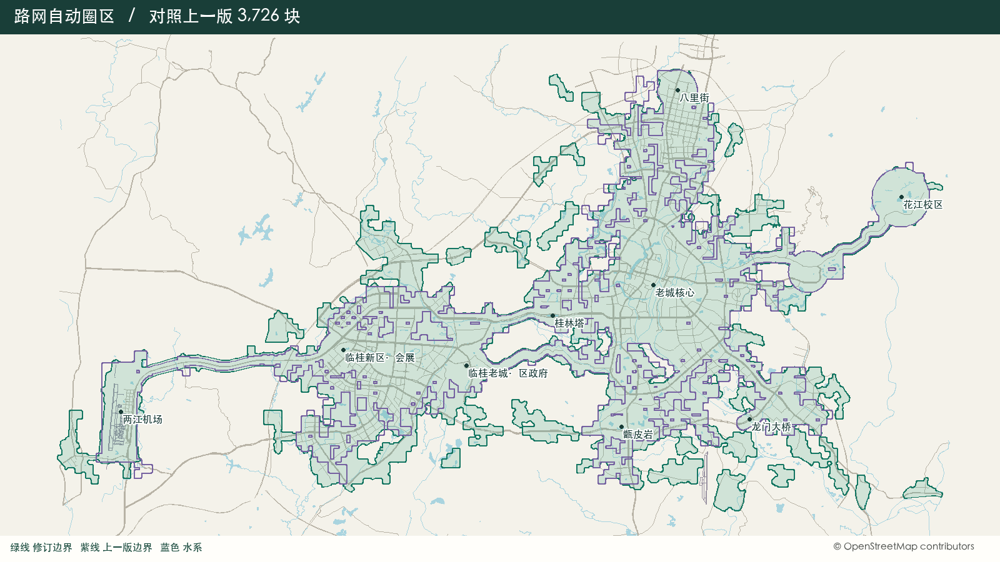

## 临桂至两江机场可玩边界 · 阶段 A 第三版

**待裁定：完整候选 5,068 块，超过 4,896 硬上限 172 块，超过目标区间上沿 1,268 块。** 此版供选择预算或调整筛选规则，阶段 B 尚未启动。

| 现网基线 | 与现网重合 | 向外新增 | 从现网裁去 | 候选总数 |
|---:|---:|---:|---:|---:|
| 4,896 | 2,684 | 2,384 | 2,212 | 5,068 |

实际边界覆盖 254.14 km²，256 m 生成网格覆盖 332.14 km²。相比上一版的 3,726 块，净增 1,342 块。

[片区近景图集](districts.zip)包括老城、两座火车站、各高校、临桂新区、机场和连接走廊周边。

### 从路网与建筑自动选区

1. 以世界原点对齐 256 m 方格，在 25.19–25.37°N、110.02–110.43°E 内选格。任一指标满足即入选。路网指标为格内道路中心线总长 ≥450 m，且至少有一个三岔及以上共享节点，避免将单条过境道路判为街区。计入 trunk、primary、secondary、tertiary、unclassified、residential、service 和 living_street；所有 link、高速、track、path 均排除。建筑/兴趣点指标为 OSM 闭合建筑 way 数 + 10 × Overture places 数 ≥20；建筑按面内代表点入格。密度图深橙表示该指标达标，浅橙为非零，绿线为候选边界。OSM 覆盖全研究区，Overture places 来自原采集框，西扩区该项只计 OSM 建筑。
2. 叠加与研究框相交的 1,198 个有效 OSM 居住、商业、零售、工业、教育用地及大中小学校园面，含 multipolygon relation 和内环。整面参与并集，跨边缘用地保留轮廓。两江机场采用 OSM relation/13846706，外扩 150 m。
3. 并入发布保护区、重点游览区和现有路线。31 条路线全部沿原 OSM 折线，两侧各 200 m。山水公园湖区按已确认的范围纳入。额外保护桂林站站房 way/819178841 及桂林北站 node/2509040864。66 个地标、252 个内城块、60 个历史校园块和乌岭隧道仍在。
4. 对并集做半径 150 m 的圆形闭运算，连通约 300 m 以内的片区；丢弃小于 0.3 km² 且未命中保护区的孤片，填平小于 0.5 km² 的内部孔洞，再作全域 64 m 外扩。若边界切过建筑，向外纳入整栋及 2 m 余量，并继续检查相邻楼体。使用全区 OSM 建筑及旧框发布原料中 Overture 的建筑轮廓。经填洞后的边界含 16 个片区，保留满足面积条件的独立街区。解放桥、临桂新区至 T2 的两条路线均位于同一主片区，OSM 路线长度驾车约 35.2 km、步行约 35.8 km。

### 输入、分块与预算

OSM 使用 2026-11-23 [Geofabrik 广西 PBF](https://download.geofabrik.de/asia/china/guangxi.html)，SHA-256 为 `45c3134fb768081677149a672a830fa0d62356c0da5230db3dd8dc6e392aa5f6`。Overture 输入来自 raw-expanded-20261123。基线为 main 8cfdf6a 的 world-822cf08b60ac。

`pipeline/region.json` v3 的 `finalGeometry` 为最终边界，采用 common.ll2xz 的本地米制坐标，x 向东，z 向南。`landuseSources` 列出并入候选生成的 OSM 面来源，`zones` 和 `corridors` 保留保护区和路线输入。取与最终边界相交的全部块；`chunkOriginsByZ` 用世界 z 米数为键，值为各块西边的 x 米数。

现网归档 113.81 MB gzip。旧包块对为 62.13 MB，候选保留部分为 41.53 MB。以约 51.68 MB 全域数据和每个新增块 12.69 kB 估算，候选约 **123.5 MB gzip**。Mac 冷构建按 **约 45–65 分钟**排期，参考历史 SG 冷构建 50 分 02 秒及本版块数已达现网的 104%。计时、实际压缩体积、游戏内步行驾车与字节一致性须在获批后验证。
