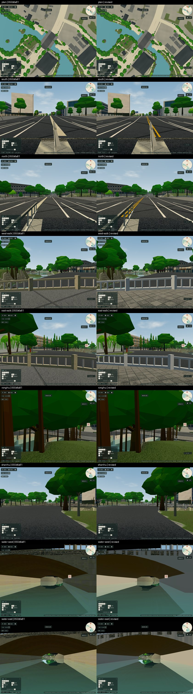
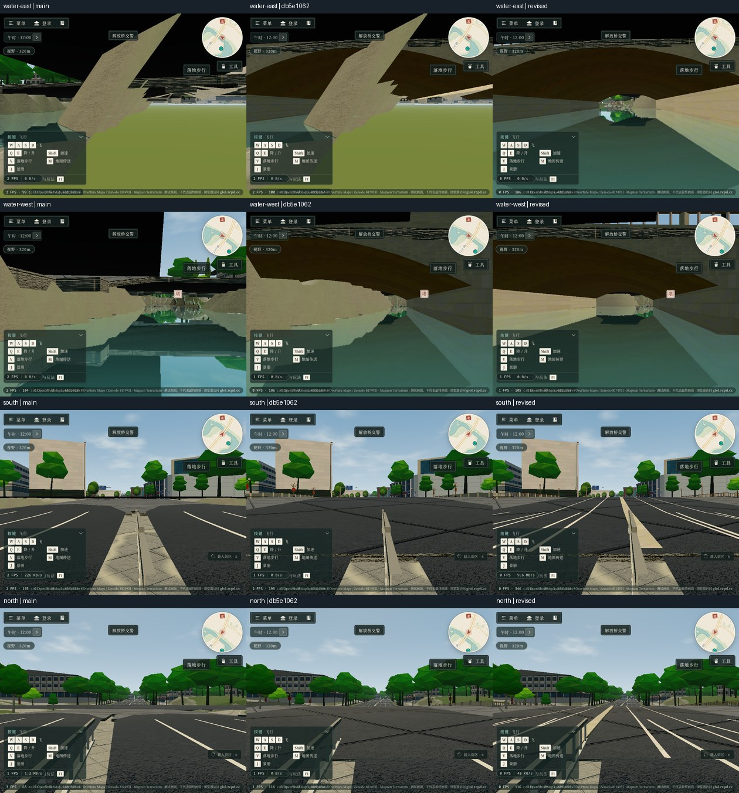
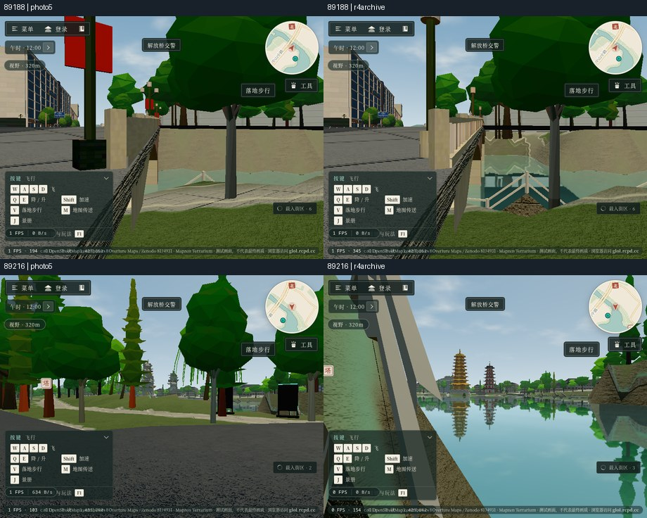
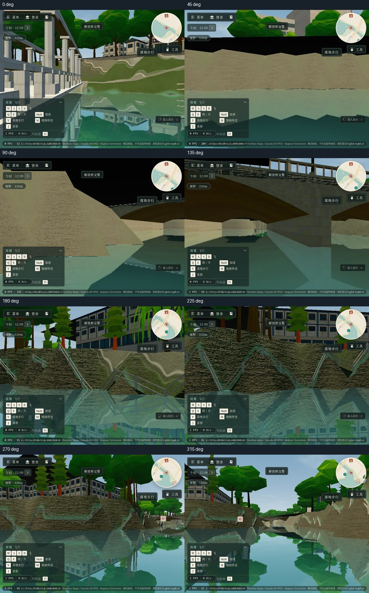
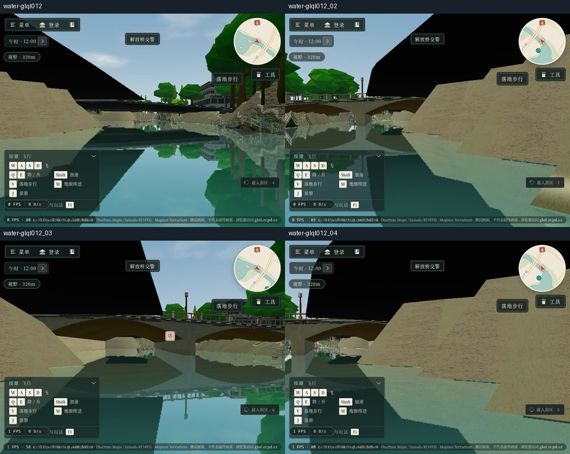
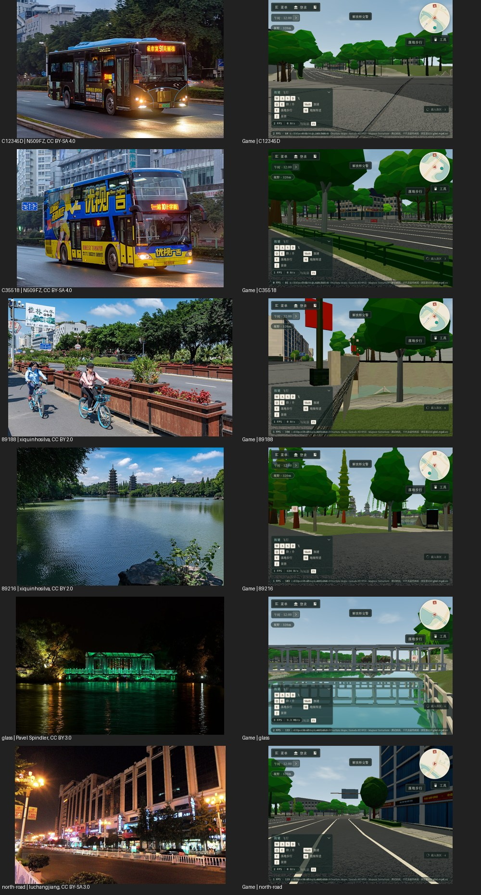

## 阳桥局部核对

### GL04 数据同步

最终桥头原图：[南](south.png)、[北](north.png)（各 1280 × 960）；[南北引道接缝原像素裁切](approach-seams.jpg)。`yangqiao-grade.json` 的 `bands` 逐段标记 `lateral` 相邻列间的面。`structure` 用桥体顶面，`walk` 只用铺装面；两者共边，共用同一碰撞三角化。正式桥段从南到北每侧结构带宽 0.443–0.436 m，西侧步道净宽 12.132–11.940 m，东侧 11.377–11.198 m；道路边界未移动。

结构带不是地标豁免区：只有从栏杆/望柱构建步骤分出的 `collision_yangqiao_rail` 碰撞节点、`yangqiao_rail` 可见材质能占据基座。审计独立检查其他碰撞切片和桥面以上的其他可见网格，重合也不能借用栏杆的身份；栏杆若越入人行或沥青带仍按原规则检查。已逐包扫描 69 个地标。桥北树干与桥头站亭没有纳入这条结构规则。

桥头对照（左 `676a43c1`，右为修订后）：[南、北桥头](approaches-r8.jpg)。两头斜栏来自 GL04 街道装饰 `kind=1`，不是地标栏杆。新车行带及两端各 10 m 内不再实例化该类合成护栏；两翼栏杆碰撞不变。步道顶面只渲染铺装，桥面碰撞连续。

水面同机位（左 `main@9d98f6de`，右为修订后）：[东、西水面](water-main-r8.jpg)。两台相机高度均为 149.7 m；main 上方也有暗区，尤其东侧。对照能确认暗区并非本 PR 新增，但不能只凭截图判定光照原因。

`world.ts` 在生成街面后调用 `yangqiaoDeck`：仅处理 `100_40.glc`（世界 XZ 原点 `-1280,256`）和 `101_40.glc`（`-1024,256`）。全宽可行走面和视觉铺装取同一组顶点：`pipeline/data/landmarks/yangqiao-grade.json` 的 `south` / `north` 是 OSM 桥缘端点，`stations`、`lateral` 和 `levels` 是沿桥、横桥的位置与 GL04 街面顶高（米）。步道用引道同款 `sidewalk` 材质；中间两条贴地线表示双向车道分隔，不是实体栏。

重新生成世界时，在新 manifest 核对两瓦片原点和桥缘；按同一采样站重取两股道路、两岸引道人行道顶高（不要取 DEM），更新 grade。另核对 `yangqiao-channel.json` 的 4 m 河床节点与 148.1 m 水位。随后 `npm run landmarks -- zhongshan_road`、`npm run build`，七路线重验接缝，并在下图机位重拍。如果原生 GL04 已包含相同桥面和河床，应同时撤下运行时替换与离线采样修正，不要叠加第二层碰撞。

地标每侧 14 段，节点 `lod{0,1}_yangqiao_rail_{west,east}_{00…13}`，共享可替换材质 `yangqiao_rail`；柱与栏的碰撞仍在独立碰撞网格里。拱腹节点单列，避免离线按旧河床裁掉应渲染的下表面。

桥体轮廓是 OSM `701820462`，两股机动车道分别是 `191185446`、`258911171`。以下九机位依次为俯视、南北桥头、两侧步道、榕湖岸、杉湖岸及桥下两个水面方向。俯视宽 400 m、高 300 m；地面机位使用实际可行走面加 1.65 m，水面机位为固定世界高度。相同 XZ，不保证修复前后的离地高度相同。

|修复前|修复后|
|---|---|
|||

|位置 / 机位|来源、问题及处置|
|---|---|
|桥南端 / south|`city-upgrade/-3_0` 将连续道路接上名为阳桥的桥段误判成横街，生成了“中山中路 × 阳桥”牌。已从路名候选和分片删除；两岸真正的交叉口保留。|
|北引道 / north|中山路包按道路长度比例造了两个阳桥站亭。两个实际站点 `2642197676`、`2643390973` 都在桥南，已由街道管线处理。移除手摆阳桥站亭及其碰撞，未移动真实站点。|
|桥身 / plan、两侧步道、水面|GL04 独占全宽可走面，铺装和车道共边；中山路地标保留栏板、望柱，桥下增加三孔拱腹及两道落地桥墩。未移动航线。|
|桥南落点 / 两侧步道|裁掉原有重叠 deck / sidewalk，高程剖面从桥南、北各延至引道约 10 m，对接街道铺装。原路线坐标和全局步行参数均未改。|
|玻璃桥、两岸楼块|玻璃桥 `836701791`、金马和东侧裙房属于实际存在的不同建筑；保留建筑，金马心理咨询中心招牌贴紧背板。|

### 同机位复核

- **水东斜板、水西三角面**：固定水东相机低于旧 GL04 地表 3.83 m。单独隐藏 `groundMesh` 后斜板消失；隐藏街道和地标时仍在。现在按三孔和洞口局部降低河床，同一像素 (425,120) 从 RGB (128,119,88) 变为 (32,22,2)，等于隐藏旧地形时的值。此机位不代表实拍岸线，不能以它的高度推算岸高。
- **标线与中央条**：桥面六车道用四道分车线；撤下上一版无定位依据的 11 cm 实体中分隔，按两股车行方向留贴地分界线。两侧外缘才有栏杆。引道标线保留，不增加可走碰撞。
- **89188 / 89216**：前者近景米色部分拾取到 `lod0_joinery`，位置在东南桥角柱。旧红色灯饰已替换，同坐标旧红区 (241,81) 现为天空。后者撤回“同坐标”说明：照片定位点在游戏干地，本次在杉湖水边 `(-995,396)`、眼高 149.85 m 复拍，不宣称知道原始相机的精确位置。

### 阳桥实拍参照

[《桂林市阳桥》四张原图](https://www.china-qiao.com/ql32/glql/glql012.htm)直接拍到桥孔和墩。原图不入库。用两座墩的像面横向位置约束水上视点和航向；两岸选择、焦距、俯仰与眼高仍为估计，不能当作带 GPS 的照片。图 1、3 用于三跨轮廓和墩距；图 2、4 用于桥头外缘、栏杆节奏与灯柱轮廓。未把无法辨认的雕刻当成实测细节。

|原图（页面顺序）|游戏 X,Z（米）|朝向（真北顺时针）|两墩横坐标 / 图宽|
|---|---:|---:|---:|
|glql012.jpg|-1122, 302|128.6°|0.245 / 0.566|
|glql012_02.jpg|-1014, 387|321.0°|0.265 / 0.625|
|glql012_03.jpg|-1106, 312|128.3°|0.135 / 0.665|
|glql012_04.jpg|-1018, 384|334.6°|0.045 / 0.490|

### 历史街景（不作桥型验收依据）

[作者、许可和原图](sources.md)。`scripts/yangqiao-views.mjs --photos` 使用照片坐标。以下朝向为真北顺时针；后四组是估计朝向，不是罗盘实测。实拍不嵌入游戏。

桥型另参[桂林市旅游公共服务管理处《榕杉湖》](https://www.glvisit.com/history_view.asp?id=75)：三孔、两侧栏杆及桥头装饰有文字依据。两排桥面灯、拱高、墩位和桥头柱尺寸按轮廓比例估计，并非测绘坐标；没有将参考网页照片用作纹理。

|机位|纬度、经度|朝向及用途|差异 / 限制|
|---|---|---|---|
|C12345D|25.276864,110.289658|246.46°，从桥东侧拍道路|原图主要是公交车，不能用来量桥墩|
|C35518|25.276067,110.288942|263.23°，南引道拍道路|交通、遮挡不同；不能据单辆车推站亭位置|
|89188|25.276530,110.289472|约 35°，南端看道路|可对照道路分隔；朝向和焦距未标定|
|89216|25.276672,110.290194|约 178°，杉湖岸望双塔|塔与水岸轮廓作方向参照；未校准裁切|
|glass|25.277462,110.288562|约 269°，榕湖玻璃桥方向|夜间实拍/日间游戏，只比轮廓|
|north-road|25.277569,110.289795|约 214°，北引道沿街|推定街轴，不能作为某根灯杆的定位证据|

复拍：构建后 `CHROMIUM=/usr/bin/chromium node scripts/yangqiao-views.mjs captures/yangqiao`；实拍角度加 `--photos`。步行检查 `CHROMIUM=/usr/bin/chromium node scripts/yangqiao-walk.mjs`，任一路线失败即返回非零。
