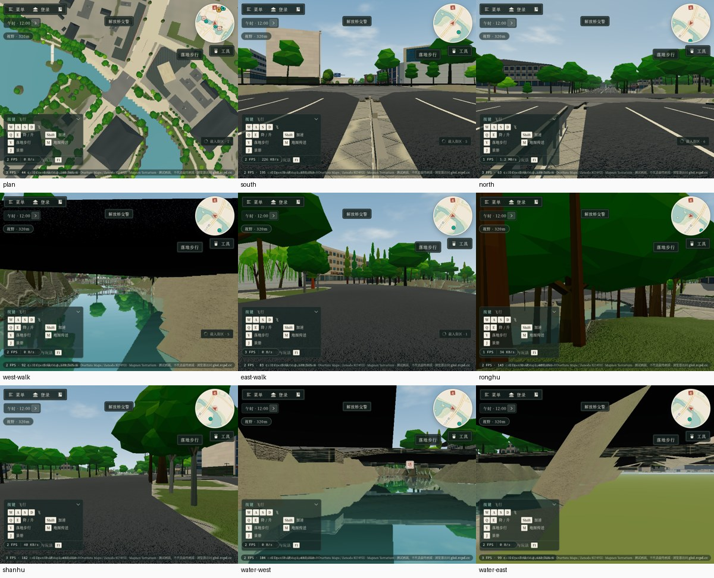
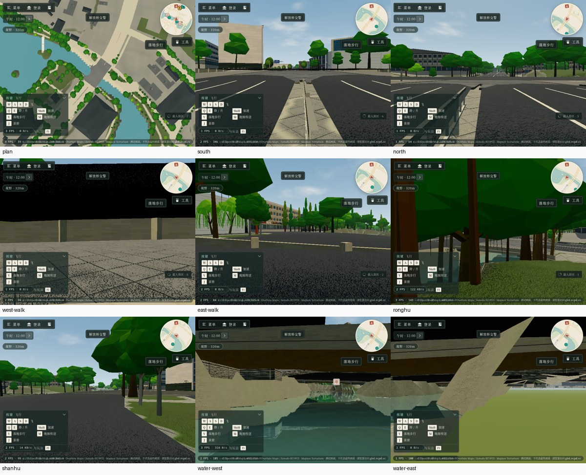

## 阳桥局部核对

桥体轮廓是 OSM `701820462`，两股机动车道分别是 `191185446`、`258911171`。以下九机位依次为俯视、南北桥头、两侧步道、榕湖岸、杉湖岸及桥下两个水面方向。俯视宽 400 m、高 300 m；地面机位使用实际可行走面加 1.65 m，水面机位为固定世界高度。相同 XZ，不保证修复前后的离地高度相同。

|修复前|修复后|
|---|---|
|||

|位置 / 机位|来源、问题及处置|
|---|---|
|桥南端 / south|`city-upgrade/-3_0` 将连续道路接上名为阳桥的桥段误判成横街，生成了“中山中路 × 阳桥”牌。已从路名候选和分片删除；两岸真正的交叉口保留。|
|北引道 / north|中山路包按道路长度比例造了两个阳桥站亭。两个实际站点 `2642197676`、`2643390973` 都在桥南，已由街道管线处理。移除手摆阳桥站亭及其碰撞，未移动真实站点。|
|桥身 / plan、两侧步道、水面|开发包只有两股连续车道和西侧零碎步道，未覆盖 OSM 全宽。按桥缘补步行板、侧墙、栏板和桥头收坡；保留原车道。未改渡船路线。|
|桥南落点 / 两侧步道|**未解决**：角色受旧 deck / sidewalk 碰撞阻挡。地标接地通过不等于跨桥通行通过。|
|玻璃桥、两岸楼块|玻璃桥 `836701791`、金马和东侧裙房属于实际存在的不同建筑；无证据支持整块删除。桥下拱券、桥墩、灯位和桥头细部尚未按实拍确认。|

### 实拍对照

[作者、许可和原图](sources.md)。`scripts/yangqiao-views.mjs --photos` 使用照片坐标。以下朝向为真北顺时针；后四组是估计朝向，不是罗盘实测。实拍不嵌入游戏。

|机位|纬度、经度|朝向及用途|差异 / 限制|
|---|---|---|---|
|C12345D|25.276864,110.289658|246.46°，从桥东侧拍道路|原图主要是公交车，不能用来量桥墩|
|C35518|25.276067,110.288942|263.23°，南引道拍道路|交通、遮挡不同；不能据单辆车推站亭位置|
|89188|25.276530,110.289472|约 35°，南端看道路|可对照道路分隔；朝向和焦距未标定|
|89216|25.276672,110.290194|约 178°，杉湖岸望双塔|塔与水岸轮廓作方向参照；未校准裁切|
|glass|25.277462,110.288562|约 269°，榕湖玻璃桥方向|夜间实拍/日间游戏，只比轮廓|
|north-road|25.277569,110.289795|约 214°，北引道沿街|推定街轴，不能作为某根灯杆的定位证据|

复拍：构建后 `CHROMIUM=/usr/bin/chromium node scripts/yangqiao-views.mjs captures/yangqiao`；实拍角度加 `--photos`。步行检查 `CHROMIUM=/usr/bin/chromium node scripts/yangqiao-walk.mjs`，任一路线失败即返回非零。
